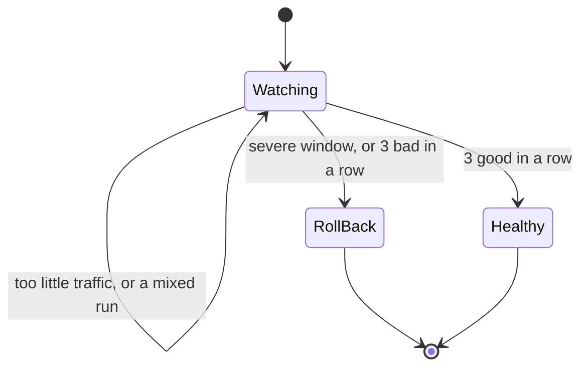
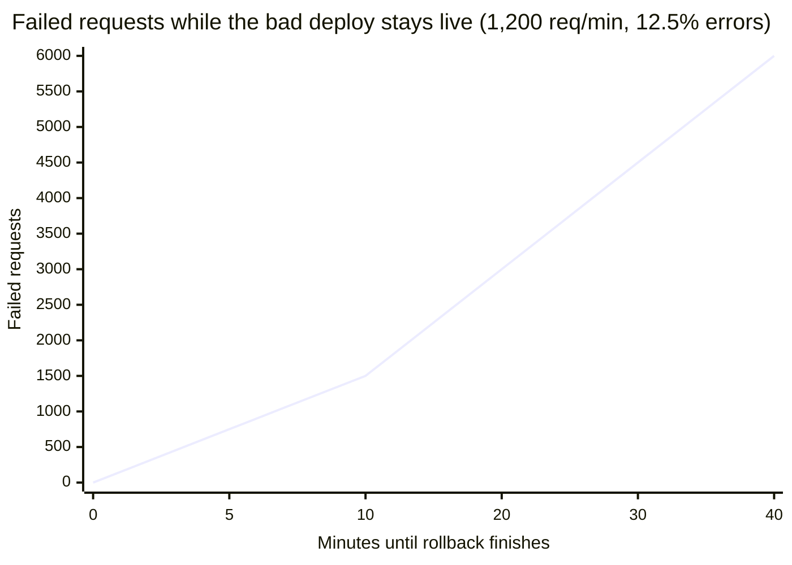

import Scenario from "../../../components/Scenario.astro";
import LevelIntro from "../../../components/LevelIntro.astro";
import Checkpoint from "../../../components/Checkpoint.astro";
import PracticeCheck from "../../../components/PracticeCheck.astro";

export const unit = {
  track: "infra-delivery",
  unitSlug: "rollback-strategy",
};

<Scenario label="A smoke alarm that rings for toast, and one that waits ten minutes">
  <Fragment slot="facts">
    <div class="not-prose flex flex-col gap-2 text-sm text-slate-700 dark:text-slate-300">
      <div class="flex items-center gap-1.5"><span>🍞</span> <strong>Too jumpy</strong> — rings at the first wisp, so you pull the battery</div>
      <div class="flex items-center gap-1.5"><span>🐢</span> <strong>Too patient</strong> — waits ten minutes to be sure, so the fire is big by then</div>
      <div class="flex items-center gap-1.5"><span>🚨</span> <strong>Thick black smoke</strong> — no one wants to wait for a second opinion</div>
    </div>
  </Fragment>

Picture two smoke alarms. The first rings the moment it sees one wisp, so it
screams at every slice of toast until you take the battery out. The second
waits ten minutes of continuous smoke to be certain, which is quite sure and
also far too late. Neither is broken; each is set to a different trade-off.
**An automatic rollback trigger is this same dial. Where would you set it,
and would you set it the same way for a faint wisp as for thick smoke?**

</Scenario>

<LevelIntro
  items={[
    "Judging a deploy over windows, not one reading",
    "Tuning: flapping against slowness",
    "Rewriting an unsafe migration safely",
  ]}
/>

## How do you judge a deploy from a stream of measurements?

**A health check must tell a real regression from ordinary noise. If it reacts
to one bad measurement, what goes wrong?** One elevated reading may be a
handful of unrelated failures, and rolling back on it risks reverting a healthy
deploy. So the check judges a deploy over a series of one-minute windows and
only acts on a pattern that persists, except for a signal too extreme to need
confirmation.

These are the rules used in this worked example (all thresholds are example
settings, not universal values):

| Rule                                                  | Value in this example |
| ----------------------------------------------------- | --------------------- |
| Minimum requests in a window before judging it        | 50                    |
| Window counts as "bad" at or above this error rate    | 5%                    |
| Window counts as "severe" at or above this error rate | 25%                   |
| Consecutive bad windows needed to roll back           | 3                     |
| Consecutive good windows needed to mark healthy       | 3                     |



Two counters are all the memory it needs: how many bad windows in a row, and
how many good in a row. A good window resets the bad counter, a bad window
resets the good counter, and a severe window skips both.

<Checkpoint question="Why does the check ask for at least 50 requests in a window before computing an error rate at all?">

A rate from very few requests swings wildly: 1 error in 4 requests is 25%,
which would count as severe, yet it is indistinguishable from noise at that
volume. Checking the sample size first means a rate is trusted only once there
is enough traffic for it to mean something. Otherwise the window is set aside
as "not enough data" instead of being misread as bad or severe.

</Checkpoint>

Here are three streams of 100-request windows run through those rules:

| Stream                          | Errors per window | Per-window verdict    | Outcome                          |
| ------------------------------- | ----------------- | --------------------- | -------------------------------- |
| A. Sustained regression         | 8, 9, 10          | bad, bad, bad         | Roll back at the 3rd window      |
| B. One noisy blip that recovers | 6, 1, 2, 1        | bad, good, good, good | Marked healthy at the 4th window |
| C. A severe spike               | 40                | severe                | Roll back at once                |

A shows that a persisting problem is told apart from noise rather than acted on
at the first bad window. B shows the same restraint the other way: one blip
does not start a rollback because the good windows that follow reset the
counter. C shows the bypass: 40% is not something ordinary noise plausibly
produces, so waiting for confirmation costs time and buys no confidence.

<PracticeCheck
  track={unit.track}
  unitSlug={unit.unitSlug}
  topicId="window-code"
/>

## Tuning: flapping or too slow to help

**If 3 windows is right, why not use 1 to be extra safe?** Because the
confirmation requirement is exactly what stream B depended on. With 1 bad
window as the trigger, that blip would have rolled back a healthy deploy.
This is **flapping**: a trigger so sensitive that normal variance keeps rolling
back good deploys, until people stop trusting it and switch it off, which is
no better than having no automation.

**Then why not require 10 bad windows, to be very sure?** Because that rebuilds
the problem the unit opened with. Using the example from L1 (1,200 requests per
minute, 12.5% failing, so 150 failed requests per minute) with one-minute
windows, the detection delay alone costs:

| Bad windows required | Minutes of failing traffic before acting | Failed requests |
| -------------------- | ---------------------------------------- | --------------- |
| 1                    | 1                                        | 150             |
| 3                    | 3                                        | 450             |
| 10                   | 10                                       | 1,500           |



Put together with a 2-minute redeploy, a 3-window trigger costs about 3 + 2 = 5
minutes, or 750 failed requests, against 6,000 for the 40-minute rebuild path
(this ignores the time a person would need to notice the problem, which the
automatic version also removes). Waiting for 10 windows plus the same 2 minutes
costs 12 minutes and 1,800 failed requests.

There is no single correct number. It depends on how noisy the system's
normal metrics are and on how costly a false rollback is next to how costly
extra minutes of a real failure are. What cannot be tuned away is the trade
itself: more confirmation means fewer false rollbacks and a slower reaction,
and less confirmation means the reverse. The severe bypass exists because some
signals are clear enough that the trade does not apply.

<Checkpoint question="A team lowers the bad-window count from 3 to 1 after one regression took 6 minutes to auto-roll back. A week later, three healthy deploys are rolled back on ordinary noise. How are these two events related?">

They are the same trade-off seen from its two costs. Lowering to 1 does make a
real regression trigger faster, but it also removes the protection that
filtered noise out, so healthy deploys now flap. The team got the speed it
asked for and is paying the cost it did not intend. The fix is to retune the
number against how noisy this system actually is, not to treat it as a
constant set once.

</Checkpoint>

<PracticeCheck
  track={unit.track}
  unitSlug={unit.unitSlug}
  topicId="tuning-windows"
/>

## The migration trap, made concrete

L2 described the danger in the abstract. Here is the order of events for a
service storing an order's status, with the unsafe version beside the safe one:

| Step                          | Unsafe: drop in the same deploy        | Safe: expand-contract                           |
| ----------------------------- | -------------------------------------- | ----------------------------------------------- |
| Deploy N (the risky code)     | Drops `legacy_status`; v42 ships       | Adds `order_status`; v42 writes both columns    |
| Roll back to v41              | v41 reads a missing column and crashes | v41 reads `legacy_status`, still present: works |
| Deploy N+k (after the window) | nothing left to do                     | Drops `legacy_status`; no old code remains      |

The only SQL that matters is the final step, kept as a separate deploy:

```sql
-- Deploy N+k: contract, only after deploy N's rollback window has passed
ALTER TABLE orders DROP COLUMN legacy_status;
```

During deploy N's window `legacy_status` is never touched, so v41 keeps
working if a rollback happens. The migration risk has been moved out of the
risky deploy and into a later one that changes no application behavior.

## This is a case, not the whole territory

The lesson that a rollback is only as safe as the least backward-compatible
thing shipped with it, and that a trigger's sensitivity is a real trade-off,
reaches past database migrations to any coupled pair that is versioned
separately: a mobile app and its API, a message producer and its consumers, a
library and its callers. The specifics here are not universal. The thresholds
(5%, 25%, three windows) are tuned for an imaginary service, and a real system
takes its numbers from its own history.

**Try extending it.** Suppose the bad deploy had already accepted writes in the
new format before the rollback fired, so some orders have only `order_status`
filled in. Is redeploying v41 enough, or does the rollback now need a
data-repair step, and does that change whether rolling back is still the right
call? And if the system had no structured health metric yet, only raw logs,
could the decision still be automatic, or would every rollback fall back to a
person until that signal exists?

## Failure modes

| Failure mode                                                 | What it gets wrong                                                                          |
| ------------------------------------------------------------ | ------------------------------------------------------------------------------------------- |
| Discarding previous artifacts after each successful deploy   | Turns every rollback into a rebuild from source                                             |
| Dropping or renaming a column in the same deploy as the code | The old code a rollback redeploys no longer matches the schema: a second incident           |
| Setting the confirmation window too low                      | Flapping: noise rolls back healthy deploys until the automation is disabled                 |
| Setting it too high, or requiring it for everything          | Reacts too slowly to deliver the speed automation is for, and slows even unambiguous spikes |
| Judging a window with too little traffic                     | A rate from a handful of requests swings on tiny numbers and misfires either way            |
| Treating a rollback plan as a one-time decision              | Traffic, schema and noise change; a plan written once drifts out of date                    |
