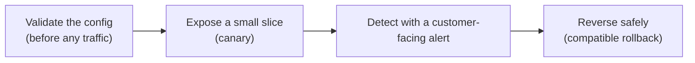

import Scenario from "../../../components/Scenario.astro";
import LevelIntro from "../../../components/LevelIntro.astro";
import PracticeCheck from "../../../components/PracticeCheck.astro";

export const unit = {
  track: "infra-delivery",
  unitSlug: "staff-level-release-engineering-strategy",
};

<Scenario label="Same bug, same Friday, two very different afternoons">
  <Fragment slot="facts">
    

      
🐛 <strong>Same bug</strong> — a null-pointer regression in a checkout price calculator, shipped at 4:45pm Friday

      
🅰️ <strong>Team A</strong> — everyone gets the new build at once, a customer ticket is the first alarm, rollback is blocked

      
🅱️ <strong>Team B</strong> — a small slice gets it first, an alert on checkout failures fires, rollback is safe

    

    

      

        Team A: time to safe
        

          

        

        72 min
      

      

        Team B: time to safe
        

          

        

        10 min
      

    

  </Fragment>

Picture a restaurant adding a new dish. One careless kitchen serves it to the
whole dining room at once and learns it is too salty from the angry
reviews. A careful kitchen sends it to one table first, watches the plate
come back, and pulls it before anyone else orders. The recipe is identical.
The difference is what the kitchen set up _before_ the dish left the pass.

Two engineering teams are in exactly that position. Both ship the same bug
at 4:45pm on a Friday: a null-pointer regression that makes checkout show a
$0.00 total. Neither code review caught it. The numbers below are an
illustrative scenario, not measurements from a real incident.

**Which of the two afternoons would you rather have, and what did the
other team fail to build in advance?**

</Scenario>

<LevelIntro
  items={[
    "Four safety gates and the order they fire in",
    "Blast radius versus detection latency",
    "Why the whole chain is built before the bad day",
  ]}
/>

## What actually differed between the two teams?

Nothing about typing speed or calm on-call nerves. The difference is four
things that existed on Team B's pipeline before Friday started:

| Step         | Team A                                               | Team B                                         |
| ------------ | ---------------------------------------------------- | ---------------------------------------------- |
| Exposure     | 100% of traffic, immediately                         | 5% of traffic (canary stage)                   |
| Detection    | Customer complaint, about 41 min later               | Alert on checkout failures, about 3 min later  |
| Rollback     | Blocked 31 more min by an incompatible schema change | Safe, because the schema change was compatible |
| Time to safe | 72 min (41 + 31), seen by real customers             | 10 min (3 to detect, the rest to reverse)      |

The 72 comes straight from adding Team A's two delays. Team B's total is an
assumption in this scenario: 3 minutes to detect and roughly 7 to reverse
and confirm.

Each box is a separate topic elsewhere in this track. This unit is about
the thing none of them is on its own: the **order** and the **wiring**.

## Which two ideas carry most of the weight?

**If a bad deploy is inevitable, what do you control?** Two quantities:

- **Blast radius** — how many users the bad build reaches before anyone
  reacts. A canary keeps this small.
- **Detection latency** — how long the bad build runs before something
  notices. An alert on what users experience (checkout failures) keeps this
  in minutes; alerts on server CPU and memory can stay perfectly calm while
  checkout is broken.

<PracticeCheck
  track={unit.track}
  unitSlug={unit.unitSlug}
  topicId="blast-radius-detection"
/>

## What do I need to remember?

- **Integrated release architecture** — several safety techniques wired into
  one ordered pipeline, not tools each team grabs during an incident.
- **Fail-fast config validation** — rejects a wrong setting before any
  request is served; the cheapest gate.
- **Safe reversibility** — undoing a deploy without causing a second
  incident; it needs the database change to stay compatible with the old
  code.
- **Error budget** — how much unreliability a service may spend; a nearly
  empty budget is a reason to ship slower.
- **Designed in advance** — the chain is tested before the bad day, because
  an untested rollback is a guess.

Safety also costs something: every canary stage adds minutes to every
deploy. L2 shows how the gates compose and how to size them to the stakes.
