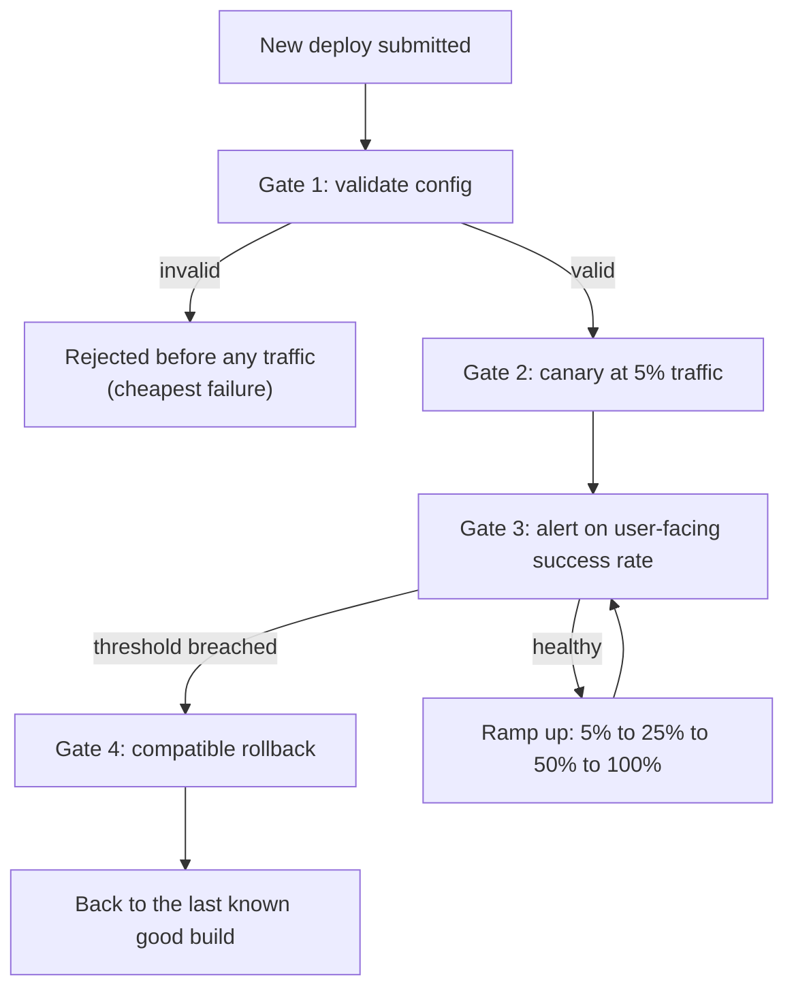
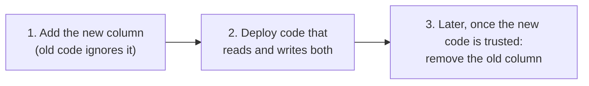

import LevelIntro from "../../../components/LevelIntro.astro";
import Checkpoint from "../../../components/Checkpoint.astro";
import PracticeCheck from "../../../components/PracticeCheck.astro";

export const unit = {
  track: "infra-delivery",
  unitSlug: "staff-level-release-engineering-strategy",
};

L1's Team B did not invent anything new. A canary, an alert on checkout
failures, a compatible schema change and a config check are each covered
elsewhere in this track. So the sharper question for this level is: **if none of
the individual pieces are new, what is the real design work, and in what
order must they fire?**

<LevelIntro
  items={[
    "The order of the four gates and why",
    "Why a rollback has to be designed before the deploy",
    "Sizing the pipeline to what a bad deploy costs",
  ]}
/>

## Why does the order of the gates matter?

**Team A could have bought a canary tool, an alerting tool and a rollback
command. Why did owning them not help?** Because a canary that starts after
the new build already reached everyone does nothing, and an alert that
fires after the rollback was attempted does nothing either. Each gate
catches a different failure class, and the cheapest catch should come first.

| Gate                   | What it catches                                           | Why it sits here                                   |
| ---------------------- | --------------------------------------------------------- | -------------------------------------------------- |
| 1. Config validation   | A missing value or an out-of-range setting                | Rejects the build before any request is served     |
| 2. Canary              | A logic bug validation cannot see, like L1's null pointer | Keeps the bad build on a small slice of traffic    |
| 3. User-facing alert   | Whether the canary is really failing for users            | Answers "is it bad?" inside the canary window      |
| 4. Compatible rollback | Turns a detected problem into a quick exit                | Fast only if the deploy was built to be reversible |

<Checkpoint question="A team has a working canary and a working alert, but no config validation gate. A mistyped setting ships. Does the canary plus alert still help?">

Usually yes, eventually: the canary would show degraded success rates and
the alert would fire. But it is strictly worse than the first gate. The bad
setting still reaches real traffic, even if only 5% of it, and it costs a
full canary-and-alert cycle of several minutes instead of a rejection
before any request is served. Validation is not redundant with the canary;
it is the cheaper, earlier catch for one failure class.

</Checkpoint>

<PracticeCheck
  track={unit.track}
  unitSlug={unit.unitSlug}
  topicId="pipeline-order"
/>

## Why must the rollback be designed before the deploy?

**Team A's rollback took 31 extra minutes. Was that bad luck?** No, it was
a consequence of how the deploy was built. The 4:45pm deploy included a
database change that dropped a column the _previous_ code version still
reads. Rolling the code back would have broken the old version too, so
"revert the code" and "keep the database as it is" could not both be true.

The discipline that avoids this is to split a risky schema change into
steps that each work with both code versions:

Because step 1 and step 2 are reversible in isolation, rolling back during
the canary is quick. Detecting a bad deploy in 3 minutes is worth little
if reversing it still takes 31. See `rollback-strategy` for the full
treatment.

<Checkpoint question="The alert fires 3 minutes into the canary, but the deploy also dropped a column the old code reads. What is the real time to safe?">

Not 3 minutes. Detection only starts the clock on reversal; if reverting
the code would break the old version too, the team must untangle the
schema first, exactly like Team A's extra 31 minutes. Fast detection and
fast reversal are two separate properties, and the pipeline is only as
quick as the slower of the two.

</Checkpoint>

<PracticeCheck
  track={unit.track}
  unitSlug={unit.unitSlug}
  topicId="reversible-rollback"
/>

## Why is "we have all four pieces" not enough, and how much should we build?

**Most teams of a certain size have a canary, alerts and a runbook
_somewhere_. So what actually goes wrong?** Nobody has proved they work
together under the conditions of a real bad deploy. Team A almost
certainly had a rollback runbook. It had never been rehearsed against a
deploy carrying an incompatible schema change, so the problem was found live
instead of in a planned drill.

So the design work is: wire the gates in order, test the chain before it is
needed (force an alert to fire once on purpose, rehearse a rollback against
a real schema change), and decide how much to build per service.

| Service                          | What a bad deploy costs  | Reasonable pipeline                                |
| -------------------------------- | ------------------------ | -------------------------------------------------- |
| Payment checkout                 | High, immediate          | All four gates, multiple canary stages             |
| Internal tool used by six people | Low, easy to fix by hand | Config check plus a fast rollback; skip the canary |

Safety margin is a running cost: each canary stage adds minutes to every
deploy, good alerts need real tuning effort, and drills take engineer time.
Size each gate to the cost of failure, rather than building the maximum
everywhere.

<PracticeCheck
  track={unit.track}
  unitSlug={unit.unitSlug}
  topicId="cost-and-rehearsal"
/>
