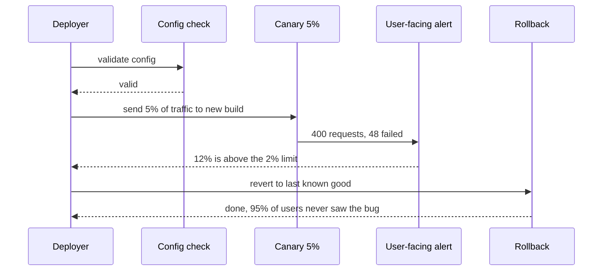
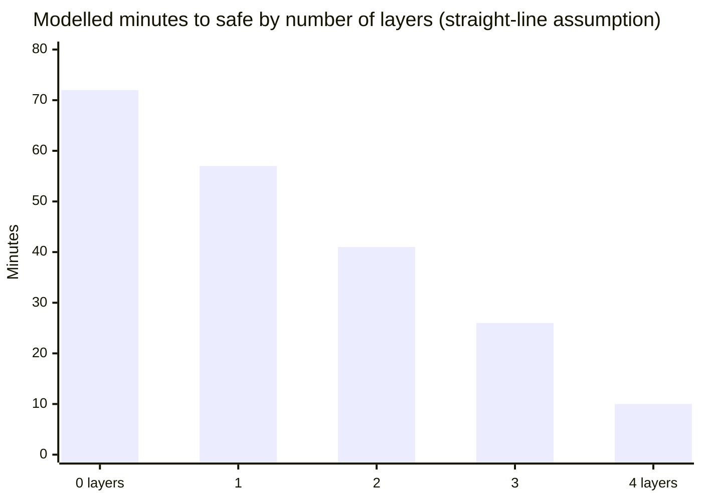

import Scenario from "../../../components/Scenario.astro";
import LevelIntro from "../../../components/LevelIntro.astro";
import Checkpoint from "../../../components/Checkpoint.astro";
import PracticeCheck from "../../../components/PracticeCheck.astro";

export const unit = {
  track: "infra-delivery",
  unitSlug: "staff-level-release-engineering-strategy",
};

<Scenario label="The same bug, run through the pipeline stage by stage">
  <Fragment slot="facts">
    <div class="not-prose flex flex-col gap-1.5 text-sm text-slate-700 dark:text-slate-300">
      <div class="flex items-center gap-1.5"><span>🛂</span> <strong>Gate 1</strong> — config is valid, so the build moves on</div>
      <div class="flex items-center gap-1.5"><span>🕊️</span> <strong>Stages</strong> — 5% for 3 min, 25% for 5 min, then 100%</div>
      <div class="flex items-center gap-1.5"><span>🚨</span> <strong>Limit</strong> — a stage is unhealthy above a 2% error rate</div>
      <div class="flex items-center gap-1.5"><span>⏪</span> <strong>Result</strong> — rolled back at the first stage</div>
    </div>
    <div class="not-prose mt-3 flex flex-col gap-1.5 text-xs">
      <div class="flex items-center gap-2">
        <span class="w-28 shrink-0">Observed at 5%</span>
        <div class="h-3 flex-1 overflow-hidden rounded bg-slate-200 dark:bg-slate-800">
          <div class="animate-fill-bar h-3 rounded bg-rose-400" style="--target-width: 12%"></div>
        </div>
        <span class="w-16 shrink-0 text-right">12%</span>
      </div>
      <div class="flex items-center gap-2">
        <span class="w-28 shrink-0">Allowed limit</span>
        <div class="h-3 flex-1 overflow-hidden rounded bg-slate-200 dark:bg-slate-800">
          <div class="animate-fill-bar h-3 rounded bg-emerald-400" style="--target-width: 2%"></div>
        </div>
        <span class="w-16 shrink-0 text-right">2%</span>
      </div>
    </div>
  </Fragment>

L2 drew the pipeline as a diagram. Take the same checkout bug and ask a
plain question: **at which exact moment does the pipeline stop it, and what
does stopping it cost?** The traffic numbers below are an invented example
chosen so the arithmetic is easy to check, not data from a real system.

</Scenario>

<LevelIntro
  items={[
    "One bad deploy traced stage by stage",
    "The latency and effort each gate costs",
    "Where the same bug lands when it is a config mistake",
  ]}
/>

## Where exactly does the bad build get caught?

**Config validation passes, because the bug is in the code. So what does the
first canary stage see?** Assume the 5% slice served 400 requests and 48 of
them failed.

| Stage           | Traffic | Requests seen | Errors | Error rate | Healthy at a 2% limit? |
| --------------- | ------- | ------------- | ------ | ---------- | ---------------------- |
| 1               | 5%      | 400           | 48     | 12%        | No: roll back          |
| 2 (not reached) | 25%     | -             | -      | -          | Never evaluated        |
| 3 (not reached) | 100%    | -             | -      | -          | Never evaluated        |

48 divided by 400 is 12%, six times the 2% limit. The pipeline stops at the
first unhealthy stage and never exposes the remaining 95% of traffic.



The decision at each stage is tiny, and reading it is the point:

```javascript
function stageIsHealthy(requests, errors, maxErrorPercent) {
  if (requests === 0) return true; // nothing observed, nothing failing
  return errors * 100 <= maxErrorPercent * requests; // avoids float rounding
}
```

Comparing `errors * 100` with `maxErrorPercent * requests` keeps the check
in whole numbers, so a stage at exactly the limit is treated the same way
every time.

<Checkpoint question="The 5% stage observed zero requests (a quiet minute). Should the pipeline call it healthy and ramp up?">

It will by the rule above, and that is a real weakness: a stage with no
traffic proves nothing about the build. A careful pipeline either holds
the stage until a minimum number of requests has been observed, or treats
"too little data" as "not yet decided" rather than "healthy". The
canary only protects you for as long as it is actually exercising the
code.

</Checkpoint>

<PracticeCheck
  track={unit.track}
  unitSlug={unit.unitSlug}
  topicId="stage-gate-check"
/>

## What do the gates buy, and what do they cost?

**If the pipeline reliably catches this bug at 5%, why not run every
service through the full chain?** Because the costs are paid on every
deploy, including the ones with no bug at all.

| Cost           | How it shows up                                                                                         |
| -------------- | ------------------------------------------------------------------------------------------------------- |
| Deploy latency | Two canary stages before 100% add 3 + 5 = 8 minutes; at 20 deploys a day that is 160 minutes of waiting |
| Infrastructure | Percentage-based traffic splitting must be built and kept correct                                       |
| Alert quality  | A user-facing signal needs a sound definition and tuned thresholds                                      |
| Drills         | Rehearsing rollback takes engineer time not spent on features                                           |

The benefit side can be read from this unit's interactive demo, which
reproduces L1's two endpoints. Treating the layers as equally valuable is
a simplification: it draws a straight line between 72 minutes with no
layers and 10 minutes with all four.



The endpoints (72 and 10) come from the scenario; the middle bars are
interpolated and rounded, not measured. In real life the layers are not
equally valuable, and the first one a service lacks is usually the costly
one.

<Checkpoint question="A team drops the canary stages to save 8 minutes per deploy, keeping validation and rollback. What does a genuinely expensive service lose?">

The limited blast radius. Without a smaller slice absorbing the risk
first, every bad deploy hits everyone, and detection has to work against
full-scale traffic. Validation still stops config mistakes and rollback
still speeds recovery, but the exposure that kept Team B's incident small
is gone. Saving 8 minutes per deploy was paid for with a much larger worst
case.

</Checkpoint>

<PracticeCheck
  track={unit.track}
  unitSlug={unit.unitSlug}
  topicId="cost-and-rehearsal"
/>

## This was one case, not the whole territory

The trace above is a code bug caught at the first canary stage. Change one
thing and the answer moves. Try these before reading on:

- **What if the bad change were a config value, not code?** A gateway
  timeout of `100` ms instead of `8000` ms is outside any sensible range, so
  Gate 1 rejects it in milliseconds. But `5000` ms passes a range check and
  can still be wrong for current conditions, so only the canary would show
  it. The same mistake lands at a different gate depending on how wrong it
  is.
- **What if two independent bad changes shipped together?** One unhealthy
  stage still triggers a rollback, but the team cannot tell which change
  caused it. That is why independent changes are best canaried one at a
  time.
- **What if the audience changed?** Suppose the service were an internal
  tool with six users. Which gates would you keep, which would you drop,
  and what is the cheapest rollback that still protects them?
- **What if the news were worse?** Suppose the schema change were not
  reversible at all. Which gate would you add, and where in the order
  would it have to go?
