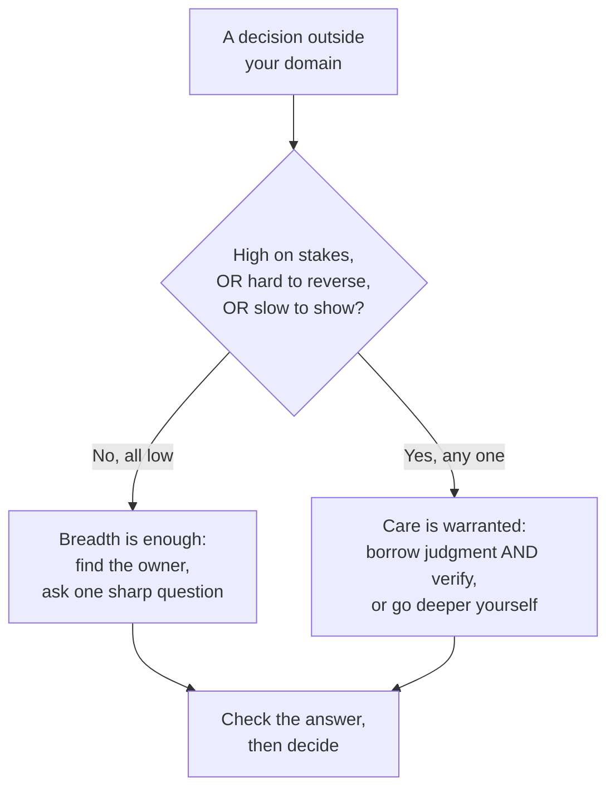
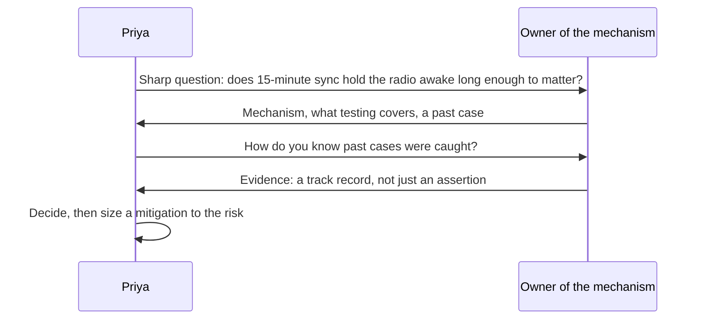

import LevelIntro from "../../../components/LevelIntro.astro";
import Checkpoint from "../../../components/Checkpoint.astro";
import PracticeCheck from "../../../components/PracticeCheck.astro";

export const unit = {
  track: "learning-craft",
  unitSlug: "breadth-depth-trade-off-scale",
};

L1 left the practitioner and Priya at the same fork: learn it yourself or find
the right conversation. L2 builds the model for choosing, then the technique for
running that conversation well. Every number in this level is a made-up
teaching number.

<LevelIntro
  items={[
    "Stakes, reversibility and time-to-signal",
    "A flow from those factors to an action",
    "Finding, questioning and checking an expert",
  ]}
/>

## What actually decides whether a call needs real depth?

**Almost everything feels important when it lands on your desk. What question
separates "ask one sharp question" from "block three days and get fluent"?**
Three factors, read together. None is enough alone.

| Factor         | The question                             | Low: breadth is enough                    | High: depth is warranted                      |
| -------------- | ---------------------------------------- | ----------------------------------------- | --------------------------------------------- |
| Stakes         | How much damage does a wrong call do?    | An internal tool's error message          | User data, revenue, safety                    |
| Reversibility  | How cheaply can it be undone?            | A flag flipped back in minutes            | A public contract, a data migration           |
| Time-to-signal | How fast does a wrong call show itself?  | Breaks on the next dashboard refresh      | Degrades quietly over weeks or months         |
| In the clinic  | The same three questions about a patient | Cough: mild, rechecked in a week, visible | Odd pattern: serious, hard to reverse, silent |

A call is safe on breadth alone when it is low on all three. It earns personal
depth when it is high on any one, because borrowed judgment stops being a safe
substitute exactly where a mistake is expensive, hard to undo, or invisible.

Priya's call is high on stakes (millions of users), medium on reversibility (a
later release can revert it, after users update), and slow on signal (battery
drain shows up in reviews and support tickets over weeks). That is high on
three of three, so carelessness is ruled out. It does not mean three weeks of
self-study. It means borrowed judgment, handled carefully.

The demo on this level shows how much personal depth a call warrants as stakes
and reversibility change. It uses an assumed rule: warranted hours equal stakes
times (10 minus reversibility), divided by 100, times 120 hours (three weeks at
40 hours per week, assumed). At Priya's settings of 8 and 5, that is 8 x 5 =
40, so 0.4 x 120 = 48 hours. That is far more than a one-hour chat and far less
than three weeks.

<Checkpoint question="An engineer is asked to approve a one-line wording change to an internal admin tool's error message, in a system they have never touched. Does this call need real depth?">

No. Stakes are low (an internal tool), it is trivially reversible (revert the
text in seconds), and any problem shows itself immediately (someone reads the
wrong message and says so). None of the three factors is high, so a glance and
a one-line question to whoever owns the tool is the right-sized response. It is
neither under-caution nor over-caution.

</Checkpoint>

<PracticeCheck
  track={unit.track}
  unitSlug={unit.unitSlug}
  topicId="three-factors"
/>

## How do you find and question the right expert, fast?

**Once Priya knows she does not need to understand the mechanism herself, what
does she actually do in the hour she has?** Three moves, in order.

1. **Find the actual owner**, not the nearest available person. The owner is
   whoever has depth in the specific mechanism: not the highest-ranking person in
   the room, not whoever replies fastest, not necessarily the person with the
   obvious job title. For Priya, that is the engineer who wrote the sync
   scheduler.
2. **Ask a question sharp enough to answer in minutes.** A vague question gets a
   vague answer, because it never said what "safe" means or what the asker
   already knows.
3. **Check the answer before acting.** An answer from a real expert is not yet
   a verified one. Ask for the reasoning, and notice whether it names a
   mechanism that could be wrong or just sounds fluent.

| Question                                                                                   | Why it fails or works                                     |
| ------------------------------------------------------------------------------------------ | --------------------------------------------------------- |
| "Is this safe?"                                                                            | No dimension named, so any confident reply is uncheckable |
| "Any battery concerns?"                                                                    | Asks for a verdict, not a mechanism                       |
| "Does every 15 minutes hold the radio awake long enough to matter, and how would we know?" | Names the mechanism, asks for evidence                    |

This is the same specificity test as the earlier unit on weighing credibility,
applied to a live conversation. Calibration matters too: the goal is not zero
uncertainty but an honest sense of how much confidence borrowed judgment
should give you.

<Checkpoint question="Priya asks the scheduler's owner 'is this safe?' and hears 'should be fine.' Has she got a useful answer?">

Not really, and the problem is the question, not the person. "Is this safe?"
never said whether battery, crashes or data loss was the worry, so "should be
fine" is an honest reply to a vague prompt. It is not load-bearing, because
Priya has nothing in it to check. A sharper question forces a specific answer
she can test.

</Checkpoint>

<PracticeCheck
  track={unit.track}
  unitSlug={unit.unitSlug}
  topicId="ask-the-expert"
/>

L3 walks Priya's evening end to end, including the point where she nearly
signs off on a confident answer that was worth very little.
