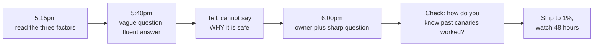
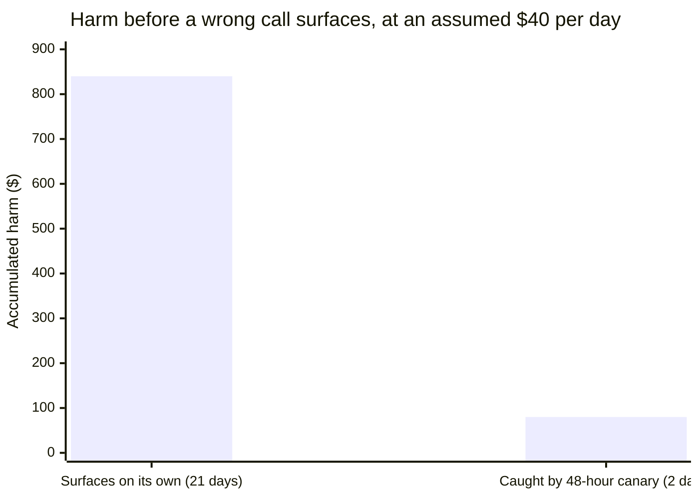

import Scenario from "../../../components/Scenario.astro";
import LevelIntro from "../../../components/LevelIntro.astro";
import Checkpoint from "../../../components/Checkpoint.astro";
import PracticeCheck from "../../../components/PracticeCheck.astro";

export const unit = {
  track: "learning-craft",
  unitSlug: "breadth-depth-trade-off-scale",
};

<Scenario label="The scenario">
  <Fragment slot="facts">
    

      
🕔 5:15pm: PR changes sync from every hour to every 15 minutes (4 times as often)

      
💬 5:40pm: a fast, friendly answer from the team's manager

      
🔎 6:00pm: the engineer who wrote the scheduler

      
🐤 Outcome: ship to 1% of users, watch battery telemetry for 48 hours

    

  </Fragment>

Same Priya as L1 and L2. The deadline is tomorrow morning, and she has never
worked on mobile power management. The numbers here (hours, the 1% rollout,
the cost per day) are made up for teaching.

She gets a fast answer within minutes, from someone plausible, saying exactly
what she hoped to hear. For about ten minutes she drafts an approval.

**Before reading on: what is missing from that answer that should have stopped
her?**

</Scenario>

<LevelIntro
  items={[
    "Reading the three factors on one real call",
    "A near-miss from the wrong person and a vague question",
    "A sign-off sized to the risk, and where it bends",
  ]}
/>

## What does the framework say about this specific call?

**Before touching mobile at all, what is the first thing Priya has to settle?**
Not how wakelocks work, but how much depth this decision needs. She reads the
three factors against the call itself, not against "mobile sync" in general.

| Factor         | Her read | Why                                                                        |
| -------------- | -------- | -------------------------------------------------------------------------- |
| Stakes         | High     | Millions of installs; drain complaints hit ratings and support for weeks   |
| Reversibility  | Medium   | A later release can revert it, but only after users have updated           |
| Time-to-signal | Slow     | Battery drain crashes nothing; it appears gradually in reviews and tickets |

That rules out the laziest option (skim and approve) and the other extreme
(learn the platform from scratch tonight). The right size is careful borrowed
judgment: find the real owner and ask something specific.

<Checkpoint question="The mobile team's tests are all green. Does a passing suite replace the three-factor read?">

No. Tests confirm the code does what its authors expected. They cannot say
whether running a job four times as often has a battery consequence nobody
thought to test. The three-factor read asks a different question: is there a
plausible failure that tests would miss, and would it be expensive and slow to
surface? A green suite is reassuring about a narrower claim than the one at
stake.

</Checkpoint>

## The near-miss: why was the first answer worth almost nothing?

Priya messages the mobile team's manager, Deja, because she is the
highest-ranking person on the team and replies fastest. Priya writes: "Sync is
going from an hour to fifteen minutes, any battery concerns?" Five minutes
later: "We've bumped sync frequency before without issues, I think we're
fine."

**What exactly is wrong with an answer that fast, that friendly and that
plausible?**

| Part             | Deja's answer                             | What Priya could do with it            |
| ---------------- | ----------------------------------------- | -------------------------------------- |
| Source           | Manages the team, does not write the code | A memory of a different change         |
| Question asked   | "Any battery concerns?" (a verdict)       | Nothing named, so nothing to check     |
| Mechanism named  | None                                      | Cannot be tested or contradicted       |
| Evidence offered | "Before, without issues"                  | Unverifiable, and about another change |

Deja was not dishonest. Neither the person nor the question was sharp enough to
produce a checkable answer. Priya catches it herself: re-reading her draft, she
cannot say in one sentence why the change is safe, only that someone said it
probably is. That gap is the tell.

<Checkpoint question="Deja is experienced and answered in good faith. Why was 'ask the highest-ranking, plausible person' not enough?">

Because rank and plausibility are not the same signal as depth in the specific
mechanism. Deja's reply was a recollection about a different change, not a
verified claim about this one. Fluency and standing make an answer feel more
trustworthy without making it more checkable, the same lesson as the unit on
weighing credibility, here applied to a live conversation. The fix is not to
distrust Deja in general. It is to route the specific question to whoever has
depth in the specific mechanism.

</Checkpoint>

<PracticeCheck
  track={unit.track}
  unitSlug={unit.unitSlug}
  topicId="near-miss"
/>

## Recovery and a sign-off sized to the risk

Priya asks Deja one more thing: who wrote the background-sync scheduler? Deja
names Marcus. At 6pm Priya sends him a sharp question: does running every 15
minutes instead of every hour hold the radio awake long enough to raise battery
drain, and would testing catch it before release or only users after?

Ten minutes later Marcus answers differently in kind. The job takes under two
seconds, but it wakes the radio each time, and four wake-ups per hour instead
of one is where the real battery cost lives. There is no automated battery
test, so testing will not catch it. Past changes were caught by a canary
rollout to 1% of users, watched against battery telemetry for 48 hours.

Priya still checks. She asks how Marcus knows past canaries caught problems,
and he points to two real incidents where 1% telemetry flagged drain before full
release. That is a track record, not an assertion, and it is what lets her defend
the call tomorrow.

She neither approves as-is nor blocks. She tells the VP: ship to 1% first, watch
battery telemetry for 48 hours, then decide on full rollout. The mitigation fits
the factors that made the call risky. A canary converts a slow, expensive
failure into a fast, cheap one.

The arithmetic is 21 x 40 = 840 against 2 x 40 = 80. The $40 per day is an
assumption, so read the chart for shape, not for dollars. The demo on this level
lets you drag the days until a wrong call surfaces and watch the harm grow
linearly.

<PracticeCheck
  track={unit.track}
  unitSlug={unit.unitSlug}
  topicId="sized-response"
/>

## Extending past this one case

This is a case, not the whole territory. Priya's evening happened to be about
battery drain, but the sequence travels: read the factors, decide breadth or
depth, find the real owner, ask a sharp question, check the answer, size a
mitigation to the risk. Try bending it yourself:

- **What if the canary shipped and battery complaints appeared anyway?** Was
  asking an expert the wrong call? Not necessarily: a checked expert answer plus
  a cheap detection mechanism is still a better bet than blind approval or three
  weeks of study she did not have. The canary exists because even good answers
  are not guarantees.
- **What if the change were a config flag flippable in minutes?** Reversibility
  jumps, the canary may be overkill, and a quick ship-and-watch could be right.
- **What if the only person who wrote the scheduler were on leave?** Who is the
  next best owner, and what would you ask them differently?
- **What if Priya were asked about a database or a legal question instead?**
  Which of the three factors would dominate, and who is the real expert?
