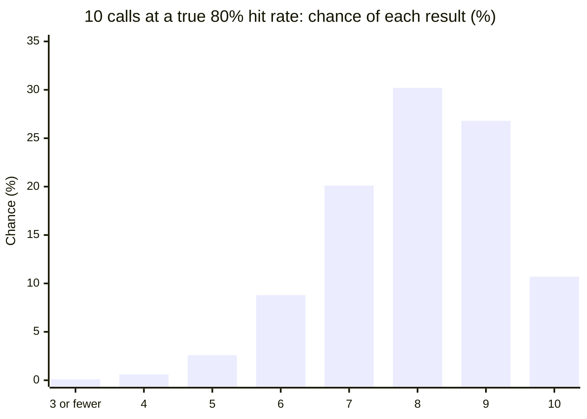
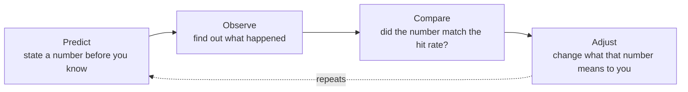

import LevelIntro from "../../../components/LevelIntro.astro";
import Checkpoint from "../../../components/Checkpoint.astro";
import PracticeCheck from "../../../components/PracticeCheck.astro";

export const unit = {
  track: "learning-craft",
  unitSlug: "calibration",
};

L1 showed Ben and Rosa with the same twenty years and very different track
records. L2 builds the two ideas underneath that: how to read a track record
without fooling yourself, and the loop that actually produces a good one. The
weather numbers are assumed teaching figures.

<LevelIntro
  items={[
    "Grouping predictions by stated confidence",
    "Why a small sample misleads",
    "The predict, observe, compare, adjust loop",
  ]}
/>

## How do you check a confidence level against reality?

**Ben says "60%," "75%" and "90%" on different mornings. How do you tell whether
each of those numbers means what he says?** You sort his calls into buckets by
stated confidence, then look at the hit rate inside each bucket.

```mermaid
xychart-beta
    title "Stated confidence vs. actual hit rate (assumed figures)"
    x-axis ["Said 60%", "Said 75%", "Said 90%"]
    y-axis "Actual hit rate (%)" 0 --> 100
    bar [60, 75, 90]
    bar [55, 64, 58]
```

The first series is a perfectly calibrated forecaster: the hit rate equals the
stated number in every bucket. The second is Ben. His shortfall is 5 points at
"60%," 11 points at "75%," and 32 points at "90%" (the same 58% from L1). The
widening gap, not any single bar, is what overconfidence concentrated at the
top of the scale looks like.

**One more trap: how many calls does a bucket need before you believe it?**
Suppose someone says "80%" on only 10 calls. Even a perfectly calibrated person
would not hit exactly 8 every time.

Eight hits is the single most likely result at only 30%. Six or fewer hits
happens about 12% of the time to a forecaster who is calibrated exactly. So
6 of 10 is weak evidence of overconfidence, while 65 of 100 at "80%" would be
strong evidence: a calibrated person gets 65 or fewer in 100 about 0.03% of
the time.

| Calls at "80%" | Hits | Calibrated person gets this or worse | Verdict          |
| -------------- | ---- | ------------------------------------ | ---------------- |
| 10             | 6    | about 12%                            | Could be noise   |
| 100            | 65   | about 0.03%                          | Clearly too high |

<Checkpoint question="Someone says '70% confident' on 100 separate predictions in a year and is right on 95. Are they well-calibrated?">

No, and it is the direction that surprises people, because 95 right sounds like
a good result. Calibration is not about being right more often. It is about the
stated number matching the real hit rate. At "70%" they should expect about 30
misses, and they had 5. Their calls were good, but the number they attached to
them was far too low. That is underconfidence, the mirror image of Ben.

</Checkpoint>

<PracticeCheck
  track={unit.track}
  unitSlug={unit.unitSlug}
  topicId="reading-the-record"
/>

## Why does repeating something a thousand times not calibrate you?

**Ben has as many mornings as Rosa. What is missing from his twenty years?**
Not experience. A record of what he said _before_ the outcome.

| Step    | What it needs                                       | What Ben skips                                  |
| ------- | --------------------------------------------------- | ----------------------------------------------- |
| Predict | An explicit number written down in advance          | Says "probably" and never records anything      |
| Observe | The real outcome, without editing your memory       | Remembers the hits more than the misses         |
| Compare | Many calls at the same level, in a written log      | Judges each morning alone                       |
| Adjust  | A specific change, such as "my 90% means about 60%" | Nothing to adjust, because nothing was compared |

Passive repetition raises the volume of experience while the feedback about
your own confidence stays at zero. Someone with 50 logged predictions can
out-calibrate someone with 500 unlogged ones.

<Checkpoint question="An engineer has shipped 200 database migrations over five years but never wrote down beforehand how safe they thought one was. Will their next confidence estimate on a risky migration be well-calibrated?">

Not reliably. Two hundred migrations is a lot of the task, but none of it ran
through the loop, so there is nothing to compare against. They have real
pattern recognition, which counts for something, but it can be quietly
overconfident or underconfident and they would not know which. The fix is not
more migrations. It is writing a number before the next one and checking it
afterward.

</Checkpoint>

<PracticeCheck
  track={unit.track}
  unitSlug={unit.unitSlug}
  topicId="predict-check-loop"
/>

L3 runs this loop on a real engineering log and then asks what happens when the
feedback is slow.
