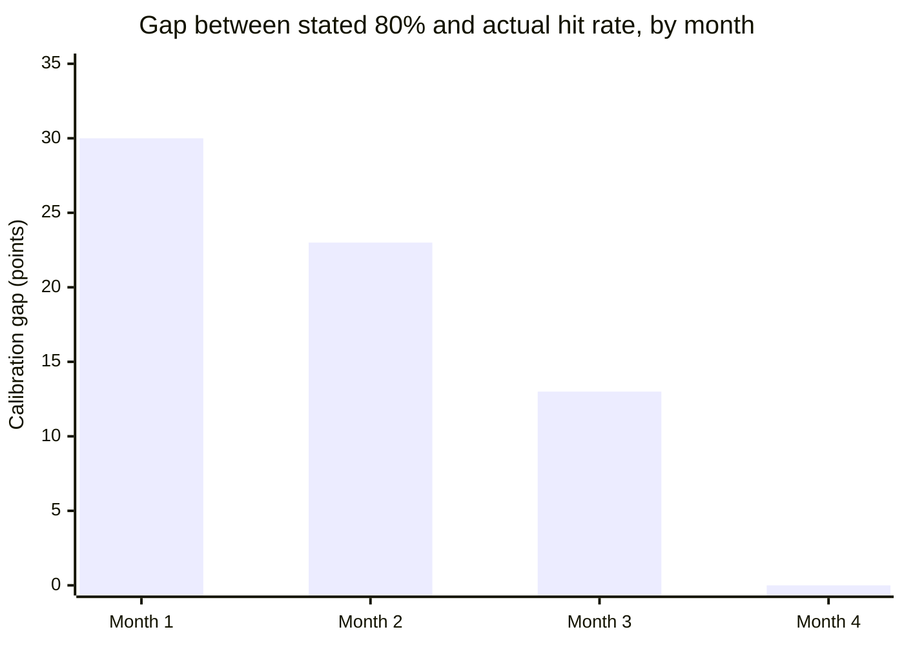

import Scenario from "../../../components/Scenario.astro";
import LevelIntro from "../../../components/LevelIntro.astro";
import Checkpoint from "../../../components/Checkpoint.astro";
import PracticeCheck from "../../../components/PracticeCheck.astro";

export const unit = {
  track: "learning-craft",
  unitSlug: "calibration",
};

<Scenario label="The scenario">
  <Fragment slot="facts">
    

      
📝 Tomás logs a number before each task estimate or debugging hypothesis

      
📉 "80% confident" calls: month 1 hit rate 50%, month 4 hit rate 80%

      
🚨 His "95% safe" production change caused a 20-minute outage

      
🐢 Two-year architecture bets: about half a resolved prediction a year

    

    

      

        65%
        of his "95% sure" calls landed (13 of 20 reconstructed, assumed)
      

      

        

      

    

  </Fragment>

Tomás is an engineer three years into his role. Like Rosa, he starts writing a
number down before he knows the outcome: "80% confident I'll finish this by
Friday," or "70% confident the root cause is the connection pool timeout." He
changes nothing else about how he works. All counts below are assumed round
numbers for teaching.

Before he started, he had told his lead "95% confident this one-line timeout
bump is safe," and it caused a 20-minute outage.

**Was that outage proof that Tomás is generally careless, or something
narrower that his log can pin down, and what does he do about it?**

</Scenario>

<LevelIntro
  items={[
    "A calibration log and what it reveals",
    "Finding which part of the scale is off",
    "Calibrating bets that resolve slowly",
  ]}
/>

## What does a log of technical judgment actually show?

**After four months of writing numbers down, did Tomás get a better memory or a
better gut?** Neither. He got feedback his gut had never received.

| Month | "80%" calls | Hits | Hit rate | Gap from 80% |
| ----- | ----------- | ---- | -------- | ------------ |
| 1     | 6           | 3    | 50%      | 30 points    |
| 2     | 7           | 4    | 57%      | 23 points    |
| 3     | 6           | 4    | 67%      | 13 points    |
| 4     | 5           | 4    | 80%      | 0 points     |

Nothing about the tasks got easier. What changed is that "80%" now has a
meaning anchored to Tomás's own record. A word of caution on month 4: with 5
calls, a single miss moves the rate by 20 points, so "0 gap" means "within the
noise of five calls," not "perfect." The smooth curve in this unit's second
demo, which assumes the gap shrinks quickly at first and then more slowly,
lands near 7 points after his 24 logged calls. The real months bounce around
that curve because each month has so few.

<Checkpoint question="Tomás logs both task-duration estimates and debugging hypotheses. Does mixing the two weaken the log?">

No. Calibration is a property of how a person maps a feeling of certainty to a
number, and that mapping transfers across related calls in a domain they know.
What every entry needs is an explicit number before the outcome and a checkable
result after. Mixing the two kinds gives him more entries per month, so the
gaps become visible sooner.

</Checkpoint>

<PracticeCheck
  track={unit.track}
  unitSlug={unit.unitSlug}
  topicId="reading-a-log"
/>

## Which part of the scale was wrong, and what changes?

**Tomás's "80%" calls were off by 30 points in month 1. Is that why the outage
happened?** Not directly. The outage came from a call at the very top.

Reconstructing his past "95% sure" calls, he finds 20 of them and only 13
landed, which is 65%. A calibrated "95%" would expect about 1 miss in 20, and he
had 7. For a person who really is right 95% of the time, 7 or more misses in 20
happens roughly 1 time in 30,000, so this is a pattern, not bad luck. His
"70%" calls, in contrast, were close to accurate all along.

| Stated confidence | What his record shows           | What he does differently                           |
| ----------------- | ------------------------------- | -------------------------------------------------- |
| 95%               | Hits about 65%, far too high    | Treats his own "95%" as a prompt to get a reviewer |
| 80%               | Starts 30 points high, improves | Keeps logging until the gap closes                 |
| 70%               | Close to accurate               | Trusts it more than he had been                    |

The fix was targeted. "Be more careful" is a mood: it either makes him doubt
calls that were fine, or it fades under pressure. A log gives a specific,
checkable finding that the top of his scale runs hot, and a specific rule.

<Checkpoint question="After the outage, could Tomás have fixed this just as well by resolving to be more careful on high-stakes changes?">

Not as precisely. "More careful" does not say which confidence levels are
unreliable, so it spreads doubt over calls that were already sound while still
missing the 95% tier if attention drifts. The log produced a falsifiable
finding about exactly one part of his scale. Generic caution is a mood. A
calibration log is a diagnosis.

</Checkpoint>

<PracticeCheck
  track={unit.track}
  unitSlug={unit.unitSlug}
  topicId="targeted-recalibration"
/>

## What if the answer takes two years?

**A two-year architecture bet gets about half a resolved prediction per year.
How would Tomás ever calibrate on it?** On its own, he would not.

Two problems stack: few cycles, and a confounded outcome. Whether an
architecture "held up" is mixed up with team changes and shifting requirements,
so even an honest compare step cannot cleanly say who was right.

The response is to log faster, cleaner proxy predictions that test the same
judgment. "75% confident this interface will need to change within the next two
features built on it" resolves in about 4 weeks. At one such proxy resolving
every 4 weeks (an assumption), that is 13 resolved predictions a year instead of
half of one.

| Version of the bet                                | Resolves in   | Resolved predictions per year |
| ------------------------------------------------- | ------------- | ----------------------------- |
| "This architecture is still easy to extend"       | 2 years       | 0.5                           |
| "This interface changes within two more features" | about 4 weeks | 13                            |

A proxy is only fair if a wrong answer would actually shake your belief in the
original bet. If it tests something different, you are calibrating the wrong
judgment.

<PracticeCheck
  track={unit.track}
  unitSlug={unit.unitSlug}
  topicId="slow-noisy-feedback"
/>

## Extend it: what changes in a different case?

**This is one worked case, not the whole territory.** It had fast feedback, one
person logging alone, and a clean hit or miss. Try changing the facts.

- **What if Tomás logged code-review calls** ("70% confident this PR has a race
  condition"), and whether he was right depended on an investigation that only
  half the PRs ever get? What does that do to the compare step?
- **What if he had only 10 calls at his 95% level instead of 20?** How much
  would you trust a 70% hit rate then, and what would you do next?
- **What if his team rewarded sounding certain?** Which part of the loop would
  that quietly damage first?

None of these has one clean answer. The loop is a starting shape, not a script
that reproduces Tomás's four months.
