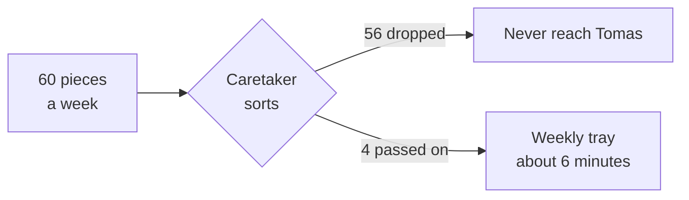

import Scenario from "../../../components/Scenario.astro";
import LevelIntro from "../../../components/LevelIntro.astro";
import PracticeCheck from "../../../components/PracticeCheck.astro";

export const unit = { track: "learning-craft", unitSlug: "curation" };

<Scenario label="Sixty pieces of mail, three that matter">
  <Fragment slot="facts">
    

      

        3 of 60
        pieces of mail in one week that actually matter (assumed numbers)
      

      

        

      

    

    

      
📬 <strong>Mara</strong> — opens all 60, about 1 minute each, so about 60 minutes

      
🧑‍💼 <strong>Tomas</strong> — reads a tray of 4 picked by the caretaker, about 6 minutes

      
🚨 <strong>Loud flyers</strong> — Mara acted on 5 "URGENT" ones, 4 were empty

    

  </Fragment>

Mara and Tomas live in the same apartment building, and each gets about 60
pieces of mail a week: flyers, coupons, "YOU HAVE WON" envelopes, and a
handful of real letters. In a typical week, just 3 of the 60 matter: a bill,
a letter from a clinic, and a parcel slip. (All numbers here are assumed for
the story, not measured.)

Mara opens every single piece, at about a minute each, so roughly an hour a
week. Five of the flyers are printed to look urgent, and she acts on all
five, calling numbers and checking accounts. Four turn out to be empty. The
real water bill ends up buried in a pile she meant to sort later.

Tomas has an arrangement with the building caretaker, who has handled the
mail for years and sets aside only what looks like real correspondence. Tomas
gets a tray of 4 items once a week, reads it in about 6 minutes, and the tray
includes one note: "this one looks official but I can't confirm it, check
before paying."

**Mara spent ten times the minutes. Who actually knows more about what is in
their mail?**

Tomas does. He can name the three things that mattered and the one thing to
double-check. Mara spent an hour absorbing volume, and all it left her with
is a pile she can no longer sort and four false alarms she still has to
un-believe.

</Scenario>

<LevelIntro
  items={[
    "More volume than any attention budget",
    "Why checking everything buys little",
    "A small trusted filter beats the firehose",
  ]}
/>

## Why can't Mara just read faster?

A fast-moving field works like that mailbox, only worse. New material arrives
faster than anyone could read it, and most of it is loud rather than
important. So the real question stops being "how do I read everything" and
becomes **"what deserves to reach my attention at all?"** Deciding that
before reading is **curation**.

|                                | Mara (reads everything)   | Tomas (trusted filter)            |
| ------------------------------ | ------------------------- | --------------------------------- |
| Pieces looked at               | 60                        | 4                                 |
| Minutes per week               | about 60                  | about 6                           |
| Urgent-looking flyers acted on | 5, and 4 were empty       | 0                                 |
| Real letters found             | 3, one misfiled in a pile | 3, plus one flagged "check first" |

<PracticeCheck
  track={unit.track}
  unitSlug={unit.unitSlug}
  topicId="attention-volume"
/>

## What is a trusted filter, in plain terms?

Tomas does not read the raw pile, and he does not simply trust the
caretaker blindly either. He picked someone with a track record: their tray
has held up for years. The caretaker reads the flood on his behalf and
passes along only what survived a quick check, plus honest labels on the
items they were unsure about.

<PracticeCheck
  track={unit.track}
  unitSlug={unit.unitSlug}
  topicId="trusted-filter"
/>

## Key terms

- **Signal.** Something real that is likely to hold up: a bill, a clinic
  letter, a well-supported finding.
- **Hype.** Something loud and urgent-looking whether or not it holds up:
  the "FINAL NOTICE" flyer, or "this changes everything" in a news feed.
- **Raw firehose.** Taking the whole flow directly, with nothing between it
  and your attention.
- **Trusted curator.** A person or source with a track record of reading the
  flood for you and surfacing what held up.
- **Batching.** Looking at what is new on a fixed schedule, such as once a
  week, instead of constantly.
- **Good-enough threshold.** Choosing to be current enough for your
  purposes, not completely current, which a fast field does not allow anyway.

L2 builds the model behind the gap: why extra checking buys so little, and
the heuristics that separate signal from hype.
