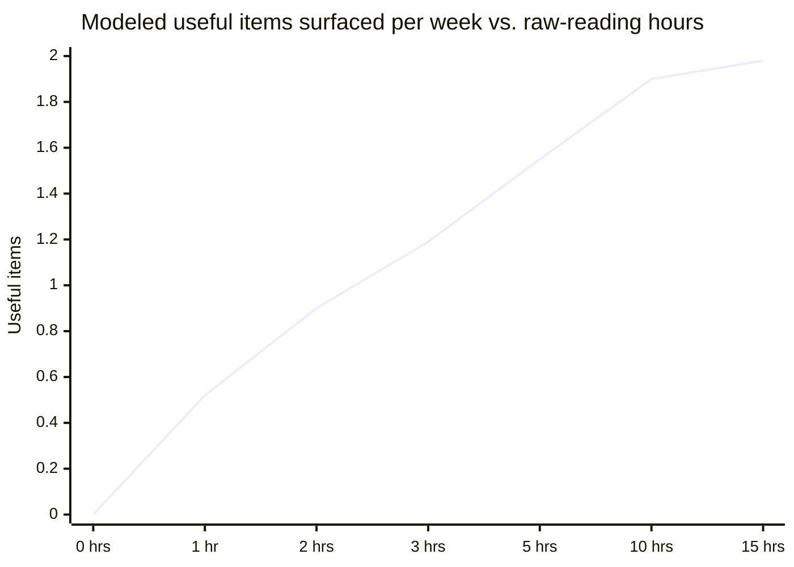
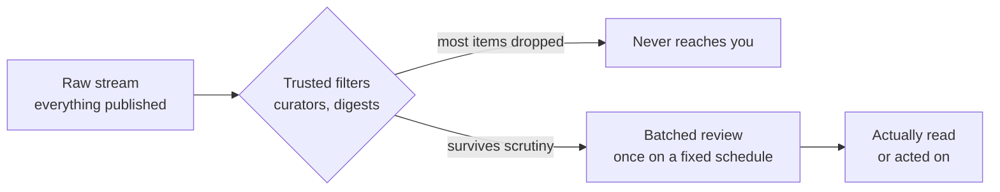

import LevelIntro from "../../../components/LevelIntro.astro";
import Checkpoint from "../../../components/Checkpoint.astro";
import PracticeCheck from "../../../components/PracticeCheck.astro";

export const unit = { track: "learning-craft", unitSlug: "curation" };

L1 showed Mara's hour losing to Tomas's six minutes with the mail. Here is the
same problem in a fast-moving field, with Elena, who follows nutrition science
by reading 40+ raw accounts and newsletters directly, about 10 hours a week.
In one month she got excited about 5 "this changes everything" claims, and 4
fizzled. Her friend Diego reads one weekly summary from 3 curators with a
track record, about 1 hour a week, and his summary mentioned only the 1 claim
that held up. Below is the model behind why her hours buy so little.

<LevelIntro
  items={[
    "Diminishing returns on raw monitoring",
    "The funnel: stream, filters, batched review",
    "Signal-vs-hype heuristics",
  ]}
/>

## Why do extra hours of raw reading buy so little?

**If Elena doubled her hours, would she know twice as much?** No, and the
reason is structural. Suppose (an assumed model, not a measurement) the field
produces about 2 genuinely useful items a week no matter how much noise
surrounds them, and each extra hour finds a smaller share of what is left.
The result is a curve that rises fast and then goes flat:

The first hour surfaces about 0.52 of the 2 items. Elena's hours 2 to 10 add
about 1.38 more, so at 10 hours she does surface about 95% of what is there
(1.90 of 2). What she pays is ten times the time, and a pile of fizzles mixed
in that she cannot sort. Her hours 11 to 15 would add just 0.08. The demo below lets
you drag the hours and watch the flattening. Attention is a small, fixed
budget while volume is effectively unbounded, so the lever that matters is
not more reading. It is filtering before reading starts.

<PracticeCheck
  track={unit.track}
  unitSlug={unit.unitSlug}
  topicId="diminishing-returns"
/>

## What does a curation system look like?

Instead of reading the raw stream, put a trusted filter between the flood and
you. It reads the volume and keeps only what survived scrutiny, and you
review its output on a schedule.

The funnel does two jobs at once. It shrinks volume, so most of what is
published never needs to reach you. And it adds delay, so a claim has to
survive a little scrutiny before it is repeated. Elena skipped both, so a
loud-but-unproven claim reached her with the same weight as one that had
been checked.

<Checkpoint question="Diego's curators read the same raw flood Elena does. Isn't he just seeing the same items later? What does the funnel change besides timing?">

It changes which items arrive, not just when. The middle step drops most of
the stream, so Diego never sees the four claims that fizzled; his curators did
not repeat them. The delay is what makes dropping possible, since a fizzle
cannot be told from a real finding the moment it is published. But the drop,
not the delay on its own, is the value.

</Checkpoint>

<PracticeCheck
  track={unit.track}
  unitSlug={unit.unitSlug}
  topicId="curation-funnel"
/>

## How do you tell signal from hype before proof exists?

Even a good filter lets some hype through. Three heuristics help sort a claim
in the moment:

| Heuristic              | What it says                                                                                     | Why it works                                                                                                                 |
| ---------------------- | ------------------------------------------------------------------------------------------------ | ---------------------------------------------------------------------------------------------------------------------------- |
| Recency check          | New is not automatically important; ask whether it is more significant or only more recent       | There is always a stream of new items, so rewarding newness means chasing whatever arrived today                             |
| Regression to the mean | The loudest early claims tend to be overstated and moderate later                                | Early reports often come from whoever framed a result most dramatically; time and repeat evidence pull claims toward reality |
| Track-record trust     | Weight a source by whether its past "this matters" calls held up, not by how confident it sounds | Confidence is free to fake, while a record of being right is expensive to fake                                               |

These are odds, not guarantees. A claim that is both brand new and from a
source with no record is the profile of Elena's four fizzles, and it is what a
track-record filter drops routinely.

<Checkpoint question="A brand-new source posts a dramatic claim. By the recency and track-record heuristics, should it be dismissed as hype?">

Down-weighted, not dismissed. Most loud, brand-new, no-record claims are
overstated, but some genuine early findings do come from first-time sources.
The practical move is not to ignore it but to keep it out of the fast lane:
let it sit a week and see whether it survives, is picked up by a source with a
record, or is quietly walked back. The heuristic buys time before belief, not
a permanent verdict.

</Checkpoint>

<PracticeCheck
  track={unit.track}
  unitSlug={unit.unitSlug}
  topicId="signal-hype"
/>

## What L3 covers next

L3 runs a full week through Diego's system, item by item, and then asks what
changes with no trusted curators yet, or when missing something early has a
real cost.
