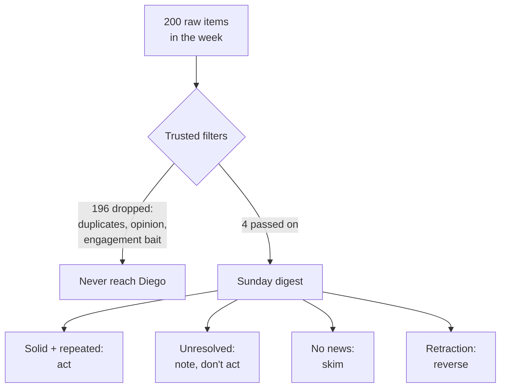

import Scenario from "../../../components/Scenario.astro";
import LevelIntro from "../../../components/LevelIntro.astro";
import Checkpoint from "../../../components/Checkpoint.astro";
import PracticeCheck from "../../../components/PracticeCheck.astro";

export const unit = { track: "learning-craft", unitSlug: "curation" };

<Scenario label="One Sunday, two hundred items, four lines">
  <Fragment slot="facts">
    

      

        200 → 4
        raw items in the week vs. lines in Diego's digest (assumed numbers)
      

      

        

      

    

    

      
✅ A finding repeated by three earlier studies

      
⏳ One dramatic pre-print, flagged "watching, not acting"

      
🔁 A curator retracting a two-month-old recommendation

    

  </Fragment>

Diego sits down on Sunday with the one thing his three curators produce: a
weekly digest of a fast-moving field, nutrition science in this story. The
raw stream that week held roughly 200 items. Among them were posts using
"new study shows" language, opinion pieces reacting to them, and one
pre-print going viral with the claim that a common supplement "reverses
cellular aging." All of that is gone by the time it reaches him. What is left
is four lines.

**With 196 items already dropped, how does Diego decide what to do with the
four that remain?**

</Scenario>

<LevelIntro
  items={[
    "Triaging the digest item by item",
    "The claim that held and the one that fizzled",
    "No curators yet, or a real cost of delay",
  ]}
/>

L2 gave the funnel and three heuristics: recency, regression to the mean, and
track-record trust. This level runs one real week through them.

## What are the four lines, and what does each deserve?

| Digest line                                | Filter's flag                                    | Diego's time | What he does                 |
| ------------------------------------------ | ------------------------------------------------ | ------------ | ---------------------------- |
| 1. Fiber intake and gut health             | "Solid, consistent with three prior studies"     | 10 min       | Acts: one small habit change |
| 2. Supplement anti-aging pre-print         | "One study, no replication, extraordinary claim" | 5 min        | Notes it, changes nothing    |
| 3. Saturated-fat guideline debate          | "No new information this week"                   | 2 min        | Skims, keeps watching        |
| 4. Retraction of an earlier recommendation | Curator reversing a two-month-old call           | 3 min        | Reverts that habit           |

That is 20 minutes of a one-hour budget. He stops there. The hour is a
ceiling, not a target, which is the good-enough threshold from L1: current
enough for his purposes, with no attempt at being completely current.

Nothing in the 196 required a decision from Diego. The volume reduction
happened upstream, which is exactly what the funnel is for.

## The item that got a skim: the pre-print

The pre-print is the one line that is neither "solid" nor "no news." The
curator's two-paragraph summary says: a single small study, not replicated,
a plausible mechanism, and an effect much larger than anything known about
this compound. That is the profile L2 predicted for hype: brand new,
dramatic, no record, and an extreme early claim that regression to the mean
says will probably moderate. Diego does not call it impossible. He also does
not change his diet on it.

<Checkpoint question="Diego spent 5 minutes on the pre-print and then did nothing differently. Was that time wasted?">

No. Those 5 minutes are what turned an unplaced claim into a calibrated "not
yet, keep watching." Without them he would either miss the claim entirely or
overreact to it as the raw-feed readers did. Triage is not about spending zero
time on unresolved items; it is about spending enough to place a claim
correctly and not a minute more before there is something new to learn.

</Checkpoint>

## The claim that held, and the retraction

The fiber study is the quietest line on the page, which is itself a tell.
Its flag says "consistent with three prior studies," so it is not even the
first time this finding has appeared. Three independent studies pointing the
same direction from a source with a track record outweigh one dramatic
single study, however exciting the second sounds. Two months later a larger
meta-analysis confirms the pattern. By then it is not news to Diego.

Line 4 is the mirror image: a recommendation that looked solid when Diego
acted on it and later did not hold up. The difference from Elena is not that
Diego's system never gets fooled. It is what happens when it does: he reverts
one habit and reads a short retraction, rather than untangling five
simultaneous half-believed claims.

<Checkpoint question="A curator got a call wrong two months ago. Does that mean Diego should go back to reading the raw stream himself?">

No. A track record is built from being right most of the time, not every
time, and one retraction does not erase the catches made in the same period,
the fiber study among them. Reading the raw 200 items would not have caught
the error faster either; it would add dozens of unresolved claims for Diego to
track alone. The lesson is the one he applied: act on solid-flagged claims,
and be ready to reverse cleanly when new evidence arrives.

</Checkpoint>

<PracticeCheck
  track={unit.track}
  unitSlug={unit.unitSlug}
  topicId="retraction-trust"
/>

## What changes with no curators yet, or a real cost of delay?

Diego's system assumes three curators with a record. A newcomer to a field has
no record to weight anyone against. The honest move is to accept more noise
for a while: follow a wider set of candidate sources than the final three,
note over a few months whose "this matters" calls hold up and whose fizzle,
and prune only then. Jumping straight to three trusted names, chosen by
popularity, is Elena's problem with an extra layer of unearned confidence.

Weekly batching also works only because nothing in nutrition science needs a
same-day reaction. In a field where being late costs something, such as a
security flaw in software you maintain, a filing deadline, or a closing
window, the interval is a variable to set against the cost of delay: daily or
sooner for the one highest-stakes source, weekly where lateness is cheap. The
filter stays; the interval moves.

| Field                               | Cost of being a week late | Sensible interval                          |
| ----------------------------------- | ------------------------- | ------------------------------------------ |
| A slow-moving health debate         | Low                       | Weekly                                     |
| A flaw in software you run          | High                      | Daily, or an alert from one trusted source |
| A regulation with a filing deadline | High, with a date         | Set by the deadline                        |

**This is a case, not the whole territory.** Try extending it yourself. What
if you picked a field you follow casually, such as local news or a hobby
community: how many raw sources do you check directly today, and where would
you find two or three curators with a real record? What if the news were
worse, and a curator you trusted was caught repeating a claim they never
checked: do you drop them, down-weight them, or ask what they got right
before? And what would change if you were new to the field entirely, with no
way yet to judge a track record?

<PracticeCheck
  track={unit.track}
  unitSlug={unit.unitSlug}
  topicId="calibrate-system"
/>
