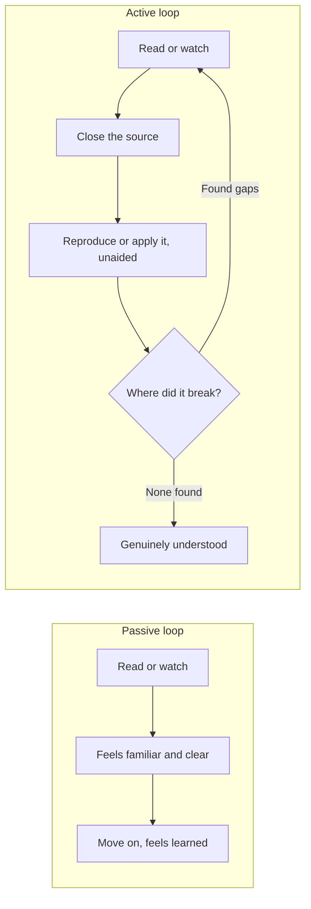
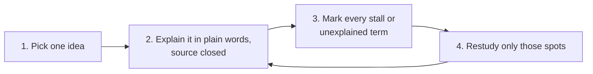

import LevelIntro from "../../../components/LevelIntro.astro";
import Checkpoint from "../../../components/Checkpoint.astro";
import PracticeCheck from "../../../components/PracticeCheck.astro";

export const unit = {
  track: "learning-craft",
  unitSlug: "exposure-understanding",
};

L1 showed Priya feeling 90% ready and scoring 40% when quizzed cold. L2 explains
the mechanism behind that gap and the one technique that turns a feeling into a
test you can run on yourself.

<LevelIntro
  items={[
    "Recognition versus retrieval",
    "The passive loop and the active loop",
    "The Feynman technique, step by step",
  ]}
/>

## Why can you recognize an answer you could not have produced?

**Someone who has watched every episode of a cooking show can pick the correct
recipe from a list. Why can't they cook it with the kitchen empty?** Picking
from a list only needs recognition. Cooking needs retrieval.

| Term               | Plain meaning                                  | 7×8 example                                 |
| ------------------ | ---------------------------------------------- | ------------------------------------------- |
| Familiarity        | "I have seen this before"                      | The row looks familiar                      |
| Perceptual fluency | The page feels easy because you have seen it   | Reading "7×8 = 56" feels smooth             |
| Recognition        | You can pick the right thing when it is shown  | Seeing 56 and thinking "yes, that is right" |
| Retrievability     | You can pull it from memory with nothing shown | Saying 56 with no page                      |

Rereading raises the first three. Only a cold attempt tests the fourth, and the
fourth is what a real quiz, or a real kitchen, demands.

The loops share the first step and split right after it. The passive loop ends
on a feeling ("that was smooth"). The active loop ends on a result ("I produced
it, or I did not"). Priya's Monday was five trips round the passive loop, and
Wednesday was the first time anyone ran the active one.

<Checkpoint question="On Wednesday, Priya's dad could have asked 'do you feel ready?' instead of quizzing her. Why would that have been a worse signal even if she answered honestly?">

Because the question only samples what the passive loop produces, the feeling of
fluency, and five smooth reads had already inflated that feeling. Her honest
Monday answer of 90% was the illusion talking, not a lie. Only closing the
source and forcing an unaided answer reveals whether the fact is retrievable.
A feeling and a retrieval attempt are not one test at two confidence levels.
They measure two different things.

</Checkpoint>

<PracticeCheck
  track={unit.track}
  unitSlug={unit.unitSlug}
  topicId="recognition-vs-retrieval"
/>

## How do you turn the "I get it" feeling into a test?

**You finish a chapter and feel fine. What can you do in five minutes that
would tell you whether the feeling is true?** Explain it, closed-book, as if to
someone who knows nothing about the topic. That is the Feynman technique.

| Step               | What you do                                            | What it protects against               |
| ------------------ | ------------------------------------------------------ | -------------------------------------- |
| 1. Pick one idea   | Narrow to a single idea                                | A vague "I know the chapter"           |
| 2. Explain plainly | Talk or write to an imagined beginner, no peeking      | Mistaking recognition for retrieval    |
| 3. Mark the gaps   | Note jargon used without meaning, and "I just know it" | Smoothing over exactly the weak spot   |
| 4. Restudy narrow  | Go back only to the marked spots, then explain again   | Rereading the whole chapter and hoping |

Two tells matter most. **Jargon as a placeholder** is a term used without ever
saying what it does. **A stall** is a point where the explanation turns to "it
just works" or "it is automatic". The value is not the explaining itself. Every
break marks the exact place to study next.

<Checkpoint question="Someone explains photosynthesis aloud: 'plants take in sunlight and water, and then, it is basically magic, they make energy.' What does this show, and what should they do next?">

"It is basically magic" is a stall: retrieval ran out at exactly the step where
sunlight and water become usable energy. The next move is not rereading the
whole chapter. It is going back to the part that explains that conversion,
because the steps before it came out clean. Then they explain the whole thing
again to see whether the stall has gone.

</Checkpoint>

<PracticeCheck
  track={unit.track}
  unitSlug={unit.unitSlug}
  topicId="feynman-technique"
/>

This site applies the same idea to itself. Reading L1 to L3 is the exposure
step, and the exercises exist because reading is not knowing. The re-exam
schedule follows [spaced repetition](/learning-craft/spaced-repetition/): one
successful retrieval today does not guarantee the fact is still retrievable in
a month.
