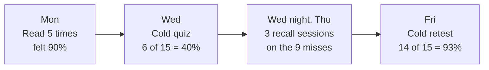
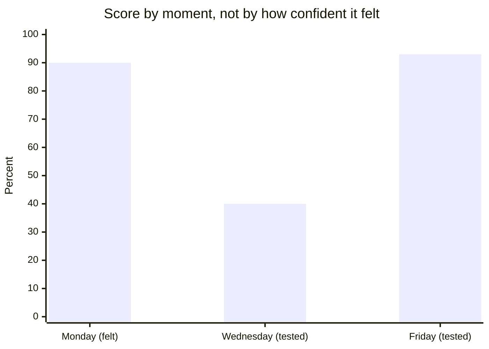

import Scenario from "../../../components/Scenario.astro";
import LevelIntro from "../../../components/LevelIntro.astro";
import Checkpoint from "../../../components/Checkpoint.astro";
import PracticeCheck from "../../../components/PracticeCheck.astro";

export const unit = {
  track: "learning-craft",
  unitSlug: "exposure-understanding",
};

<Scenario label="The scenario">
  <Fragment slot="facts">
    

      
📖 Monday: read the table 5 times, felt 90% ready

      
❓ Wednesday: cold quiz, 6 of 15 right (40%)

      
🎯 The 9 misses are mostly from 7×6 upward

      
🔁 Wed night and Thu: 3 short flashcard sessions, misses only

      
🏁 Friday: 14 of 15 right (93%)

    

  </Fragment>

Priya has a 7-times-table quiz on Friday. Monday she read the table five times
and felt 90% ready. On Wednesday her dad quizzed her cold, 15 questions with no
sheet, and she got 6 right. She has Wednesday night and Thursday left.

**What should she do with those two days, and how will she know it worked?**

</Scenario>

Follow what the cold quiz revealed and what Priya does with it.

<LevelIntro
  items={[
    "A five-day timeline from illusion to fix",
    "Reading the misses as a map of the gap",
    "The testing effect and why cramming misleads",
  ]}
/>

## What did Wednesday's quiz tell her that Monday's feeling could not?

**Why does "40%" matter more than "she got some wrong"?** Because it is the
first number in the whole story that did not come from how the page felt.
Everything before Wednesday (growing smoothness, "I could do the whole thing")
was perceptual fluency. Nobody had tested retrieval.

The nine misses were not spread evenly. Six answers came instantly, from the
early, easy facts. The misses clustered from 7×6 upward. That clustering is the
useful part: it turns "study more" into "work on these".

If her dad had said "just reread the whole table twice more", fifteen questions'
worth of effort would have been spread over six that were already solid and nine
that were not. Two days is not much time to waste on the solid ones.

<Checkpoint question="After the 40%, suppose Priya's dad says 'reread the whole table two more times before Friday'. Using the clustering of the misses, why does that waste some of her limited time?">

Rereading everything treats all fifteen questions as equally weak, but the quiz
already showed six were solid, since she answered them immediately. Time spent
on those is time taken from the nine that failed, and she only has two days.
The quiz produced a map of where the gap is, and rereading evenly throws that
map away.

</Checkpoint>

## What does she do instead, and what does it cost?

She makes one flashcard for each of the nine missed questions and runs three
sessions of about ten minutes (30 minutes in total, an assumed figure for the
example): shuffle, say the answer aloud before flipping, and set aside any card
she gets right twice in a row.

This is slower and more frustrating than rereading. Saying 7×12 wrong, aloud,
twice, feels worse than gliding over "7×12 = 84" on a page. That discomfort is a
cost of the method, not evidence that it is failing. The effortful attempt is
what builds the connection that a smooth reread never exercises.

On Friday she is quizzed cold on all 15 again and gets 14 right, missing 7×12
once. That is 14 / 15, about 93%. Her gain did not come from a long study block.
It came from spending a short one on retrieval, aimed at the gaps the test had
identified.

The Monday bar is a feeling, not a score. It is the number Priya would have
reported if nobody had tested her, and the number the fluency illusion produces
whenever a test never happens. The interactive below uses a teaching curve
shaped to match this example. It is a model, not a prediction.

| &nbsp;               | Monday (rereading)       | Wednesday (cold quiz)         | Thu and Fri (targeted recall)   |
| -------------------- | ------------------------ | ----------------------------- | ------------------------------- |
| **Method**           | Read the table 5 times   | 15 questions, no sheet        | Flashcards on the 9 misses only |
| **What it measures** | How smooth the page felt | What can be retrieved unaided | Whether the specific gap closed |
| **Result**           | 90% felt ready           | 40% actually correct          | 93% actually correct            |

<PracticeCheck
  track={unit.track}
  unitSlug={unit.unitSlug}
  topicId="targeted-recall"
/>

## Is this just a study tip, or something researchers have actually found?

**If rereading feels so productive, why would anyone trust a method that feels
worse?** The pattern here is called the **testing effect**, or retrieval
practice, and it is one of the better-replicated findings in learning research.
Attempting to retrieve something tends to leave a stronger, more durable memory
than seeing it again, and learners who only reread tend to overestimate how much
they will remember. The part that matters for this unit is the second half: the
method that feels worse gives the more honest signal.

This also explains cramming. Repeated passive review right before a test can
produce a decent score the next morning, because the material is still fresh and
fluent. It does not show the memory will last, and a good score straight after
cramming rewards exactly the illusion this unit describes.

<Checkpoint question="A student rereads notes all night, gets a strong score the next morning, and says 'so rereading works fine'. Does that disprove the testing effect?">

No. The testing effect is a claim about how well memory lasts, not about the next
morning. A cram can look the same as real understanding on an exam taken
straight after it, and that is why it is a trap rather than a counterexample.
The difference would show up on a retest a month later with no further review,
which is what this site's spaced-repetition schedule does.

</Checkpoint>

<PracticeCheck
  track={unit.track}
  unitSlug={unit.unitSlug}
  topicId="testing-effect"
/>

## Where does this go wrong?

| Failure                                 | What it looks like                                     | The fix                                                   |
| --------------------------------------- | ------------------------------------------------------ | --------------------------------------------------------- |
| Testing silently, in your own head      | Smoothing over the exact spot that would have stalled  | Say it aloud, ideally to someone who can ask "wait, why?" |
| Treating one pass as permanent          | Passing Friday and assuming the table is done for good | Re-check weeks later, before the fade matters             |
| A confident phrase in place of the fact | "I just know 7×12 now" without being able to say 84    | Test the actual output, not the confidence                |
| Restudying everything                   | Rereading all 15 after Wednesday                       | Let the misses decide what to practice                    |

## Extend it: a case, not the whole territory

Priya's table is one case. The same gap between "I have seen it" and "I can do
it" shows up in cooking, music, directions and new tools at work. Try these
before moving on:

- What would a Wednesday cold quiz look like for a skill with no single right
  answer, such as making a family bread recipe from memory? What would count as
  "closing the source"?
- Priya's misses clustered. If your own cold test had errors scattered evenly
  across everything, what would that suggest about whether targeted recall is
  the right next step yet?
- What changes if the stakes are higher than a Friday quiz, such as an exam you
  cannot retake? Does the discomfort become more worth paying for, or does
  another part of the plan need to change too?
