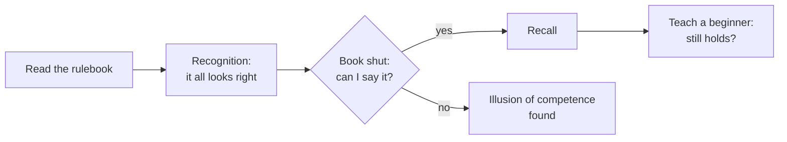

import Scenario from "../../../components/Scenario.astro";
import LevelIntro from "../../../components/LevelIntro.astro";
import PracticeCheck from "../../../components/PracticeCheck.astro";

export const unit = {
  track: "learning-craft",
  unitSlug: "feynman-technique",
};

<Scenario label="The problem">
  <Fragment slot="facts">
    

      
📖 Rulebook read: 2 times, every page "obvious"

      
🗣️ Friends arrive: Sam starts explaining a turn

      
🧱 Sam gets stuck after step 3 of 8

    

    

      

        3 of 8 steps
        explained without the book (made-up example)
      

      

        

      

      
3 / 8 = 37.5%

    

  </Fragment>

Sam bought a board game and read its two-page rulebook twice. Every page made
sense. When friends arrived, Sam began explaining a turn: "You move your
piece, then you draw a card, then... there's a thing with the dice." Three
steps in, the explanation ran out. The turn has eight steps. (The game and the
numbers are made up for this example.)

**Sam was sure the rules were understood an hour ago. What changed between
reading them and saying them?**

</Scenario>

The rulebook did not change. What changed is the test: reading checks whether
a sentence looks right, and explaining checks whether Sam can produce it.

<LevelIntro
  items={[
    "Recognition, recall and explanation",
    "The illusion of competence",
    "The four-step Feynman loop, named",
  ]}
/>

## Which kind of check did Sam actually pass?

**Reading the rulebook felt like knowing it. How many different things can
"I know this" mean?** Three, and they are not equally hard.

| Check       | What it sounds like                       | What it proves                                           |
| ----------- | ----------------------------------------- | -------------------------------------------------------- |
| Recognition | "When I see the rule, it looks right."    | The words are familiar, possibly only with the book open |
| Recall      | "With the book shut, I can say the rule." | The idea is in memory without the page                   |
| Explanation | "I can teach it to someone new."          | The idea is connected enough to survive outside the page |

- **Illusion of competence:** mistaking the ease of recognizing something for
  the ability to produce it. From the inside the two feel the same, which is
  why the gap stays hidden until someone tests it.
- Rereading makes text feel more familiar. Familiar is not the same as
  understood.

<PracticeCheck
  track={unit.track}
  unitSlug={unit.unitSlug}
  topicId="recognition-vs-recall"
/>

## What is the technique that tests the third row?

The **Feynman technique** is a loop built around that third check:

1. Explain the idea in plain words, as if to a real beginner.
2. Notice exactly where the explanation breaks down.
3. Go back to the source, only for that gap.
4. Explain again from the start.

**Teach-back** is step 1 done for real, out loud or on paper, rather than
imagined. Imagining an explanation is itself a recognition task.

L2 shows why this exposes what rereading cannot, and why plain language
matters. L3 runs the loop on a full example from start to finish.
