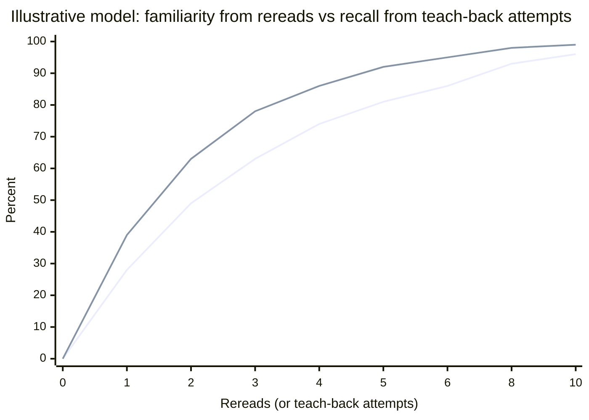
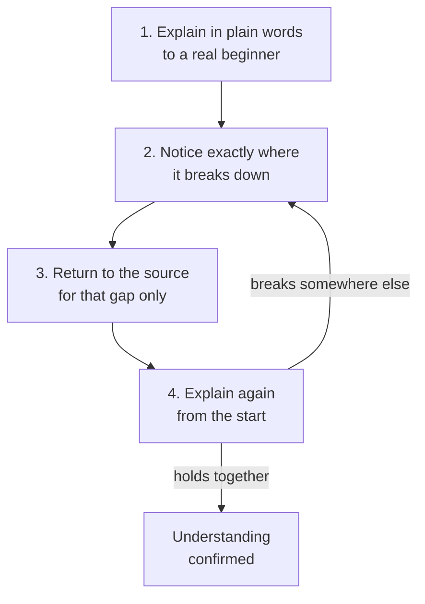

import LevelIntro from "../../../components/LevelIntro.astro";
import Checkpoint from "../../../components/Checkpoint.astro";
import PracticeCheck from "../../../components/PracticeCheck.astro";

export const unit = {
  track: "learning-craft",
  unitSlug: "feynman-technique",
};

L1 showed Sam passing the "looks right" check and failing the "say it" check.
L2 explains why the two diverge, lays out the loop precisely enough to run it,
and shows what a gap looks like from the inside.

<LevelIntro
  items={[
    "Why rereading builds familiarity",
    "The loop and the exact-gap rule",
    "Plain language and signs of a gap",
  ]}
/>

## Why does rereading feel like progress when it is not?

**Sam could reread the rulebook a fifth time and feel even surer. Is that
evidence of anything?** Only of familiarity. The unit's interactive demo uses
an illustrative model, not measured data, to make the gap visible: felt
familiarity climbs with rereads, while recall only moves when teach-back is
attempted.

| Rereads (no teach-back) | Felt familiarity | Recall |
| ----------------------- | ---------------- | ------ |
| 0                       | 0%               | 0%     |
| 3                       | 63%              | 0%     |
| 6                       | 86%              | 0%     |
| 10                      | 96%              | 0%     |

The first line is familiarity from rereads, the second is recall from
teach-back attempts. Both are the demo's formulas, not data from real learners.
The point is the shape: the same count of rereads without any attempt leaves
recall at zero.

<Checkpoint question="Someone says: 'I read the chapter twice and it feels completely clear now.' Is that a reliable sign they could explain it with the book shut?">

No. Feeling clear after rereading is evidence of familiarity, not of recall.
Rereading trains the ability to recognize the chapter's own sentences as
correct, which is a much lower bar than generating the explanation yourself.
The only way to find out is to try producing it without the source, which is
the test rereading never applies.

</Checkpoint>

## What exactly does the loop ask you to do, and why only the gap?

**When the explanation stalls, why not just reread the whole rulebook?**
Because rereading everything re-triggers the familiarity effect across material
that was never the problem. Sending yourself only to the broken point makes the
second attempt a real test of whether that one gap got filled.

Step 4 starts from the top, not from the repaired spot, because a fixed gap can
expose a different one downstream.

<PracticeCheck
  track={unit.track}
  unitSlug={unit.unitSlug}
  topicId="feynman-loop"
/>

## Why plain words, and how does a gap show itself?

**Would explaining with the source's own technical terms work just as well?**
No. An unexplained term can stand in for understanding that is not there. If
Sam says "then you resolve the trade phase," the word "resolve" may be hiding
that Sam does not know what actually happens. A listener who does not know the
jargon forces the real steps out.

A gap shows up at a locatable moment, not as a vague feeling of difficulty:

| Signal in your own explanation                           | What it usually means                     |
| -------------------------------------------------------- | ----------------------------------------- |
| "Somehow", "basically", "sort of", "that's how it works" | A mechanism should be here and is not     |
| The same claim said twice in different words             | You are restating, not explaining         |
| A term you cannot define without using the term          | Borrowed vocabulary is covering for a gap |

<Checkpoint question="Sam revises 'you get points for winning a round' to 'you earn points when you win, because winning rounds scores points.' Has the gap been filled?">

No. The second sentence restates the first with a "because" attached, so it
sounds like a reason but contains none. A real fill would say what counts as
winning, how many points, and who awards them. The signal is the same as
before: the explanation loops back to its own claim instead of moving forward.

</Checkpoint>

<PracticeCheck
  track={unit.track}
  unitSlug={unit.unitSlug}
  topicId="plain-language"
/>

This reaches past board games. Any time fluency with material could be mistaken
for understanding, from your own notes to a meeting explanation you nodded
along to, generating it is a harder and more honest test than recognizing it.
When the second pass fails because you do not know what to look up, the next
step is the habit covered in
[search literacy](/learning-craft/search-literacy/): search for the exact gap,
not the whole topic.
