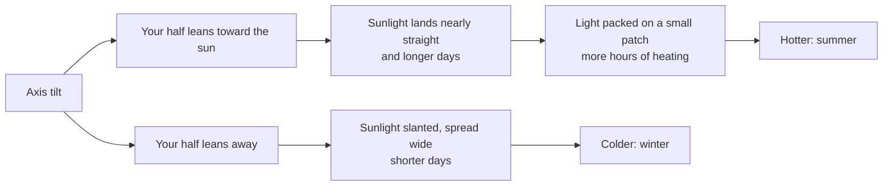

import Scenario from "../../../components/Scenario.astro";
import LevelIntro from "../../../components/LevelIntro.astro";
import Checkpoint from "../../../components/Checkpoint.astro";
import PracticeCheck from "../../../components/PracticeCheck.astro";

export const unit = {
  track: "learning-craft",
  unitSlug: "feynman-technique",
};

<Scenario label="The scenario">
  <Fragment slot="facts">
    

      
❓ Question: why is it hotter in summer than in winter?

      
🧒 Audience: a curious 10-year-old, no jargon

      
1️⃣ Attempt 1: sounds fluent, then stalls

      
2️⃣ Attempt 2: after filling one named gap

      
⚠️ Trap: a smooth answer that is simply wrong

    

  </Fragment>

A child asks, "Why is it hot in summer and cold in winter?" Most adults have
an answer ready, and it comes out smoothly. This page runs the loop on that
question twice, and then on a third explanation that never stalls at all.

**Before reading on: the first answer most people give is "in summer we are
closer to the sun." Say it out loud. Does it hold up when the child asks
"then why is it winter in Australia at the same time?"**

</Scenario>

<LevelIntro
  items={[
    "Two attempts and the gap between them",
    "Mechanism versus restated claim",
    "When a smooth explanation is still wrong",
  ]}
/>

## What does a stalled first attempt look like?

**Where exactly does the explanation break?** Read the attempt and find the
word that is carrying the weight.

> "It is hotter in summer because the sun hits us more directly. The light is
> stronger when it is more straight on, somehow, so things heat up more. In
> winter it is more slanted, so it is weaker."

The first sentence feels solid. The stall is "somehow": the explanation says
direct light is stronger but never says why a slant would make it weaker. Then
it restates the claim ("more slanted, so it is weaker") and stops. The gap is
one question: **why does a slanted beam heat the ground less than a straight
one, when the sun gives out the same light either way?**

<Checkpoint question="The attempt says 'the light is stronger when it is more straight on.' Why does this not yet count as a mechanism?">

It names the effect without the cause. A mechanism would say what changes
between a straight and a slanted beam, in the physical sense a child could
picture. Saying "stronger" repeats the conclusion, and "somehow" marks the
spot where the missing link should be. The fix is not a more confident
restatement but the step in between.

</Checkpoint>

<PracticeCheck
  track={unit.track}
  unitSlug={unit.unitSlug}
  topicId="mechanism-vs-restatement"
/>

## What fills that gap, and what does attempt 2 look like?

**Going back to the source for only that question, what turns up?** Two
connected facts. Earth's axis is tilted (about 23.5 degrees), so for part of
the year one half of the planet leans toward the sun. A beam hitting leaning-in
ground arrives nearly straight and lands on a small patch. A beam hitting
leaning-away ground arrives slanted and the same amount of light is spread over
a larger patch, so each bit of ground gets less. Days are also longer in the
leaning-in half, so the ground has more hours to heat.

> "The Earth is tilted, like a spinning top leaning over. In summer your half
> leans toward the sun. The sunlight lands nearly straight down, so it is
> packed onto a small patch of ground and heats it a lot. In winter your half
> leans away, so the same sunlight comes in at a slant and gets spread over a
> bigger patch, so each bit gets less. Summer days are also longer, so there
> are more hours of heating. That is also why it is winter in Australia when
> it is summer here: their half is leaning away."

Every step here answers the question the previous one raised, and the final
sentence survives the Australia challenge that sank "closer to the sun."

| Element               | Attempt 1                                    | Attempt 2                                                   |
| --------------------- | -------------------------------------------- | ----------------------------------------------------------- |
| Where it stalls       | "somehow" after the claim about direct light | It does not; each sentence leads to the next                |
| Role of the picture   | None                                         | "Packed on a small patch" versus "spread over a bigger one" |
| Handles the follow-up | No                                           | Yes: the same tilt explains the opposite hemisphere         |

<Checkpoint question="Attempt 2 also compares Earth to a leaning spinning top. Is that the same kind of filler as a vague analogy in attempt 1?">

No. The picture is used after the mechanism is named (tilt, packed versus
spread light), so it illustrates something already stated. An analogy that
arrives instead of a mechanism is a substitute for the explanation and should
be treated as a stall. The test is whether deleting the analogy would leave a
complete chain of cause and effect behind.

</Checkpoint>

## What if the explanation never stalls but is wrong?

**Attempt 3 comes from someone fluent and confident: "Earth's orbit is an
oval, so in summer we are nearer the sun and in winter farther away." There is
no "somehow" anywhere. Did the loop catch it?** No. The loop catches gaps that
show up as hesitation, and this explanation has a smooth, complete-looking
chain with a wrong first link. It is wrong in a checkable way: the Northern and
Southern Hemispheres have opposite seasons at the same moment, which one
distance cannot explain, and the nearest point of Earth's orbit falls in early
January, in the Northern winter.

| Failure                              | How it feels from inside       | What catches it                                           |
| ------------------------------------ | ------------------------------ | --------------------------------------------------------- |
| A gap (attempt 1)                    | Stalling, "somehow", restating | Teach-back itself                                         |
| A restated claim dressed as a reason | Smooth, but circular           | Asking "what does this say that the claim did not?"       |
| A fluent wrong mechanism (attempt 3) | Confident, no hesitation       | A check against a reliable source or a follow-up question |

So teach-back is a test for gaps, not a certificate of correctness. Run it, then
check the explanation against a source or a person who knows. That second check
is the subject of [source evaluation](/learning-craft/source-evaluation/).

<PracticeCheck
  track={unit.track}
  unitSlug={unit.unitSlug}
  topicId="fluency-vs-correctness"
/>

## Extend it: this is one case, not the whole territory

The seasons example had one gap and one clean fix. Try changing the facts:

- **What if the listener were an adult expert** instead of a child? Which
  sentences would they stop on, and would plain language still help?
- **What if the thing you must explain were a procedure**, such as the rules
  of a game, rather than a cause? What does "mechanism" mean there?
- **What if there were no source to go back to** and nobody to check you?
  Which of the four steps can you still do, and which become guesses?

None of these has one clean answer. The loop is a starting shape for testing
your own understanding, not a script that reproduces this page.
