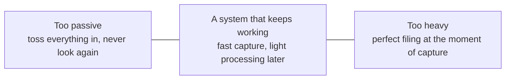
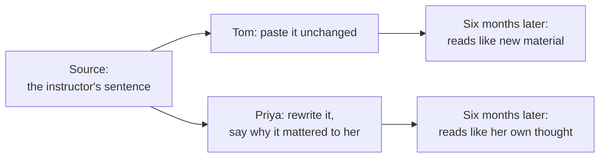

import Scenario from "../../../components/Scenario.astro";
import LevelIntro from "../../../components/LevelIntro.astro";
import PracticeCheck from "../../../components/PracticeCheck.astro";

export const unit = {
  track: "learning-craft",
  unitSlug: "notes",
};

<Scenario label="Tax day, two households, one year of receipts">
  <Fragment slot="facts">
    

      
👟 <strong>Shoebox</strong> — 120 receipts tossed in all year

      
🗄️ <strong>Cabinet</strong> — the same 120 receipts, 10 in each of 12 labelled folders

    

    

      

        
Shoebox: time to find one receipt<strong>25 min</strong>

        

          

        

      

      

        
Cabinet: time to find one receipt<strong>2 min</strong>

        

          

        

      

      
Assumed teaching numbers. 2 / 25 = 8% of the shoebox time.

    

  </Fragment>

Two neighbours keep every receipt from the same year. One tosses each receipt
into a shoebox the moment it arrives. The other spends about two minutes every
Sunday sliding that week's receipts into one of twelve labelled folders.

Tax day arrives and both need the receipt for a single purchase. The shoebox
owner digs through 120 slips, many of them faded, and finds it after an
assumed 25 minutes. The cabinet owner opens the "home repairs" folder, flips
past nine other slips, and has it in an assumed 2 minutes.

Both neighbours technically _kept_ everything. **So why did keeping a receipt
not guarantee being able to use it?**

</Scenario>

Learning something and keeping a note about it is the same situation. Saving is
cheap and easy. Getting something back out at the moment you need it is the part
that decides whether the note was worth writing.

<LevelIntro
  items={[
    "Why capturing alone is not enough",
    "Own-words notes versus copied notes",
    "Linking and resurfacing",
  ]}
/>

## What are the two ways a note system fails?

**If the shoebox is one failure, what is the opposite failure?** A cabinet so
elaborate that the owner stops filing at all.

| Failure                | What it looks like                                                     | Why it fails                                                |
| ---------------------- | ---------------------------------------------------------------------- | ----------------------------------------------------------- |
| Too passive            | The shoebox: everything saved, nothing processed or findable           | Saved material you cannot retrieve has no value             |
| Too heavy              | A cabinet with colour codes and cross-references filled in on the spot | The friction is so high that you quietly stop capturing     |
| A system that survives | Quick capture now, short filing pass later                             | Capture stays easy, and the material still becomes findable |

- **Capture** is the first, fast step: getting an idea out of your head before
  it is gone. A phrase is enough.
- Working systems sit between the two failures. They favour quick, low-friction
  capture over perfect filing in the moment.

<PracticeCheck
  track={unit.track}
  unitSlug={unit.unitSlug}
  topicId="capture-vs-organize"
/>

## What turns a saved note into a usable one?

**Tom copies 45 pages of slides into a document. Priya writes six short notes.
Six months later, which pile is more useful, and what did Priya do that Tom
skipped?** She rewrote each idea in her own words and said why it mattered to
her.

- **Processing** means rereading a raw capture and rewriting it in your own
  words, stating why it mattered to you.
- A copy of the source is a photocopy. Reading it later is close to reading the
  source for the first time.
- A rewritten note is often narrower than the original and still more useful,
  because it is already shaped around something you care about.

<PracticeCheck
  track={unit.track}
  unitSlug={unit.unitSlug}
  topicId="own-words-processing"
/>

Capture gets an idea into the system. Processing makes it yours. L2 adds the
two steps that make it findable: **linking** it to related notes, and
**resurfacing** it at a useful moment. L3 follows one note through the whole
loop, six months out.
