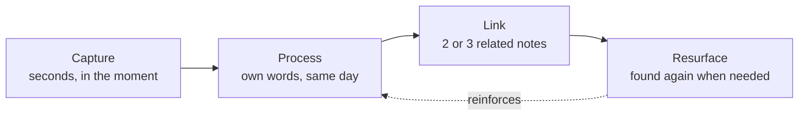
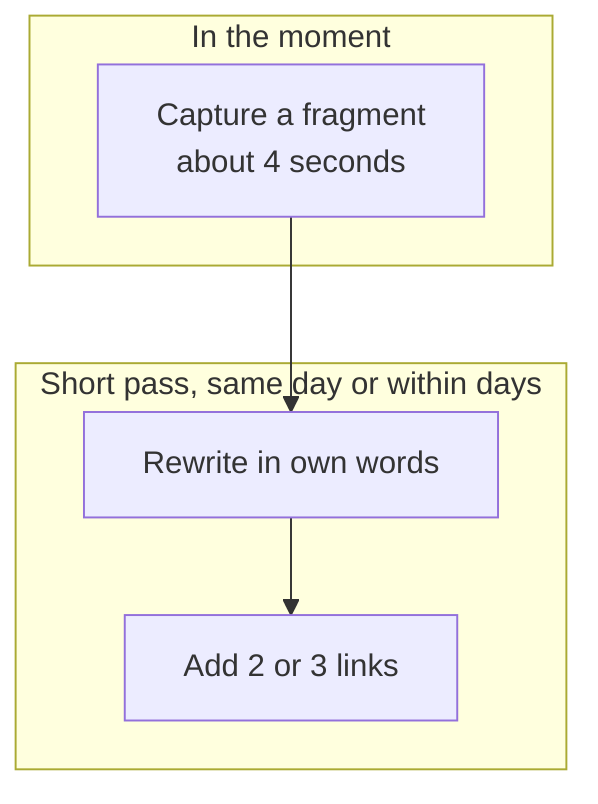
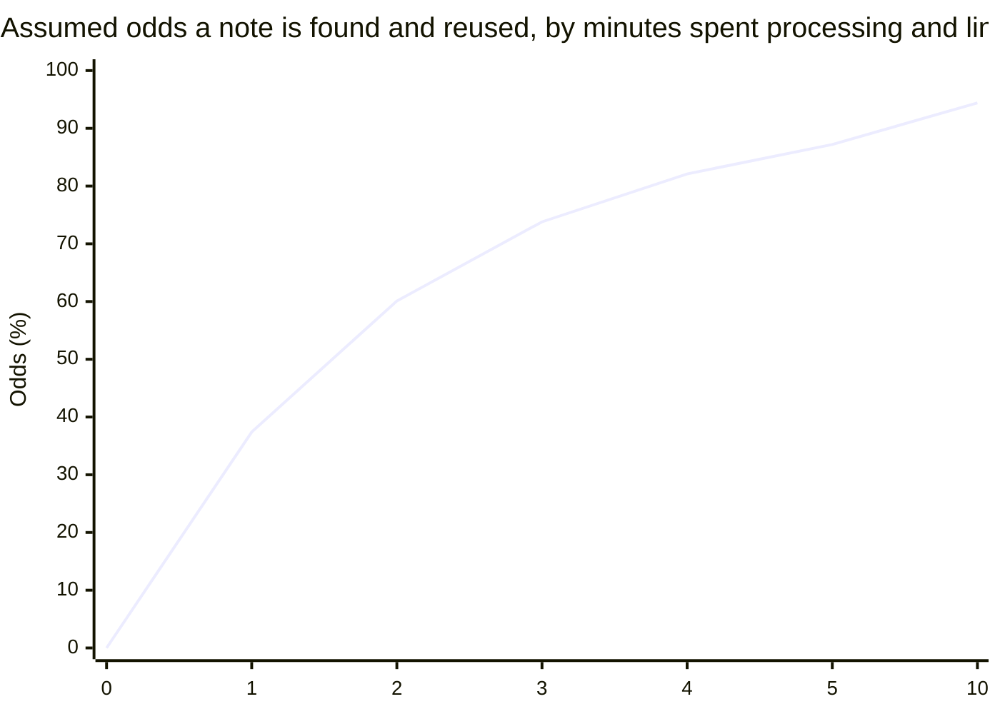

import LevelIntro from "../../../components/LevelIntro.astro";
import Checkpoint from "../../../components/Checkpoint.astro";
import PracticeCheck from "../../../components/PracticeCheck.astro";

export const unit = {
  track: "learning-craft",
  unitSlug: "notes",
};

L1 showed that saving a note is not the same as being able to use it, and that
rewriting an idea in your own words is what makes it yours. L2 adds the
steps that make a note findable, and the rule for keeping the whole habit cheap
enough to survive.

<LevelIntro
  items={[
    "Links as paths back to a note",
    "The capture, process, link, resurface loop",
    "Why the steps are separated in time",
  ]}
/>

## Why does a note need links to other notes?

**Imagine a library where every book is shelved in the order it arrived. You
remember reading a book about negotiating but not its title. How do you find
it?** You walk the whole shelf. A note with no links is that book.

- A **link** connects a note to other notes on related ideas.
- An unlinked note can only be found by remembering it exists and guessing the
  right keyword. A linked note can be found by following a trail from something
  you were already looking at, which is usually how a real need turns up.
- **Resurfacing** is meeting an old note again at a useful moment: through a
  link, a periodic reread, or a search when a new problem reminds you of it.
- A "second brain" is a note collection that helps you think because its
  notes lead to each other, not just a pile that stores what you once read.

| Same idea, two notes | Copied, unlinked note                      | Own-words, linked note                                  |
| -------------------- | ------------------------------------------ | ------------------------------------------------------- |
| What is written      | The definition, pasted from the slide      | The idea restated, tied to a real mistake of the writer |
| Ways back to it      | Search the exact word and sift the results | Follow a link from either of two related notes          |
| Speed of reuse       | Slow: reconstruct why it mattered          | Fast: the note already says why it mattered             |

<Checkpoint question="Two people each own a note on the same idea. One person has linked theirs to three other notes, the other has linked nothing. Which note is more likely to be found by someone who has forgotten the idea exists, and why?">

The linked one. Someone who has forgotten the idea exists cannot search for it
by name. They can, however, land on one of the three neighbouring notes while
doing something else, and the link carries them across. The unlinked note
depends entirely on the reader remembering a word that they have, by
assumption, forgotten.

</Checkpoint>

<PracticeCheck
  track={unit.track}
  unitSlug={unit.unitSlug}
  topicId="linking-resurfacing"
/>

## What are the steps, and in what order?

**If a note must be captured, rewritten, linked and found again, which of those
four steps has to happen in the moment, and which can wait?** Only capture has
to happen in the moment.

- **Capture** happens mid-talk, mid-article or mid-conversation. It must be so
  fast that you never skip it.
- **Process** and **link** happen in one short pass, later: the same day or
  within a few days.
- **Resurface** is the payoff. A formal weekly review is one way to get it, not
  the only way. Following a link counts as well.

### Why not file everything perfectly at the moment of capture?

Because perfect filing in the moment is exactly what kills capture. Every field
to fill in is friction at the moment friction is least tolerable: mid-talk, on
a commute, in a meeting. The fix is to **separate the steps in time**.

A small backlog of unprocessed captures is fine for a few days. A backlog that
grows forever is not, because an unprocessed capture is worth the same as no
capture at all.

The processing pass does not need to be long. The unit's demo models the odds
that a note is found and reused later as rising steeply over the first few
minutes and then flattening (an assumed model, not a measurement): about 74%
at 3 minutes, and only about 94% at 10.

<Checkpoint question="A friend says their system is better because every note gets a folder, three tags and a cross-reference table filled in at capture time. Is heavier structure automatically better?">

Not automatically. Structure at capture time is friction paid at the worst
moment. If the friend is still capturing six months later, the extra structure
is earning its cost. If they have quietly stopped adding notes because it feels
like a chore, their system is worse by the only measure that matters: whether it
keeps getting used. The choice is a point on a trade-off between capture ease
and findability, not a ranking of tidy against messy.

</Checkpoint>

<PracticeCheck
  track={unit.track}
  unitSlug={unit.unitSlug}
  topicId="loop-and-timing"
/>

L3 runs one note through all four steps end to end, then asks what changes for
notes that expire quickly and for days when the processing pass has to wait.
