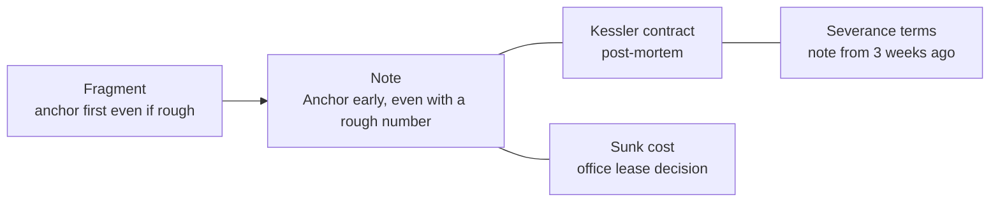
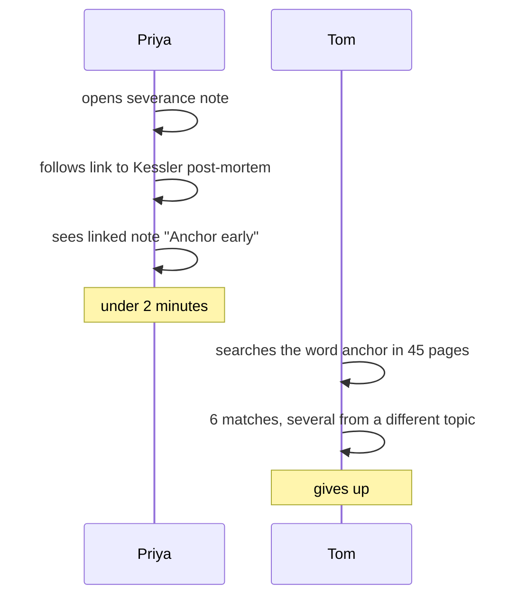

import Scenario from "../../../components/Scenario.astro";
import LevelIntro from "../../../components/LevelIntro.astro";
import Checkpoint from "../../../components/Checkpoint.astro";
import PracticeCheck from "../../../components/PracticeCheck.astro";

export const unit = {
  track: "learning-craft",
  unitSlug: "notes",
};

<Scenario label="The same course, six months on">
  <Fragment slot="facts">
    

      
📄 <strong>Tom</strong> — 45 pages pasted from slides, 6 keyword matches, none answers the question

      
🗒️ <strong>Priya</strong> — 6 own-words notes, each linked to 1 or 2 older notes, found in under 2 minutes

      
⏱️ <strong>Extra effort on Priya's side</strong> — a 4-second capture plus about 3 minutes of processing and linking

    

  </Fragment>

Tom and Priya take the same 90-minute course on negotiation. Tom pastes every
slide into one 45-page document and never reopens it. Priya writes six short
notes in her own words, each linked to related notes she already owns.

Six months later each needs one idea from the course for a real negotiation.
Priya has it in under two minutes. Tom searches his document, gets six matches
and gives up. **What exactly did Priya do, step by step, that Tom did not, and
how little extra effort was it?**

</Scenario>

L2 gave the loop. This level runs one real note through every step, then asks
what changes when the information expires quickly or the day has no spare
minutes.

<LevelIntro
  items={[
    "One note taken through all four steps",
    "The resurfacing trail against a raw dump",
    "When to skip or defer the processing pass",
  ]}
/>

## What does the raw capture look like?

The instructor says that the first number named in a negotiation anchors the
whole conversation, because every later number is judged against it. Priya is
listening, not transcribing. In about four seconds she types:

> anchor first even if rough - Kessler??

That is the whole capture. It is not a sentence, and "Kessler" means nothing to
anyone but her. It took four seconds because that is all the moment allows.
Tom pastes the full slide text in the same four seconds, but he is now behind
on the next slide, and the slide after that.

## How does the fragment become a note?

That evening Priya spends about three minutes on one short pass. She reads the
fragment and remembers what it meant: a real deal four months earlier where she
waited for the vendor to name a price, and the vendor's opening number framed
everything after it. She rewrites the fragment:

> **Anchor early, even with a rough number.** I waited for "more info" before
> naming a price on the Kessler deal and let the vendor anchor instead. The
> lesson is not "have the perfect number ready", it is "do not let waiting for
> certainty be the reason you go second."

The note is **narrower** than the instructor's sentence. It drops the
"studies show" framing entirely. What it gains is a handle: reading it in six
months takes her straight back to a specific call.

She then adds two links, which takes about thirty seconds:

1. To her older note "Kessler contract, post-mortem", written from a different
   angle.
2. To an older note "Sunk cost, the office lease decision". The connection is
   thin (both are about waiting for certainty having a cost), but a thin link
   costs almost nothing.

<Checkpoint question="The link to the sunk-cost note is thin. Was it a mistake to add it?">

No. A thin link costs about ten seconds, and its downside if it turns out
useless is that it sits there unused. Missing a plausible link costs more,
because by the time it would help, the writer will have forgotten that two ideas
ever seemed related. The bar for a link should be low. What breaks the scheme is
linking every note to everything: a note with forty links is not better
connected, it is unsearchable under a different name.

</Checkpoint>

## What happens six months later?

Priya is preparing for her own salary conversation and opens her notes to look
up severance terms. That note links to the Kessler post-mortem, which she opens
out of curiosity. The post-mortem lists its linked notes, and "Anchor early" is
among them. The whole trip takes under two minutes. She never searched for
"anchoring" and never remembered the course. She followed links through a note
she _did_ remember.

Tom remembers the course covered anchoring, searches his document, and gets six
matches across slides, several from an unrelated section on anchoring bias in
psychology. He reads two, finds nothing clear, and goes in without the idea.

**Same course, same fact. A four-second capture and about three minutes of
processing were the entire gap between using the idea and never seeing it
again.**

## Is there a right amount of processing?

The unit's demo models the odds a note is found and reused as a function of the
minutes spent processing and linking it. It is an assumed curve, not a
measurement: odds rise from 0% at zero minutes, to about 74% at 3 minutes, and
only to about 94% at 10. The first few minutes carry most of the gain, which is
why a short pass beats a long one.

| Minutes spent | Assumed odds of finding and reusing it |
| ------------- | -------------------------------------- |
| 0             | 0%                                     |
| 1             | 37.4%                                  |
| 3             | 73.8%                                  |
| 5             | 87.2%                                  |
| 10            | 94.4%                                  |

## What changes for notes that will expire?

A note saying "the deploy window next Tuesday moved to 3pm" is true for a week
and irrelevant forever after. Three minutes of processing and linking it is the
over-organising failure from L1 applied selectively. The rule that scales:
**process and link what you expect to still care about in six months, and
capture-and-forget what you do not.** Logistics and one-off facts earn no
processing pass. Ideas that will apply again in a new setting, like "anchor
early", earn the extra minutes.

## What changes when there is no time?

Some evenings have no three spare minutes. The rule is not "skip processing"
and not "process anyway and be late". **Capture stays non-negotiable, because it
costs seconds, and the processing pass may be deferred as long as the fragment
carries enough context to survive the wait.**

| Fragment                               | Survives a one-week delay? | Why                                                  |
| -------------------------------------- | -------------------------- | ---------------------------------------------------- |
| anchor first even if rough - Kessler?? | Yes                        | "Kessler" is a specific cue only Priya needs to read |
| good point about pricing               | No                         | Which point, from which talk, about which pricing?   |

Time pressure does not mean doing less work overall. It means spending a few
extra seconds **at capture time** so that processing can safely wait.

<Checkpoint question="Priya's rule says a fragment must carry enough context to survive deferral. What is the cheapest thing she can add to 'good point about pricing' at capture time so that it survives a week?">

A specific cue that only she needs to understand: a name, a place or a phrase
that points back to the exact moment. Two or three extra words, such as the
speaker's name and the topic, cost another second or two. Without them the
fragment is a pointer to nothing, and the processing pass has nothing to
reconstruct from.

</Checkpoint>

<PracticeCheck
  track={unit.track}
  unitSlug={unit.unitSlug}
  topicId="triage-and-pressure"
/>

## This is one case, not the whole territory

Priya's example is a scheduled course with a clear source, a calm evening, and
a note she expects to matter. Many real sources are messier. **What would the
triage rule need to look like if she were capturing from a fast, unstructured
source such as a busy group chat where useful ideas and chatter are mixed? Is
"capture stays non-negotiable" still the right default when ten times as much
raw material arrives and most of it is not worth even a specific fragment?**
Try rewriting the rule for that case, and then for a case where the source is
a single dense book read over weeks.
