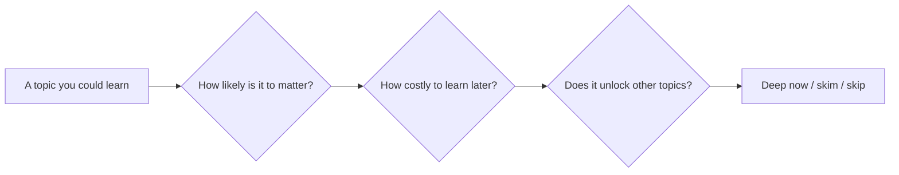

import Scenario from "../../../components/Scenario.astro";
import LevelIntro from "../../../components/LevelIntro.astro";
import PracticeCheck from "../../../components/PracticeCheck.astro";

export const unit = {
  track: "learning-craft",
  unitSlug: "prioritization",
};

<Scenario label="Same 20 hours, two very different first months">
  <Fragment slot="facts">
    

      
⏱️ <strong>Both</strong>: 20 hours, the same 6 topics

      

        
📊 Marco: 3.3h on each of 6 topics33% focused

        

      

      

        
🎯 Sofia: 15h on 2 topics, 5h on 475% focused

        

      

      
Bars show each person's share of hours on the two make-or-break topics (Marco 2 x 3.3 = 6.7 of 20, about 33%; Sofia 15 of 20).

    

  </Fragment>

Marco and Sofia are each moving to a new country for work, and each gives
themselves 20 hours to prepare. Both list the same six things they could
study: local language basics, tipping and dining customs, visa and residency
paperwork, opening a bank account, the public transit system, and local slang.

Marco splits his 20 hours evenly, about 3.3 hours per topic. Sofia puts 15
hours into two topics (visa paperwork and the bank account) and shares the
other 5 hours across the remaining four.

**Same hours, same list. Whose 20 hours paid off once they landed?**

Sofia's. Her visa and bank account both went through cleanly. Marco's visa
paperwork was rejected over a formatting detail, and he had no bank account for
three weeks because he had not brought the right documents. The tipping customs
he knew cold barely came up, and Sofia learned them free from a coworker on day
two. The difference was never how much they studied, only whether they decided
in advance which hours mattered.

</Scenario>

<LevelIntro
  items={[
    "Depth costs hours you can't spend twice",
    "Just-in-time vs. just-in-case learning",
    "A three-factor triage heuristic",
  ]}
/>

## Why can't Marco's even split be the safe choice?

**If nothing on the list is ignored, what exactly did Marco lose?** He lost the
hours that his two make-or-break topics needed, because an even split gives
slang exactly as much as visa paperwork.

Depth is a fixed budget. Every hour spent going deep on one topic is gone for
every other topic, so "learn a bit of everything" is a decision too: it decides
that all topics matter equally.

| Topic                      | Marco's hours | Sofia's hours |
| -------------------------- | ------------: | ------------: |
| Visa and residency papers  |           3.3 |           7.5 |
| Opening a bank account     |           3.3 |           7.5 |
| Local language basics      |           3.3 |          1.25 |
| Public transit system      |           3.3 |          1.25 |
| Tipping and dining customs |           3.3 |          1.25 |
| Local slang                |           3.3 |          1.25 |

Both columns add to 20. Only one of them was chosen with the consequences in
mind.

<PracticeCheck
  track={unit.track}
  unitSlug={unit.unitSlug}
  topicId="cost-of-depth"
/>

## What are the two ways to spend learning time early?

**Should you study something now because it might matter, or wait until it
does?** Those are the two strategies, and they are not equally good for every
topic.

- **Just-in-time learning.** Stay shallow now and learn properly when the real
  need arrives. It works when the topic is quick to pick up at that moment.
- **Just-in-case learning.** Learn it now because it might matter later. It is
  usually wasted, because most "might need this" material never gets used, but
  it pays off when the material is foundational.
- **Cost to learn later.** How expensive it would be, in time, difficulty or a
  missed deadline, to pick the topic up only when you need it. This number
  decides whether just-in-time is safe.
- **Foundational-ness.** Whether the topic makes many other things easier to
  learn afterwards.
- **Triage heuristic.** Weigh likelihood to matter, cost to learn later and
  foundational-ness, then choose deep study now, a skim, or nothing.

<PracticeCheck
  track={unit.track}
  unitSlug={unit.unitSlug}
  topicId="timing-strategies"
/>

L2 builds the model behind Sofia's split: the two questions she asked of each
topic, and the third factor that can override both.
