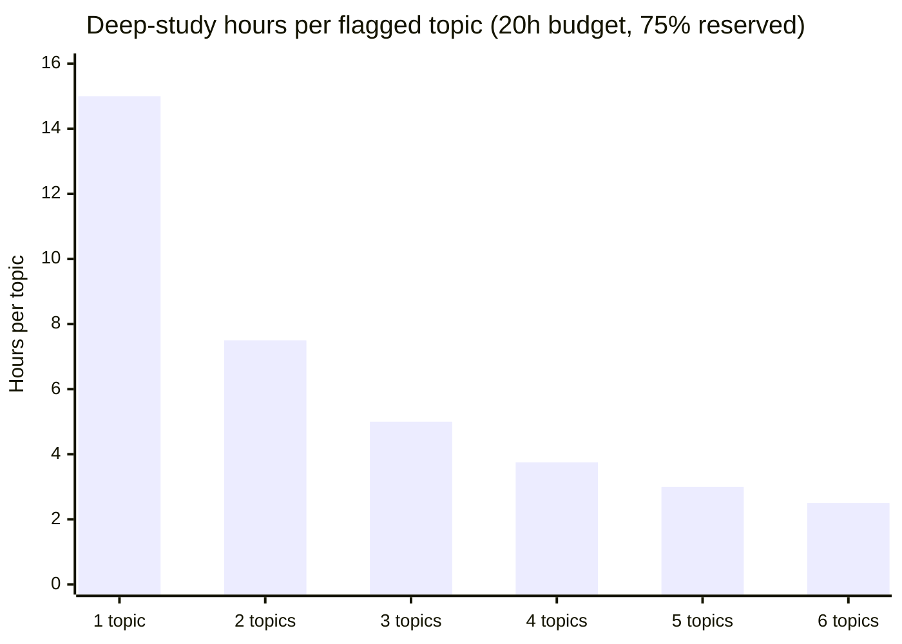
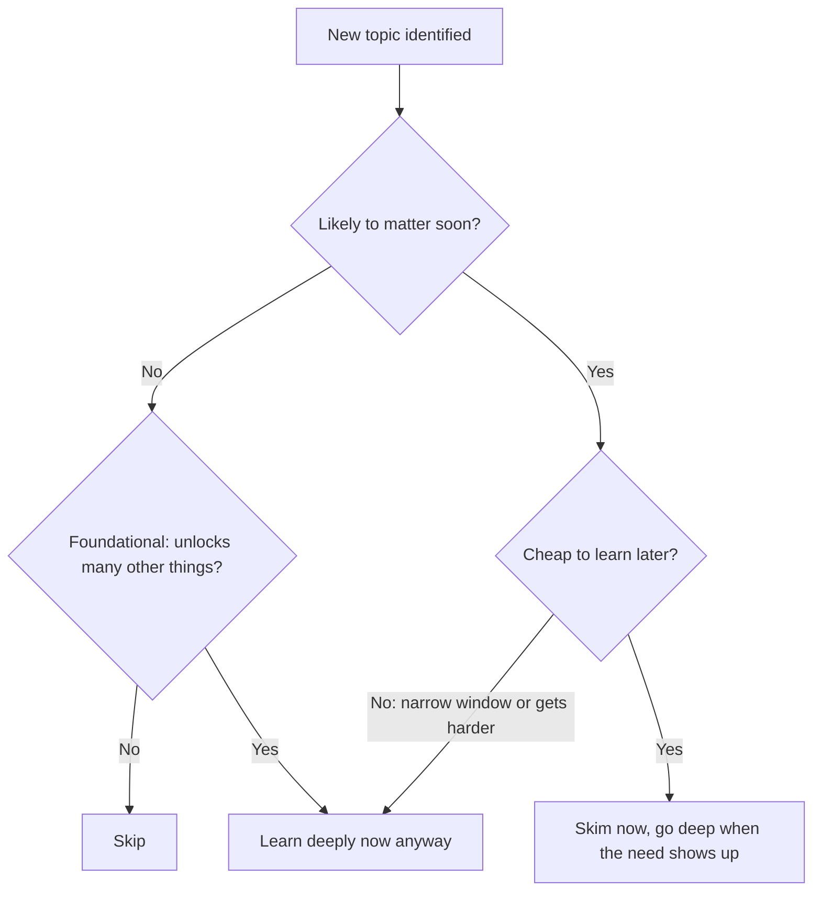

import LevelIntro from "../../../components/LevelIntro.astro";
import Checkpoint from "../../../components/Checkpoint.astro";
import PracticeCheck from "../../../components/PracticeCheck.astro";

export const unit = {
  track: "learning-craft",
  unitSlug: "prioritization",
};

L1 showed that Sofia's 15 hours on two topics beat Marco's even split with the
same 20 hours. Here is the model behind that split: the two questions she asked
about each topic, and a third factor that can override both.

<LevelIntro
  items={[
    "The two-axis test and its four zones",
    "Where hours go as priorities multiply",
    "When foundational-ness overrides the test",
  ]}
/>

## What actually decides whether a topic deserves depth?

**Of everything that could conceivably matter, which topics earn hours?** Ask
two questions of each one.

1. **How likely is this to matter in practice?** Almost anything could come up.
   The question is how probable it is given the situation you are really in.
2. **How costly would it be to learn later?** Some things take a five-minute
   lookup at the moment of need. Others have a narrow window, such as a filing
   deadline, or get harder to learn once you have started without them.

Crossing the two gives four zones:

|                        | **Cheap to learn later**                    | **Costly to learn later**                      |
| ---------------------- | ------------------------------------------- | ---------------------------------------------- |
| **Likely to matter**   | Just-in-time: skim now, go deep when needed | **Deep now**: the best use of study hours      |
| **Unlikely to matter** | Skip: not even a skim                       | A cheap skim as insurance, unless foundational |

Sofia's visa paperwork and bank account sit in the top-right cell: she needed
both within days, and a missed deadline or a missing document from home is hard
to repair afterwards. Tipping customs and slang sit on the left, where a coworker
or daily life teaches them at almost no cost.

<Checkpoint question="A topic is unlikely to matter but would be genuinely hard to learn later if you were wrong, with a narrow window and real consequences. Which cell is it, and is a plain skim enough?">

It is the bottom-right cell. A skim is a reasonable default there, but this is
the one cell where you should double-check the "unlikely to matter" judgment
before settling, because being wrong is expensive. It is also the cell where a
topic's foundational-ness can tip the decision towards deep study anyway.

</Checkpoint>

<PracticeCheck
  track={unit.track}
  unitSlug={unit.unitSlug}
  topicId="two-axis-test"
/>

## What happens to each topic's share as the priority list grows?

**If Sofia flags more topics as "deep now", does each one still get real depth?**
No, because the budget is shared. Suppose she keeps the 75 percent rule from L1
(15 of her 20 hours reserved for the flagged topics). The hours per flagged
topic are then 20 x 0.75 divided by the number of topics:

At two flagged topics each gets 7.5 hours, which is Sofia's real split. At six
the "deep" bucket gives 2.5 hours each, which is barely better than Marco's
even split. Flagging everything as important is the same mistake as flagging
nothing. The demo for this unit lets you drag both the budget and the number of
flagged topics.

<PracticeCheck
  track={unit.track}
  unitSlug={unit.unitSlug}
  topicId="shared-budget"
/>

## When does "it might be useful" actually earn deep study?

**Marco hedged on everything. Is "just in case" ever the right reason to go
deep?** Rarely, but yes: when the topic is foundational.

Most "might matter" material never gets used, and the hours it took were hours a
likely topic did not get. Foundational topics are the exception. A topic that
speeds up many other things later is worth something even when it never matters
on its own, so foundational-ness can move a topic out of "skip" or "skim".

Sofia's language basics were arguably foundational: even rough grammar speeds up
reading signs, bank forms and a lease. She still gave them only 1.25 hours,
because finishing her visa and bank preparation mattered more. That is a
judgment call, not a formula.

<Checkpoint question="Someone says touch-typing is foundational for almost any desk skill, so it always deserves deep practice time. Is foundational enough on its own?">

No. Foundational-ness raises a topic's priority, but it still competes with
everything else for the same hours. A person three days from an urgent,
likely-to-matter deadline does not owe touch-typing deep practice first. It just
becomes a better candidate for the slack time that comes later than a topic
with no foundational value at all.

</Checkpoint>

<PracticeCheck
  track={unit.track}
  unitSlug={unit.unitSlug}
  topicId="foundational-override"
/>

L3 runs the full triage on nine topics, including one bet that fails because
an input was wrong, and shows how to re-score once new facts arrive.
