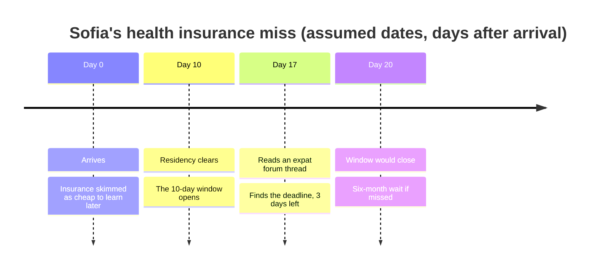

import Scenario from "../../../components/Scenario.astro";
import LevelIntro from "../../../components/LevelIntro.astro";
import Checkpoint from "../../../components/Checkpoint.astro";
import PracticeCheck from "../../../components/PracticeCheck.astro";

export const unit = {
  track: "learning-craft",
  unitSlug: "prioritization",
};

<Scenario label="The one bet that didn't pay off">
  <Fragment slot="facts">
    

      
📋 9 candidate topics, 20 hours

      
✅ Visa and bank account: deep, went perfectly

      
⚠️ Health insurance: skimmed, scored as "cheap to learn later"

      
⏳ Assumed 10-day enrollment window, found out with 3 days left

    

  </Fragment>

Sofia ran the triage carefully on a full list of nine topics. Two bets paid off
exactly as scored. One did not: she skimmed health insurance enrollment,
assuming it would behave like tipping customs, something to ask a colleague
about once settled.

For this example, assume the destination's public health system opens a strict
10-day enrollment window on the day her residency clears. Miss it and she waits
six months for coverage.

**Was her method wrong, or something else?**

</Scenario>

<LevelIntro
  items={[
    "Scoring a full list of nine topics",
    "A good method fed a wrong input",
    "Re-triaging and shrinking budgets",
  ]}
/>

## How does the full list get scored?

**Why write down all nine before deciding anything?** Because deciding as items
occur to you anchors the first few with more attention than they deserve.

Sofia's list: visa and residency paperwork, bank account, language basics, public
transit, tipping and dining customs, slang, health insurance enrollment, local
tax filing rules, and getting a local phone SIM. For each she asks the same three
questions from L2, using what she knows on day one.

| Topic                      | Likely to matter soon?    | Costly to learn later?        | Foundational? | Decision as scored  |
| -------------------------- | ------------------------- | ----------------------------- | ------------- | ------------------- |
| Visa and residency papers  | High, needed within days  | High, a missed deadline hurts | No            | **Deep now**        |
| Opening a bank account     | High, needed within weeks | High, documents are from home | No            | **Deep now**        |
| Health insurance           | Medium                    | Scored low (actually high)    | No            | Skim (the mistake)  |
| Local language basics      | Medium                    | Medium                        | Yes           | Light study         |
| Local tax filing           | Low, not due for months   | Low, plenty of lead time      | No            | Skip                |
| Public transit             | High                      | Low, an app explains it       | No            | Just-in-time        |
| Local phone SIM            | High, needed day one      | Low, a short errand           | No            | Just-in-time        |
| Tipping and dining customs | Low to medium             | Low, a coworker mentions it   | No            | Skip, pick up later |
| Local slang                | Low                       | Low, immersion teaches it     | No            | Skip                |

Two topics are "deep now", three get just-in-time treatment, one gets light
study for its foundational value, and three are skipped or skimmed. The 20 hours
go where the consequences are.

<Checkpoint question="Why is the phone SIM, which is needed on day one, labelled just-in-time and not deep now?">

Because the second question, cost to learn later, is low. It is a short errand
that can be done the moment it is needed, so studying it in advance would spend
hours on something that costs almost nothing to learn at the point of use.
Likelihood to matter is only half of the test.

</Checkpoint>

## What happens when one input to a good method is wrong?

**Sofia scored every item with care. Why did health insurance still go wrong?**
Her "cost to learn later" answer came from an analogy, not from a check.

She reasoned that insurance would work like tipping customs: informal, no
deadline, sort it out within a month. The real rules had a deadline she could not
have guessed without looking. Under the assumed 10-day window:

She learned about the deadline by accident on day 17. With three days left she
skipped researching the system and went straight to her employer's HR contact,
who had walked other relocated employees through an expedited filing. It cost her an
afternoon of stress that a five-minute check on day one would have avoided.

<Checkpoint question="The process was careful and the outcome was bad. Does that show the triage method failed?">

No. The method asked the right question and got a wrong answer because one input
was based on a false assumption. A sound process run on bad information can
still produce a bad result, in the same way a well-reasoned bet can lose. What
the miss does teach is where to spend a few minutes: for any item with real
consequences, verify the cost-to-learn-later answer instead of estimating it by
analogy to a lower-stakes item.

</Checkpoint>

<PracticeCheck
  track={unit.track}
  unitSlug={unit.unitSlug}
  topicId="wrong-input"
/>

## How does the triage change when facts or time change?

**Is a triage decision final once made?** No. It rests on what was known at the
time, and it should update the moment better information arrives.

By the end of her first two weeks Sofia knows more. Transit needed almost no
study, which confirms its score. But her employer needs a tax form filed within
her first month, not months away as she assumed, so local tax filing moves from
"skip" to "deep now". The original call was reasonable given what she knew, and
the correction came from new input, not from a flaw in her reasoning. Updating
costs nothing; defending the old score does.

Time pressure changes the bar. With 20 hours she could afford two "deep now"
topics. Suppose she found out about the move with only 2 hours and 2 days:

| Budget   | Deep-now room         | What happens to the rest                    |
| -------- | --------------------- | ------------------------------------------- |
| 20 hours | Two topics            | Skims for a handful of topics               |
| 2 hours  | One topic, maybe part | Most skims dropped to "figure it out there" |

The same three questions apply, but the single topic that wins is the one with
the worst, least reversible consequence if wrong, which here is the visa
paperwork. Skim time also comes from the scarce budget, so a smaller budget
shrinks the skim tier, not just the deep tier.

<Checkpoint question="With only 2 hours, which topic would most plausibly get all the deep time, and why that one?">

The visa paperwork. A rejected filing has the most severe and least reversible
consequence on the list, so it scores highest on both likelihood and
cost-to-learn-later. When the budget cannot cover two deep topics, the one
whose failure is hardest to undo takes everything.

</Checkpoint>

<PracticeCheck
  track={unit.track}
  unitSlug={unit.unitSlug}
  topicId="re-triage"
/>

This is one worked case, not the whole territory. **Try extending it:** how
would the triage look for someone starting a new job instead of moving abroad?
The three questions stay the same but the list changes: key stakeholders, the
team's approval process, internal tools, unwritten norms. Which would you put in
"deep now", which in "just-in-time", and which is this scenario's version of the
health-insurance miss, something that looks safe to skim but has a narrow,
easy-to-miss window? And what would change if the news were worse, with half the
time to prepare?
