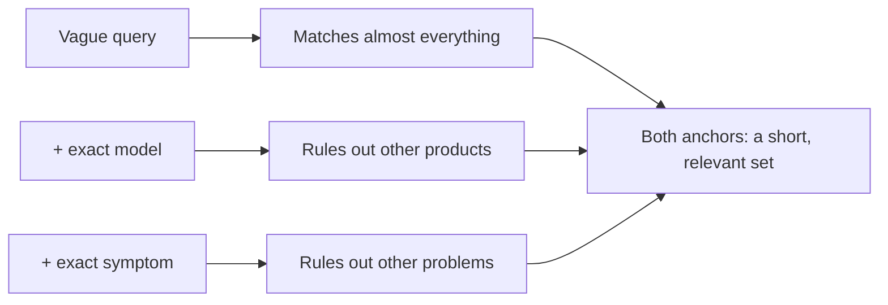
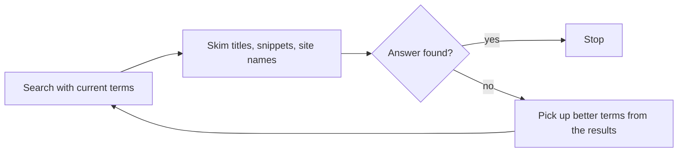

import LevelIntro from "../../../components/LevelIntro.astro";
import Checkpoint from "../../../components/Checkpoint.astro";
import PracticeCheck from "../../../components/PracticeCheck.astro";

export const unit = {
  track: "learning-craft",
  unitSlug: "search-literacy",
};

L1 showed that the librarian and Jordan's second search both worked because
the question pointed at something specific. L2 names the mechanism: why
specific terms narrow so fast, how to find better terms when you do not have
them, and when searching more is the wrong move.

<LevelIntro
  items={[
    "Why anchors compound",
    "The search, skim, refine loop",
    "When to go to the source itself",
  ]}
/>

## Why does a second anchor help more than a second vague word?

**Adding "problem" or "help" to a query changes almost nothing. Adding the
model number changes everything. What is the difference?** A source has to
match _every_ term to surface. A generic word is matched by nearly every
source, so it removes almost none. A specific word is matched by few, so it
removes most of what is left.

Assume, as a rough illustrative model and not a measurement, that each truly
specific term rules out about nine of every ten remaining results. Starting
from Jordan's 42,000:

| Anchors used | Results left | Arithmetic       |
| ------------ | ------------ | ---------------- |
| 0            | 42,000       | the starting set |
| 1            | 4,200        | 42,000 / 10      |
| 2            | 420          | 4,200 / 10       |
| 3            | 42           | 420 / 10         |

The drop is multiplicative, which is why two or three anchors turn an
unreadable pile into a short list. The unit's slider lets you drag this
yourself.

<Checkpoint question="A search for 'laptop battery draining fast' returns thousands of generic results. Which addition is the strongest anchor: 'help', 'laptop', or the exact laptop model plus its operating-system version?">

The model plus the operating-system version. "Help" is matched by nearly
every troubleshooting post, and "laptop" is already implied by the rest of the
query, so neither rules anything out. The model and version are what a source
must match to be about your machine at all. A battery thread about a different
laptop, or the same laptop on a different system, probably has a different
cause.

</Checkpoint>

## What if the first search did not answer the question?

**Was it wasted?** Not if you treat it as scouting. The loop has four steps:

1. Search with the best terms you have now.
2. Skim the results, not for the answer but for better terms: model or
   version numbers, exact error wording, and the vocabulary people closer to
   the source use.
3. Search again with those terms as anchors.
4. Repeat until the answer appears, or until it is clear the answer lives in
   one specific place.

Skimming does not mean opening everything. Read the title, the snippet, the
site name, and the date if shown, and notice words that repeat across several
relevant-looking results. If three results use a term you did not know, that
term may be the vocabulary your next query needs. Jordan's first search taught
two such words: the router's model number and "firmware", meaning the
router's built-in software.

<PracticeCheck
  track={unit.track}
  unitSlug={unit.unitSlug}
  topicId="refinement-loop"
/>

## When is more searching the wrong move?

**If the question is really "what does this specific product say or do", who
is the best person to ask?** The one who wrote it. For a tool, a device, or a
rule, the answer usually lives in exactly one place: the official
documentation, the changelog, the support page, the rule itself. Blog posts
summarizing it and forum threads guessing at it each add a layer where errors
can creep in.

"Official" is not magic. The page can be old, written for another country, or
about another version. The reason to go there first is that it removes one
layer of guessing; you still check that it matches your exact situation.

| Signal                                                      | Suggests                                  |
| ----------------------------------------------------------- | ----------------------------------------- |
| The question is about general experience with something     | Broad searching is fine                   |
| The question is what one specific tool or rule says         | Go to the official source                 |
| Results keep linking back to one page                       | That page is the source; read it directly |
| The same proper noun keeps surfacing (model, version, code) | Use it as the next query's anchor         |

<Checkpoint question="You search 'is the app down' and every result is a blog post or thread guessing from user reports. What does the table suggest, and why is it better than reading a fifth guessing post?">

Go to the source that would actually know, which is the service's own status
page if one exists. Each guessing post is a secondhand layer that can be wrong
or out of date in ways a status page, maintained by the people who see the
real system, cannot. When results all point at the same uncertainty instead of
adding information, more searching only re-reads that uncertainty in different
words.

</Checkpoint>

<PracticeCheck
  track={unit.track}
  unitSlug={unit.unitSlug}
  topicId="primary-source"
/>
