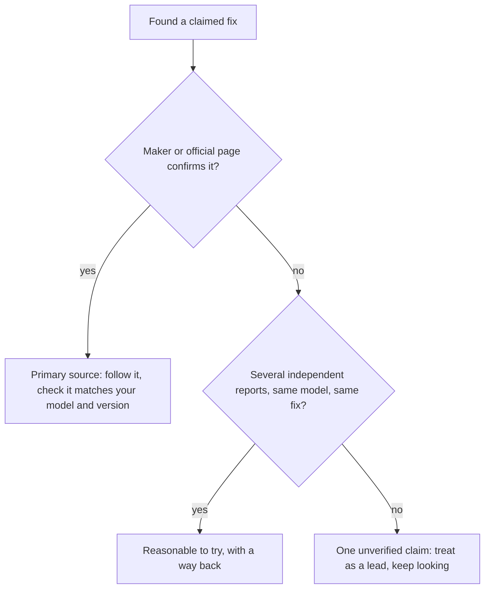

import Scenario from "../../../components/Scenario.astro";
import LevelIntro from "../../../components/LevelIntro.astro";
import Checkpoint from "../../../components/Checkpoint.astro";
import PracticeCheck from "../../../components/PracticeCheck.astro";

export const unit = {
  track: "learning-craft",
  unitSlug: "search-literacy",
};

<Scenario label="Jordan's full search session">
  <Fragment slot="facts">
    

      
📶 <strong>Symptom</strong>: Wi-Fi drops for a few seconds, several times a day

      
🏷️ <strong>Anchor in reach</strong>: the model number printed on the router

      
⏱️ <strong>Search 1</strong>: 20+ minutes, no answer

      
✅ <strong>Search 2</strong>: under 2 minutes, the maker's fix

    

  </Fragment>

Jordan has been through both searches already. Before reading how they went
in detail, one question. **Which anchor term did Jordan already have access to
before typing the very first query, and where was it the whole time?**

</Scenario>

<LevelIntro
  items={[
    "Both searches, step by step",
    "Judging sources when no maker page exists",
    "Searching without the field's vocabulary",
  ]}
/>

## What happened in search 1, and in search 2?

**Search 1**, the query "wifi keeps disconnecting", was skimmed for 20
minutes. What it returned:

- A forum thread blaming "interference", with no specifics.
- A troubleshooting page for a different router brand.
- Several posts saying "restart your router", with no diagnosis.
- One buried reply: "Same thing on my [router model], turned out to be a
  firmware bug."

The one useful line in twenty minutes was a reply naming the model and the
word "firmware". Both were also printed on the router itself.

**Search 2**, "[router model] intermittent disconnect firmware known issue",
put the manufacturer's support page in the top results, titled as a known
issue, with the fix linked. Two minutes.

| Question                  | Search 1                            | Search 2                           |
| ------------------------- | ----------------------------------- | ---------------------------------- |
| Anchors used              | None, only generic words            | Model, "firmware", and the symptom |
| Did the answer exist yet? | Yes, already published by the maker | Yes, the same page                 |
| What it contributed       | The two anchors search 2 needed     | The answer                         |

The support page existed before Jordan typed anything. Search 1 did not fail
at finding something that was missing; its generic words simply could not tell
that one page apart from tens of thousands of others.

<Checkpoint question="The support page existed before Jordan searched. Was search 1 pointless, or did it still do something useful?">

It did something useful, just not what it was aimed at. Its terms were too
generic to ever surface the support page directly. But it exposed the model and
"firmware", which are what search 2 needed to land on that page. Search 1's
value was scouting for search 2, not answering the question.

</Checkpoint>

## What if no maker page exists?

**Everything above assumes the page was out there waiting. What changes when
the product is discontinued, or the maker never wrote documentation?** The
problem stops being "where is the answer" and becomes "whom do I believe".

A **primary source** is the original place that can settle a claim; a
**secondary source** describes, summarizes, or guesses from outside. With no
primary source reachable, you are choosing between secondary ones. The deeper
check on that choice belongs to [source evaluation](/learning-craft/source-evaluation/).
The practical move here: look for the smallest number of _independent_ people
reporting the same symptom on the same model, with the same fix working.

<Checkpoint question="A discontinued kitchen appliance has no support page. One unverified forum user says a specific fix works. How should you treat that compared with Jordan's maker page?">

As one unverified secondary source, not as settled fact. The maker page could
confirm the bug and the fix, which is why finding it ended the search. A single
post has nothing behind it, so the sound move is to look for other independent
people reporting the same fix on the same model. One claim carries little
weight; several matching, independent ones carry more, because no maker page is
left to settle it.

</Checkpoint>

<PracticeCheck
  track={unit.track}
  unitSlug={unit.unitSlug}
  topicId="no-primary-source"
/>

## What if you do not know the field's words yet?

**Jordan at least knew the product. What if you do not even know the word for
the symptom?** Searching "internet keeps stopping for a second" is accurate
everyday language, and it returns vaguer results than "intermittent packet
loss", the phrase people who diagnose this use. In plain terms, "packet loss"
means small pieces of internet traffic fail to arrive, and "intermittent"
means the problem comes and goes.

The refinement loop from L2 simply starts one level earlier. The first
search's job is not to answer; it is to surface the field's own vocabulary,
which then becomes the anchor for the search that does.

<PracticeCheck
  track={unit.track}
  unitSlug={unit.unitSlug}
  topicId="unknown-vocabulary"
/>

## Failure modes

| Failure mode                                           | What it gets wrong                                        |
| ------------------------------------------------------ | --------------------------------------------------------- |
| Rephrasing the same vague query five ways              | Shuffles equally generic words and adds no anchors        |
| Scrolling deeper into a poor result set                | Spends time in a bad pile instead of using what it showed |
| Searching broadly when one authoritative source exists | Adds secondhand layers the source itself does not have    |
| Concluding the answer does not exist                   | Often it exists; the query was too vague to surface it    |
| Treating missing vocabulary as a dead end              | The first search can supply the field's own words         |

## This is one case, not the whole territory

Jordan's story is a single worked example. Try changing it. What if the router
were the one Jordan's landlord supplied, with no model number visible? What if
the support page turned out to describe a different firmware version than
Jordan's? What if the topic were a medicine, a legal form, or a school rule
instead of a router? Work out for each which anchors you would reach for,
whether a primary source exists, and what you would do if it did not.
