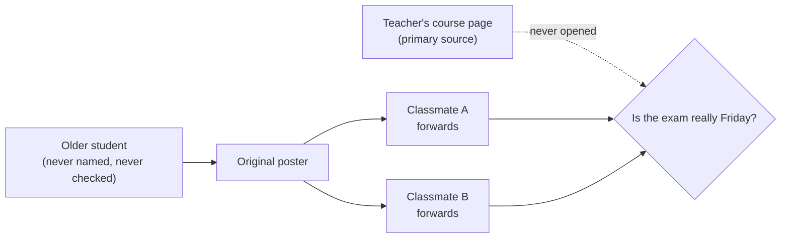

import Scenario from "../../../components/Scenario.astro";
import LevelIntro from "../../../components/LevelIntro.astro";
import PracticeCheck from "../../../components/PracticeCheck.astro";

export const unit = {
  track: "learning-craft",
  unitSlug: "source-evaluation",
};

<Scenario label="The problem">
  <Fragment slot="facts">
    
The claim

    
"The final is moved to Friday" — you have practice tonight and won't have time to study if that's true.

    
Who is repeating it

    

      
💬 Original poster: "my cousin's friend goes there, heard it from an older student"

      
🔁 Two classmates: both forwarded the same screenshot

    

    
One click away

    

      🏫 The teacher's official course page, never opened
    

  </Fragment>

A rumor lands in your class group chat: "I heard the final got moved to Friday!" Three people have now repeated it. You have practice tonight, and if the exam really is Friday, tonight is your only study time.

| What you know                                         | What you do not know                                         |
| ----------------------------------------------------- | ------------------------------------------------------------ |
| Three people in the chat say it is true               | Whether any of them checked, or all copied the first message |
| The teacher posts the real schedule on the class page | Whether the page has been updated                            |

**Before reading on: does "three people are saying it" make the rumor three times as likely to be true, or could all three be repeating one unchecked claim?**

</Scenario>

It could go either way. The only way to tell is to look at where each person got it, not at how many of them said it.

<LevelIntro
  items={[
    "Primary versus secondary sources",
    "Why repeated claims can be one claim",
    "Three questions before you trust a claim",
  ]}
/>

## What is the difference between the place a claim started and the places that repeat it?

**The teacher's posted schedule and a classmate's screenshot of it both "say" Monday. Are they the same kind of source?** No. One is the original, the other is a copy of it.

| Term             | Plain version                                             | School-life example                                        |
| ---------------- | --------------------------------------------------------- | ---------------------------------------------------------- |
| Primary source   | The original place that can settle the claim              | The teacher's posted schedule                              |
| Secondary source | Someone reporting, summarizing or repeating that original | A classmate forwarding a screenshot                        |
| Verification     | Comparing the claim with something you can check          | Opening the course page instead of trusting the group chat |
| Corroboration    | Real, independent support, not the same message copied    | Two teachers saying it separately beats two forwards       |

- Neither kind is better in general. A summary is often faster and good enough. They fail in different ways: a primary source can be hard to read, a secondary one can be wrong or out of date.
- Each layer between you and the original is a chance for a detail to be dropped or changed, and later layers tend to copy the earlier ones instead of going back to the original.

The rumor, drawn as a chain instead of a headcount:

Three voices, one origin, and the one place that could settle it sits unopened.

<PracticeCheck
  track={unit.track}
  unitSlug={unit.unitSlug}
  topicId="primary-vs-secondary"
/>

## What should you ask before you trust a specific claim?

**You cannot trace everything you read. So which claims deserve the effort?** Ask three questions, and let the answers decide how much more checking is worth doing.

| #   | Question                                                      | What it decides                                    |
| --- | ------------------------------------------------------------- | -------------------------------------------------- |
| 1   | Is this a primary or a secondary source?                      | How much interpretation has already happened to it |
| 2   | Can I trace it back to something I could check myself?        | Whether checking is even possible right now        |
| 3   | How fast does this kind of claim go stale, and how old is it? | Whether age is a red flag here                     |

Rule of thumb: if being wrong costs little and is easy to undo, a quick look is enough. If being wrong changes an important decision, costs money, affects health or is hard to undo, spend more effort tracing the claim.

The next two levels show why headcounts mislead (L2) and what the full trace looks like on a real claim (L3).
