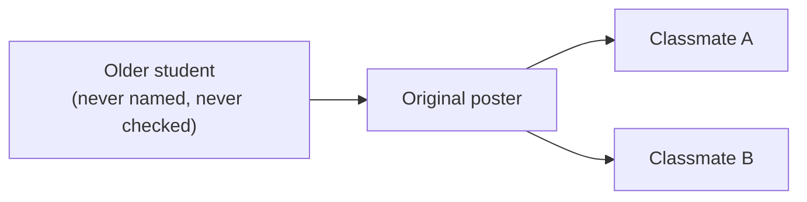
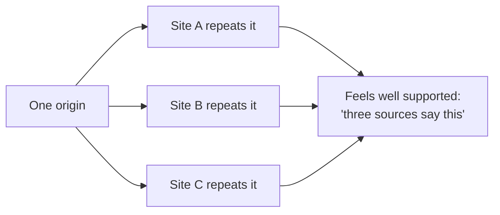
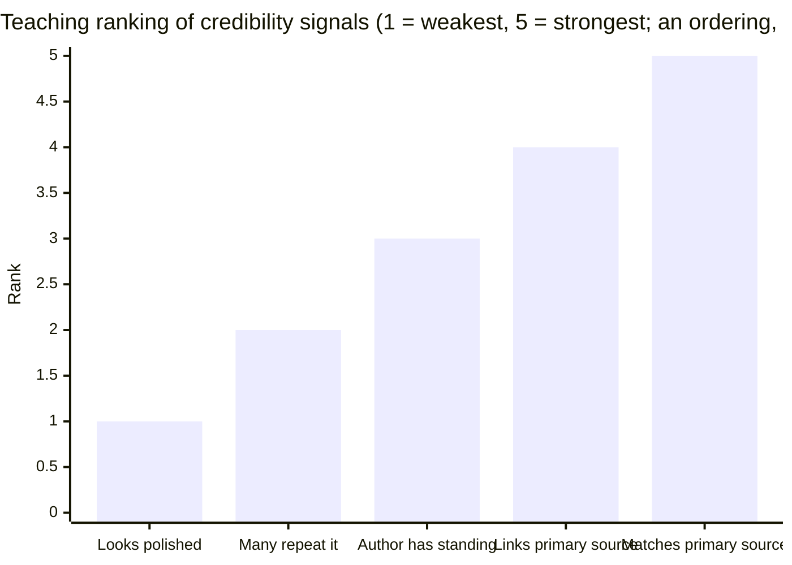

import LevelIntro from "../../../components/LevelIntro.astro";
import Checkpoint from "../../../components/Checkpoint.astro";
import PracticeCheck from "../../../components/PracticeCheck.astro";

export const unit = {
  track: "learning-craft",
  unitSlug: "source-evaluation",
};

L1 named the two kinds of source and the three questions worth asking. L2 works out why a headcount of agreeing sources is such a weak signal, which signals are worth checking instead, and how age fits in.

<LevelIntro
  items={[
    "Why forwarded claims collapse to one claim",
    "Ranking credibility signals by what they predict",
    "Age depends on how fast the topic moves",
  ]}
/>

## Why does "three people said it" feel more convincing than "one person said it"?

**In the group chat, three people repeat the rumor. How many separate claims is that?** Draw who got it from whom, instead of counting voices.

Only one arrow starts a new claim: the original poster. Classmates A and B add no information; they pass on the same message. Three people "saying" it is one claim copied twice. This is the corroboration trap.

The same shape appears when the voices are websites. If three pages all repeat what one page said, the count is three and the independent checks are zero:

The interactive below turns this into numbers. It is a made-up model, not a truth calculator: it assumes each independent check cuts the remaining doubt by 40%, so confidence after k independent checks is 100 × (1 − 0.6^k) percent. With 3 sources and 0% independent, the model counts 1 independent check and gives 40%. With 3 sources that all checked on their own, it counts 3 and gives 78%. With 10 sources and 0% independent, it still gives 40%.

| Sources | Share that checked on their own | Independent checks | Model confidence |
| ------- | ------------------------------- | ------------------ | ---------------- |
| 3       | 0%                              | 1                  | 40%              |
| 3       | 100%                            | 3                  | 78%              |
| 10      | 0%                              | 1                  | 40%              |

<Checkpoint question="A fourth classmate says 'I heard it too, from my older sibling, who is actually in that class.' Does this collapse into the same claim as the other three?">

No. The first three trace back to one unnamed origin through one original poster. The sibling report starts a different arrow: a named person who is plausibly in a position to know and who did not get the news from that chain. It can still be wrong, but what makes a report count as corroboration is not that it agrees; it is that it comes from a different origin.

</Checkpoint>

<PracticeCheck
  track={unit.track}
  unitSlug={unit.unitSlug}
  topicId="independent-corroboration"
/>

## Which signals are worth checking, and which only feel convincing?

**A forwarded screenshot has the school's logo on it. Does that tell you the schedule change is real?** Not really, and a ranking shows why.

| Signal                                                | How much it tells you                                                |
| ----------------------------------------------------- | -------------------------------------------------------------------- |
| Matches what you can check against the primary source | Strongest: this is the check itself, not a stand-in for one          |
| Links the specific primary source so you can check it | Strong: lets you verify, even if you have not yet                    |
| Author is identifiable, with relevant standing        | Moderate: expertise raises the odds but does not prove this claim    |
| Many sources say the same thing                       | Weak alone: only strong once you confirm the sources are independent |
| Looks professional and well written                   | Weakest: polish is unrelated to whether the claim was checked        |

The weakest signals are also the easiest to notice at a glance, which is why they tend to stand in for real checking.

<Checkpoint question="A classmate says 'this must be true, the screenshot even has the school's logo.' How strong is that, and what is wrong with the reasoning?">

It is the weakest signal on the list. A logo is easy to copy, and appearance says nothing about whether anyone compared the claim with the primary source. The reasoning mistakes how convincing something looks for how well it was verified. The signal that matters, whether the claim matches the original, takes the less eye-catching work of actually checking.

</Checkpoint>

## Does a source's age tell you anything on its own?

**A five-year-old explanation and a two-day-old one: which do you trust?** It depends on how fast the subject moves.

| Kind of claim                                   | How fast it goes stale | Is an old source a red flag? |
| ----------------------------------------------- | ---------------------- | ---------------------------- |
| How a multiplication table works                | Never                  | No                           |
| How TCP's three-way handshake works             | Very slowly            | Usually not                  |
| A bus schedule or class deadline                | Hours to days          | Yes, quickly                 |
| A framework benchmark or open security advisory | Months                 | Yes, after a few months      |

Even the exam rumor has an age angle: a screenshot from this morning is more likely to be current than one that has circulated since last week, in a class where the schedule has already changed once. The question is not "how old is this" in isolation; it is "how fast does this kind of claim go stale, compared with its actual age."

<PracticeCheck
  track={unit.track}
  unitSlug={unit.unitSlug}
  topicId="credibility-signals"
/>
