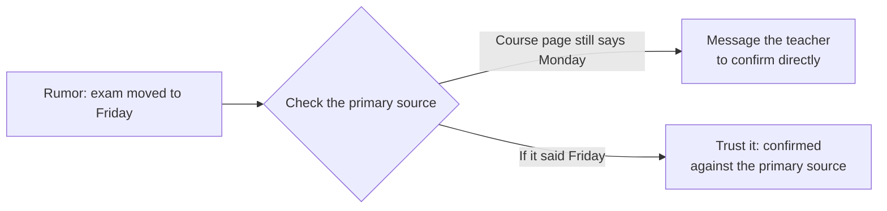

import Scenario from "../../../components/Scenario.astro";
import LevelIntro from "../../../components/LevelIntro.astro";
import Checkpoint from "../../../components/Checkpoint.astro";
import PracticeCheck from "../../../components/PracticeCheck.astro";

export const unit = {
  track: "learning-craft",
  unitSlug: "source-evaluation",
};

<Scenario label="The scenario">
  <Fragment slot="facts">
    
The claim

    
"The final is moved to Friday": practice tonight, so tonight is the only study time if it is true.

    
The chain

    

      
💬 Original poster: heard it from an unnamed older student

      
🔁 Two classmates: forwarded the same screenshot

      
🏫 Course page: says Monday, updated two days ago

    

  </Fragment>

The same group-chat rumor as L1 and L2: the final "moved to Friday", three people repeating it, practice tonight. This level follows the claim all the way back, then does the same on a claim where a wrong answer is much harder to undo.

**Before reading on: if you only had two minutes, which one thing would you check first, and why not the number of people who said it?**

</Scenario>

L1 and L2 covered the mechanism. Here it runs end to end on two real-sized cases, including the part the earlier levels did not show: what you do once the trace is done.

<LevelIntro
  items={[
    "Tracing a claim to its primary source",
    "Matching effort to the stakes",
    "Catching a claim stretched past its source",
  ]}
/>

## How do you trace the exam rumor to its actual source?

**Three people say it. What do you check, in what order?**

1. **Check independence first.** The original poster heard it from an unnamed older student. Both classmates forwarded the same screenshot; neither asked a teacher or anyone else. Three people collapse to one unverifiable origin plus two forwards.
2. **Go to the primary source.** The teacher posts the real schedule on the course page. It still says Monday, updated two days ago, which is after the date the rumor says it began.
3. **Resolve the gap.** Either the rumor is false, or the schedule changed and the page has not caught up. Both are checkable: message the teacher, or wait for tomorrow's announcement.

You did not have to find out who the older student was. Tracing one level deeper than the group chat, to a checkable source, was enough to know three people were not worth an evening's study plan.

## When is shallow trust the right call?

**Checking everything back to the original would make a school day impossible. So which claims earn the trace?** The stakes and the reversibility decide.

| Claim                                    | Cost of checking               | Cost of being wrong               | Right effort  |
| ---------------------------------------- | ------------------------------ | --------------------------------- | ------------- |
| "The cafeteria is serving pizza today"   | Walk over and look             | A mild surprise, fixed on arrival | Shallow trust |
| "The exam is Friday, so tonight is free" | Two minutes on the course page | Walking into Monday unprepared    | Trace it      |

<Checkpoint question="A classmate says the cafeteria ran out of the main lunch line and is serving only the backup option. Is this worth tracing to a primary source before you decide what to do?">

No. This is the low-stakes, easily reversed case, and shallow trust is the correct call, not a shortcut. You learn the truth the moment you walk in, and nothing rides on it that cannot be fixed on the spot. Spending effort tracing it would be the wrong move: calibration means recognizing that some claims do not deserve even the two-minute check, because being wrong costs almost nothing and corrects itself.

</Checkpoint>

<PracticeCheck
  track={unit.track}
  unitSlug={unit.unitSlug}
  topicId="verification-effort"
/>

## What changes when being wrong cannot be undone by morning?

**The exam rumor is recoverable: worst case you study on the wrong night. What if the claim feeds a decision about a child's health?** The check gets more worth doing, and a new failure appears: a claim stretched past what its source supports.

A study has boundaries: it studied certain people, for a certain time, with a certain dose or method, and measured a specific outcome. A post can sound "based on a study" while claiming far more than the study tested.

Here is the case. The claim is invented: "Supplement X" and the study are made up for teaching. A family group chat shares: "New research shows Supplement X reverses vitamin deficiency in kids within a week; a neighbor's pediatrician recommended it to three other families." An aunt is considering giving it to her seven-year-old instead of the prescribed multivitamin.

- **Independence first.** The post links a wellness blog, which cites "a 2019 study" without linking it. It links a second blog post, which also does not link it but names a journal. Two layers of secondary sourcing, neither checked against the original.
- **Primary source.** Searching the named journal finds the paper (the anchor-term method from [search literacy](/learning-craft/search-literacy/) applies: journal, supplement, year, exact claim). In this made-up case it tested adults with a specific diagnosed deficiency, under medical supervision, for twelve weeks.
- **Compare claim to scope.** The post says "kids", "within a week", and "instead of the prescribed treatment". The study covered adults, twelve weeks, and supervised use.

| Dimension | What the post claims         | What the study tested              | Match? |
| --------- | ---------------------------- | ---------------------------------- | ------ |
| Who       | Kids in general              | Adults with a diagnosed deficiency | No     |
| How long  | Within a week                | Twelve weeks                       | No     |
| Setting   | Used instead of prescription | Under medical supervision          | No     |

The move is not to diagnose anything yourself. It is to bring the traced mismatch to the pediatrician before changing what a child is given.

<Checkpoint question="The blog did link something, but only another blog post. Does that satisfy 'links the primary source so you can check it'?">

It is weaker than it looks. A link only counts if it leads to something checkable, and this one leads to a second post that does not link the study either; it only names a journal. Two secondary layers each citing the layer before them is not one layer citing the original. A link can make a claim feel traceable without it being traceable, which is why the trace had to continue past the first citation.

</Checkpoint>

<PracticeCheck
  track={unit.track}
  unitSlug={unit.unitSlug}
  topicId="scope-stretch"
/>

## Failure modes

- **Treating "cites its sources" as enough.** A name dropped without a checkable link looks like a citation but cannot be traced.
- **Letting the messenger's expertise settle the claim.** "A pediatrician recommended it" may repeat something broader than that pediatrician verified. Expertise shifts the odds; it does not replace the check when the stakes justify one.
- **Confusing "I could not quickly find the original" with "there is none".** The honest answer under time pressure is often hedged confidence: "several people say it moved, but none checked the course page yet."
- **Applying rigor only when the claim is inconvenient.** It is easy to trace a rumor that ruins your evening and skip one that conveniently cancels practice. Effort should follow the stakes, not your preference.

## Beyond these two examples

  💬 A group chat rumor, a forwarded post
  &rarr;
  📰 Any claim you are about to act on

These are two cases, not the whole territory. Try extending them:

- What changes if the primary source is hard to reach: the teacher is unavailable until tomorrow and there is no course page? What is the calibrated move when a full trace is impossible before the decision?
- The supplement claim had two secondary layers. What would four layers change about how much you trust it, before you read any of them?
- What if the news were worse, say a claim that a friend was seriously hurt? Does urgency change which parts of the trace are worth skipping, and which are not?
