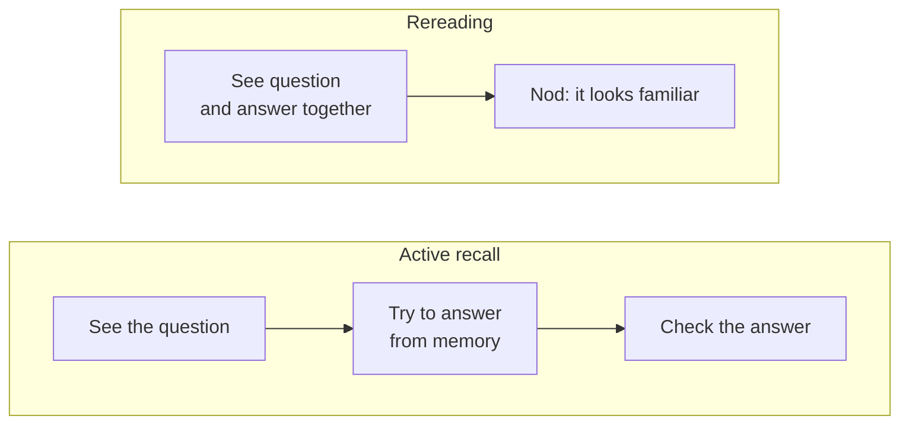

import Scenario from "../../../components/Scenario.astro";
import LevelIntro from "../../../components/LevelIntro.astro";
import PracticeCheck from "../../../components/PracticeCheck.astro";

export const unit = {
  track: "learning-craft",
  unitSlug: "spaced-repetition",
};

<Scenario label="Same 3 hours, same 60 words, very different results a month later">
  <Fragment slot="facts">
    

      
📚 <strong>Both study</strong>: 60 new words, 3 hours in total

      

        
🌙 Maya, one 3-hour session on day 110% on test day

        

      

      

        
📅 Diego, six 30-minute sessions over 4 weeks90% on test day

        

      

      
The 10% and 90% are teaching numbers from a simplified model, not measurements.

    

  </Fragment>

Maya and Diego each need to learn 60 new vocabulary words for a test
four weeks from now. Both put in exactly 3 hours of study time. Maya
does it all in one long session on day 1 and never looks at the words
again. Diego splits the same 3 hours into six 30-minute sessions spread
across the four weeks. On test day, Maya remembers a small fraction of
the words and Diego remembers most of them. **Same words, same hours,
same starting day. Why did the schedule alone change the result so
much?**

</Scenario>

<LevelIntro
  items={[
    "Why timing beats total study hours",
    "Retrieval practice versus rereading",
    "How memory fades without review",
  ]}
/>

## Why does the same amount of study give different results?

**If the hours are identical, what could possibly differ?** Only the
timing. Look at the two schedules side by side.

|                    | Maya                       | Diego                  |
| ------------------ | -------------------------- | ---------------------- |
| Total study time   | 3 hours                    | 3 hours                |
| Number of sessions | 1                          | 6                      |
| Session length     | One 3-hour session         | Six 30-minute sessions |
| Spread across      | Day 1 only                 | 4 weeks                |
| Result on test day | Remembers a small fraction | Remembers most of them |

- A memory with nothing to interrupt it fades on its own. After one
  long session, the fading runs for 27 days before the test.
- A review close to the point of forgetting lifts the memory back up,
  and each later fade is slower than the one before.
- **Spaced repetition** is the name for reviewing at growing intervals
  instead of all at once. Packing the study into one block is called
  **massed practice**, or cramming.

The same pattern shows up outside school. A gardener who waters a
plant heavily once and then walks away gets a dead plant. A gardener
who gives smaller amounts on a rhythm gets a living one, with the same
total water.

<PracticeCheck
  track={unit.track}
  unitSlug={unit.unitSlug}
  topicId="spacing-vs-cramming"
/>

## Is looking at the material again the same as reviewing it?

**You can reread your notes for an hour and feel fluent. Does that mean
you could write the answers down tomorrow?** Not necessarily. Feeling
that the page looks familiar is a different thing from being able to
produce the answer without the page.

- **Retrieval practice** means pulling information out of memory by
  trying to recall it, instead of just looking at it again. The effort
  of pulling is what strengthens the memory.
- **Active recall** is the usual way to do retrieval practice: hide the
  answer, try first, then check.
- **Rereading** turns the order around. You see the answer first, so
  the review becomes recognition, which is easy and builds much less.

The practical sentence for the whole unit: do not review while
everything is still effortless, and do not wait until the idea has
disappeared. Review when remembering takes a little work, and make the
review an attempt to recall before you check.

<PracticeCheck
  track={unit.track}
  unitSlug={unit.unitSlug}
  topicId="retrieval-vs-rereading"
/>

## What this unit covers

L2 explains the shape of forgetting and how to tell when a review lands
at the right moment. L3 follows Maya's and Diego's four weeks day by
day and then changes the facts to see what survives.
