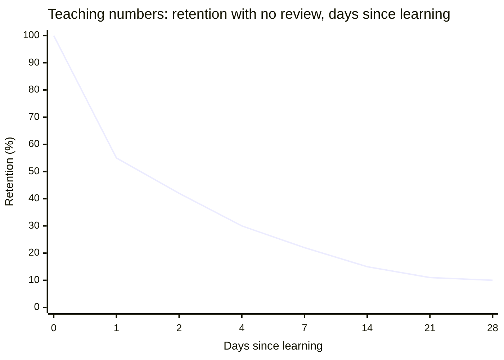
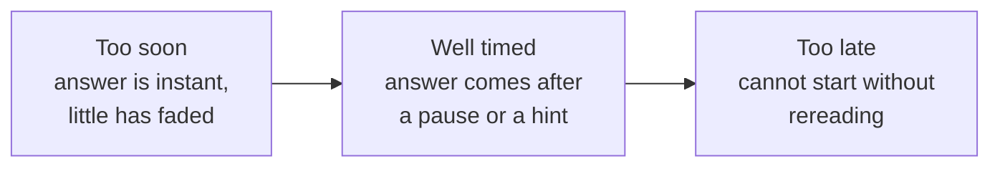

import LevelIntro from "../../../components/LevelIntro.astro";
import Checkpoint from "../../../components/Checkpoint.astro";
import PracticeCheck from "../../../components/PracticeCheck.astro";

export const unit = {
  track: "learning-craft",
  unitSlug: "spaced-repetition",
};

L1 showed that Maya and Diego spent the same hours and got very
different results, and named the pieces: spacing, retrieval, and the
fading of memory. L2 builds the model behind those pieces. Every
percentage below is a teaching number, not a measurement of anyone's
memory.

<LevelIntro
  items={[
    "The shape of the forgetting curve",
    "Signals that a review is well timed",
    "Spacing and recall as two separate levers",
  ]}
/>

## Does a memory fade at a steady speed?

**Imagine remembering a phone number someone read to you. After a
minute you still have it. After an hour, half is gone. After a week,
does it keep losing the same amount every hour?** No. The loss is
fastest right after learning and slows down as time passes.

- **Forgetting curve:** the shape of how remembering changes over time
  when nothing is reviewed. Steep at first, then a long slow slope.
- **Reset:** a successful review lifts retention back up.
- **Flatter:** after each review the next fall is gentler, so the
  memory needs less frequent attention each time.

The curve flattens because there is less left to lose, and, once you
review, because the memory itself has become sturdier.

<Checkpoint question="A memory has been through several successful reviews and starts to fade again. Compared with how fast it faded right after first learning, will this fade be faster, slower or the same, and why?">

Slower. Each successful review does more than restore the memory: it
makes the next fade more gradual. That is why review intervals stretch
out, a day, then several days, then weeks. A memory that has survived a
few rounds is sturdier, so it needs less frequent reinforcement to stay
intact.

</Checkpoint>

<PracticeCheck
  track={unit.track}
  unitSlug={unit.unitSlug}
  topicId="forgetting-curve"
/>

## How do you know you are reviewing at the right moment?

**You have no timer inside your head. What tells you it is time?** The
effort of recalling. A review is well placed when the answer is still
there but takes work to reach.

| Signal during review                | What it suggests                                            |
| ----------------------------------- | ----------------------------------------------------------- |
| You answer instantly with no effort | Probably too soon: little has faded yet                     |
| You answer after a pause            | Good spacing: the memory is pulled back with effort         |
| You remember half and need a hint   | Still useful: try first, then check the missing piece       |
| You cannot start without rereading  | Probably too late: you are relearning more than reinforcing |

The "feels harder" part is the mechanism, not a cost to avoid. Cramming
feels smooth because the material is still fresh each time you look at
it, and that smoothness is exactly why it protects so little next
month.

<PracticeCheck
  track={unit.track}
  unitSlug={unit.unitSlug}
  topicId="review-timing"
/>

## Is spacing enough on its own?

**If Diego kept the perfect schedule but only reread each word together
with its meaning, would he get the same result?** No. Spacing decides
when you review. Recall decides what kind of review it is. They are two
separate levers.

<Checkpoint question="Two students review on exactly the same well-timed schedule for the same total time. One tries to recall each answer before flipping the card. The other reads both sides together. Will they end up with the same retention?">

No. Timing controls when the review happens, not how much it
strengthens the memory. The first student's attempt makes memory do the
reconstruction work, and that work is what strengthens it. The second
student, at the same well-timed moment, mostly re-exposes themselves to
the material. Both levers are needed, and one does not guarantee the
other.

</Checkpoint>

The same two levers apply to any material you want to keep: a language,
a procedure at work, a technical idea. Review close to when you would
otherwise forget, and try to recall before you check.
