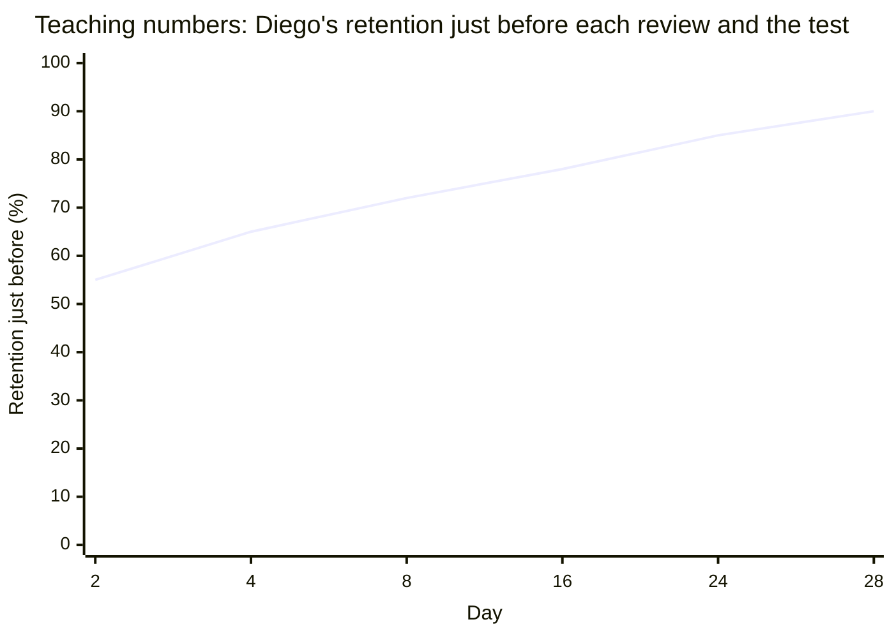

import Scenario from "../../../components/Scenario.astro";
import LevelIntro from "../../../components/LevelIntro.astro";
import Checkpoint from "../../../components/Checkpoint.astro";
import PracticeCheck from "../../../components/PracticeCheck.astro";

export const unit = {
  track: "learning-craft",
  unitSlug: "spaced-repetition",
};

<Scenario label="Same 3 hours, tracked day by day">
  <Fragment slot="facts">
    

      
📅 <strong>Day 1</strong>: both learn all 60 words for the first time

      
🌙 <strong>Maya</strong>: one 3-hour session on day 1, nothing after

      
📚 <strong>Diego</strong>: 30 minutes on day 1, then reviews on days 2, 4, 8, 16 and 24

      
🧪 <strong>Test</strong>: day 28 for both

    

  </Fragment>

Diego's last review is on day 24, four days before the day-28 test.
Maya's only session was on day 1, twenty-seven days before it. **Before
reading the tables, predict: whose material has had more time to fade
since its last exposure, and does that gap alone explain the result, or
is something else going on too?**

</Scenario>

<LevelIntro
  items={[
    "Both schedules, day by day",
    "Why the gap alone does not explain it",
    "What changes if the review is passive",
  ]}
/>

All retention percentages here are teaching numbers from a simplified
model. They show the direction of the effect, not what any real
person's memory will do.

## What happens to Maya's memory with no review?

| Day | What happens                 | Teaching retention |
| --- | ---------------------------- | ------------------ |
| 1   | Learns all 60 words, 3 hours | 100%               |
| 4   | No review                    | about 30%          |
| 14  | No review                    | about 15%          |
| 28  | Test, no review since day 1  | about 10%          |

With nothing to interrupt it, her memory slides down the whole curve
from L2. By test day, most of what she studied has faded to the point
of being relearned rather than recalled.

<Checkpoint question="Maya's retention goes from 30% on day 4 to 15% on day 14, then only to 10% by day 28. Does the slowing decline mean a later review would have mattered less than an early one?">

No. The curve slows because there is less and less left to lose, not
because forgetting stopped mattering. A review during the steep early
drop protects much more than one after the memory has already mostly
gone, since it catches the memory while more is still at stake.

</Checkpoint>

## What does Diego's schedule do differently?

Diego's reviews land at gaps of 1, 2, 4, 8 and 8 days: the gaps
roughly double and then hold. That pattern is a teaching device, not a
law.

| Day | What happens                   | Retention just before | Retention just after |
| --- | ------------------------------ | --------------------- | -------------------- |
| 1   | Learns all 60 words, 30 min    | -                     | 100%                 |
| 2   | Reviews, 30 min                | about 55%             | about 97%            |
| 4   | Reviews, 30 min                | about 65%             | about 98%            |
| 8   | Reviews, 30 min                | about 72%             | about 98%            |
| 16  | Reviews, 30 min                | about 78%             | about 99%            |
| 24  | Reviews, 30 min                | about 85%             | about 99%            |
| 28  | Test, 4 days after last review | about 90%             | -                    |

Each review pushes retention back near 100%, and the dip before the
next one gets shallower. The last point, 90%, matches the interactive
demo for this unit: with 5 spaced reviews it shows 10 + 5 x 16 = 90%.
With 0 reviews it shows 10%, which is Maya.

The demo is a simplification of the simplification. It adds a flat 16
points per well-timed review and caps at 95%, so it cannot show the
shrinking dips in the chart above. Use it for the direction of the
trend, not the exact figures.

<PracticeCheck
  track={unit.track}
  unitSlug={unit.unitSlug}
  topicId="worked-schedule"
/>

## Why does the gap alone not explain it?

Diego's gap since last exposure is 4 days and Maya's is 27, so the gap
is part of the story. But look at Diego's retention before his day-24
review: about 85%, already far above anything on Maya's curve. Five
earlier reviews had made his memory sturdier, so even untouched days
cost him less.

<Checkpoint question="Two people both have their last review exactly 4 days before a test. Person X had five earlier spaced reviews. Person Y is reviewing for the first time. Would you expect the same retention on test day?">

No, even though the gap is identical. What matters is how sturdy the
memory was going into the gap. X's five earlier reviews flattened the
curve, so four untouched days barely dent it. Y's first review sits on
the steep original curve, so the same four days cost far more. The
length of the gap is half the story and the shape of the curve under it
is the other half.

</Checkpoint>

## Extend it: what if the schedule stays but the recall goes?

**This is one worked case, not the whole territory.** Try changing the
facts and predict before you decide.

- **Passive reviews.** Suppose Diego keeps the same five dates but only
  rereads each word with its meaning. Would "retention just after" still
  reach 97 to 99% each time, or plateau lower? What does that predict
  for day 28? Spacing alone would still beat Maya's zero reviews, but
  each session would add less than a genuine attempt to recall.
- **Different material.** What if the 60 words were instead a
  procedure with ordered steps? Which part of the schedule would you
  keep, and what would an attempt to recall look like?
- **A real deadline.** What if the test were tomorrow instead of in four
  weeks? Which approach would you choose and why?

None of these has one clean answer. The schedule sets when to review,
and the attempt to recall decides how much each review is worth.

## Failure modes

| Failure mode                                 | What it gets wrong                                                          |
| -------------------------------------------- | --------------------------------------------------------------------------- |
| Reviewing too soon after the last exposure   | Retention is still near 100%, so there is little fading to reinforce        |
| Reviewing too late, after the memory is gone | It becomes relearning from scratch, not a review that flattens the curve    |
| Spacing correctly but only rereading         | Captures the timing benefit and misses the strengthening from recall effort |
| Assuming total hours is what matters         | Maya and Diego spent identical hours, so the whole gap came from timing     |
| Stopping after one successful review         | Retention fades again after each review, so the schedule has to continue    |
