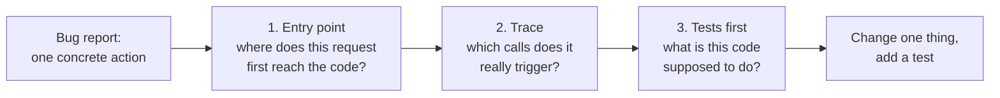

import Scenario from "../../../components/Scenario.astro";
import LevelIntro from "../../../components/LevelIntro.astro";
import PracticeCheck from "../../../components/PracticeCheck.astro";

export const unit = {
  track: "learning-craft",
  unitSlug: "systematic-exploration",
};

<Scenario label="One broken light switch in a building you have never entered">
  <Fragment slot="facts">
    

      
🐛 <strong>Bug report</strong> — applying the same discount code twice is not rejected; the order is discounted twice

      
📂 <strong>Codebase</strong> — you have never opened it

      
🧭 <strong>Two plans</strong> — read from the top of the folder tree, or follow this one request

    

    

      

        
Files the bug passes through (assumed: 3 of 400)about 1%

        

      

    

  </Fragment>

You walk into an office building and someone says, "the light in room 214 is
broken." You could walk every corridor from the ground floor and hope to find
it. Or you could ask which switch controls that room, then follow the wire.

A bug report arrives the same way: **applying the same discount code twice is
not rejected, and customers get a double discount.** You have never opened
this repository. Two engineers start. One reads folders from the top. The
other has a fix out in twenty minutes. What did the second one do first?

The numbers here are assumptions for illustration: a repository of about 400
files where this one bug passes through 3 of them. The point holds whatever
the real counts are.

</Scenario>

<LevelIntro
  items={[
    "Entry point, trace and tests first",
    "Why reading everything wastes time",
    "What each move tells you",
  ]}
/>

## What do you actually do first?

**If you cannot read the whole codebase, what is the smallest set of moves
that still gets you to the bug?** Three, each answering a different question:

| Move        | Question it answers                                   | Everyday version                                  |
| ----------- | ----------------------------------------------------- | ------------------------------------------------- |
| Entry point | Where does this kind of request first reach the code? | Which switch controls room 214?                   |
| Trace       | What sequence of calls does this one request trigger? | Follow the wire from that switch                  |
| Tests first | What does the code claim to do in a known case?       | The label on the switch panel saying what it runs |

The goal is not to understand the whole system. It is to understand one path
well enough to change it safely, and to confirm that understanding against
evidence instead of guessing.

<PracticeCheck
  track={unit.track}
  unitSlug={unit.unitSlug}
  topicId="three-moves"
/>

## Key terms

- **Entry point.** The first code a kind of request or event reaches: a route
  handler, an event listener, a command handler, a queue consumer.
- **Tracing execution.** Following one concrete request through the calls it
  actually triggers, instead of studying every layer in isolation.
- **Reading tests first.** Treating the test suite as documentation of
  intended behavior. Tests are partial evidence: they may miss the exact case
  that broke.
- **Call graph.** The real chain of calls a request triggers. It often does
  not match the folder structure.

## What this unit covers

L2 explains why folder order is a poor map of execution order and what each
move answers that the others do not. L3 runs all three moves on the discount
bug above: find the entry point, trace three layers, read the tests, write a
fix that matches the codebase's own habits, and add the test that was missing.
