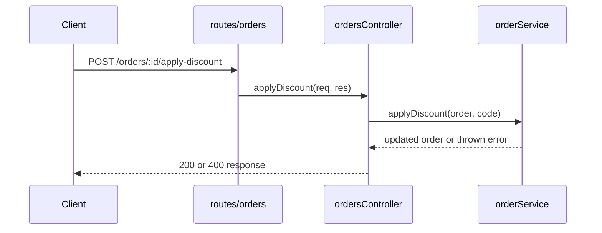

import LevelIntro from "../../../components/LevelIntro.astro";
import Checkpoint from "../../../components/Checkpoint.astro";
import PracticeCheck from "../../../components/PracticeCheck.astro";

export const unit = {
  track: "learning-craft",
  unitSlug: "systematic-exploration",
};

L1 named three moves: find the entry point, trace the request, read the tests
first. L2 shows why the folder tree actively misleads you about where to
start, and what each move answers that the others cannot.

<LevelIntro
  items={[
    "Folder order versus execution order",
    "What each move answers and misses",
    "Why tests come before implementation",
  ]}
/>

## Which folder should you read first?

**You open the repo and see `controllers/`, `models/`, `routes/`, `services/`
and `tests/`. Which do you read first?** Not in that alphabetical order.
Folders describe how code is _organized_, not the order it _executes_ for a
request. The real order is a chain of calls:

| Layer      | Plain role                                                     |
| ---------- | -------------------------------------------------------------- |
| Router     | Recognizes the URL and method, then sends the request onward   |
| Controller | Translates web details like `req`, `res`, `params`, and `body` |
| Service    | Applies the business rule, such as changing an order           |

Reading `models/` before you have found the route spends time on code that may
never appear in the trace. For the web words used here, see
[HTTP request/response basics](/web/http-request-response-basics/); you do not
need that whole unit first.

## What does each move answer?

**If you cannot explore everything, what is the minimum worth doing?** Three
moves, and each fills a gap the other two leave:

| Move        | Answers                                                | Does not tell you                                        |
| ----------- | ------------------------------------------------------ | -------------------------------------------------------- |
| Entry point | Where this request first reaches the code              | What happens once execution moves past it                |
| Trace       | The real sequence of calls this one request triggers   | Whether that behavior is correct or intended             |
| Tests first | What the author says the code should do in known cases | Whether today's implementation actually lives up to that |

Entry point narrows _where_ to look. Tracing shows _what happens_. Tests show
_what should happen_. Trace without tests and you cannot tell a bug from a
feature. Tests without a trace and you know the intent but not whether the
code meets it.

<Checkpoint question="Tracing shows a discount code is pushed into an order's appliedDiscounts list with no check for repeats. Does that alone tell you it is a bug?">

No. The trace confirms what the code does: nothing stops a duplicate. It says
nothing about whether that was a mistake or a choice made for a reason you
cannot see yet. To tell the difference you still need the tests or the bug
report, which say what this code is supposed to do.

</Checkpoint>

<PracticeCheck
  track={unit.track}
  unitSlug={unit.unitSlug}
  topicId="execution-path"
/>

## Why read the tests before the implementation?

**Why open the test file before `orderService`?** A test suite is usually the
most concentrated, checkable description of intended behavior in the repo.
Comments go stale and docstrings are prose; a test is an example that fails
when violated. A line like `expect(() => applyDiscount(order, "FAKE")).toThrow()`
tells you two things at once: unknown codes should be rejected, and this
codebase rejects bad input by _throwing_. That is a habit worth matching in
your own fix.

<Checkpoint question="A comment says duplicate codes are rejected, but no test checks that and the code does not reject them. Do you trust the comment or the missing test?">

Trust neither blindly, but the missing test is the more useful signal. The
comment only records what someone hoped was true, and nothing forces it to stay
accurate. The absent test tells you this behavior was never pinned down by a
checkable example, which is exactly where bugs hide. Treat the comment as a
hint about intent, then add the test that makes it true.

</Checkpoint>

<PracticeCheck
  track={unit.track}
  unitSlug={unit.unitSlug}
  topicId="tests-as-evidence"
/>

## Failure modes at this level

| Failure mode                   | What goes wrong                                                           |
| ------------------------------ | ------------------------------------------------------------------------- |
| Starting from the folder tree  | No concrete request to trace, so no natural place to stop reading         |
| Tracing but skipping the tests | You may "fix" intended behavior, or miss that tests already call it wrong |
| Trusting a comment over a test | A comment cannot fail; a test can, so it is closer to ground truth        |
