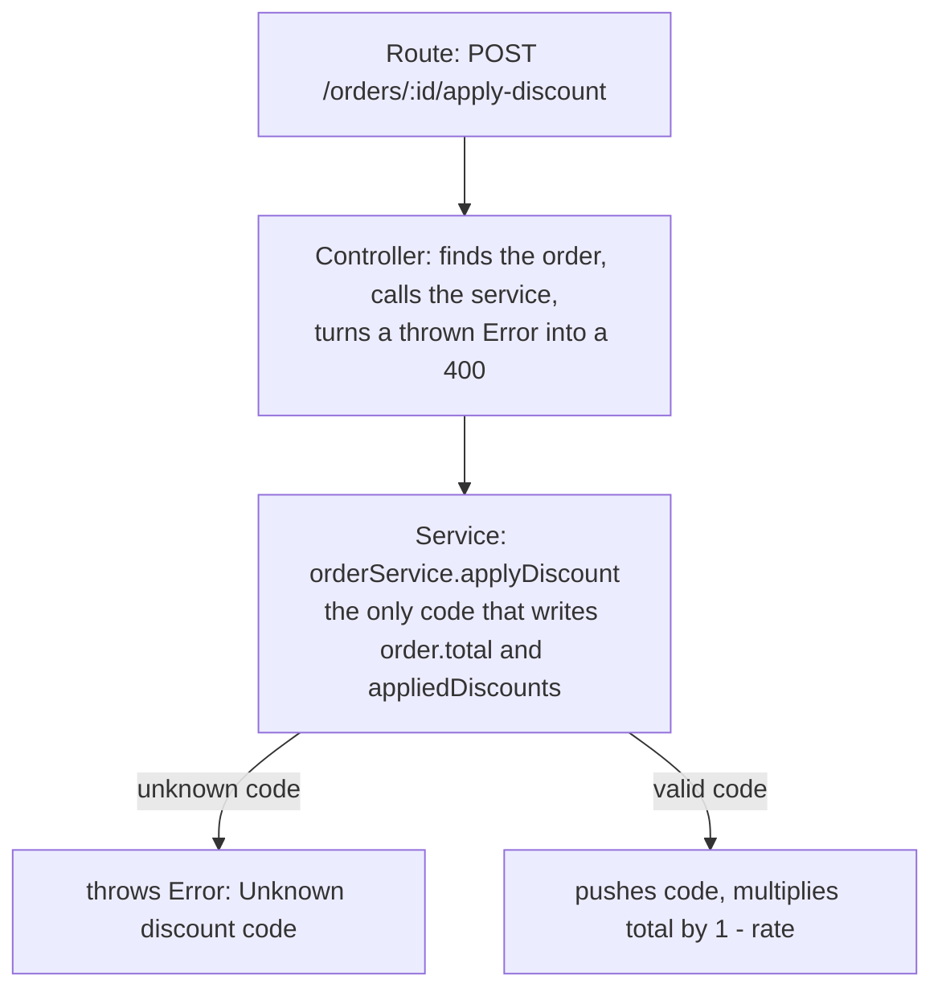
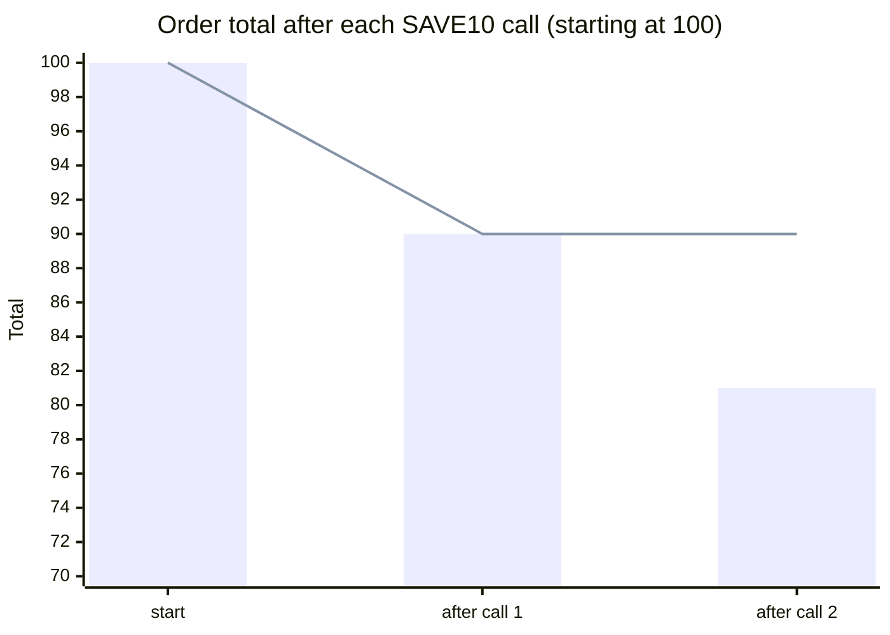

import Scenario from "../../../components/Scenario.astro";
import LevelIntro from "../../../components/LevelIntro.astro";
import Checkpoint from "../../../components/Checkpoint.astro";
import PracticeCheck from "../../../components/PracticeCheck.astro";

export const unit = {
  track: "learning-craft",
  unitSlug: "systematic-exploration",
};

<Scenario label="The same bug, now in real code">
  <Fragment slot="facts">
    <div class="not-prose flex flex-col gap-2 text-sm text-slate-700 dark:text-slate-300">
      <div class="flex items-center gap-1.5"><span>🧾</span> <strong>Order</strong> — total 100, code SAVE10 (10% off)</div>
      <div class="flex items-center gap-1.5"><span>✅</span> <strong>Expected</strong> — second SAVE10 is rejected, total stays 90</div>
      <div class="flex items-center gap-1.5"><span>❌</span> <strong>Actual</strong> — total becomes 81 (100 × 0.9 × 0.9)</div>
    </div>
  </Fragment>

L2 argued in the abstract. Here you run all three moves on the actual bug: an
order of 100 with a 10% code. Applied once the total should be 90. Applied a
second time it should be rejected, but the bug report says it reaches **81**.
**Where in the code does 81 come from, and how do you fix it without clashing
with how the rest of the code already behaves?**

</Scenario>

<LevelIntro
  items={[
    "Entry point and trace across three layers",
    "Reading tests to learn the codebase's habit",
    "A matching fix plus the missing test",
  ]}
/>

## Step 1: find the entry point

Search for the route, not the business logic. One line of the router file
gives the method, the path and the handler, so you can ignore `models/`,
`middleware/` and every unrelated route:

```text
POST /orders/:id/apply-discount  ->  ordersController.applyDiscount
```

## Step 2: trace through the layers



Reading the service is where the trace pays off. This is the one place where
reading code _is_ the point:

```js
const discountCodes = { SAVE10: 0.1, SAVE20: 0.2 };

function applyDiscount(order, code) {
  const rate = discountCodes[code];
  if (rate === undefined) throw new Error("Unknown discount code");
  order.appliedDiscounts.push(code);
  order.total = order.total * (1 - rate);
  return order;
}
```

Nothing checks whether `code` is already in `appliedDiscounts`, so a second call
multiplies again. The numbers follow directly (move the sliders in the demo
below to see the extra amount lost as the order and rate change; its defaults
reproduce this exact 100 and 10% case):



The bars are the buggy behavior (100, 90, 81); the line is the intended one
(100, 90, 90). The gap at the last point is the 9 lost to the bug.

<Checkpoint question="The trace shows orderService.applyDiscount is the only code that writes order.total and that it never checks for a repeat code. Is that enough to write the fix?">

Not yet. The trace narrowed the bug to one function and confirmed what it does.
It did not say what this codebase expects when input is invalid. A fix written
straight from the trace might work but disagree with how the rest of the code
signals bad input. The next move, the existing tests, supplies that half.

</Checkpoint>

<PracticeCheck
  track={unit.track}
  unitSlug={unit.unitSlug}
  topicId="trace-the-bug"
/>

## Step 3: read the existing tests

```js
test("applies a valid discount code", () => {
  const order = { total: 100, appliedDiscounts: [] };
  const result = applyDiscount(order, "SAVE10");
  expect(result.total).toBe(90);
  expect(result.appliedDiscounts).toEqual(["SAVE10"]);
});

test("rejects an unknown discount code", () => {
  const order = { total: 100, appliedDiscounts: [] };
  expect(() => applyDiscount(order, "FAKE")).toThrow("Unknown discount code");
});
```

Neither test applies the same code twice; that gap let the bug ship. But they
teach the habit to follow: **bad input is rejected by throwing a specific
error, before anything is changed.** The controller depends on that habit. It
catches thrown errors and returns a 400.

| Fix option                          | Stops the double discount? | Fits the codebase?                        |
| ----------------------------------- | -------------------------- | ----------------------------------------- |
| Throw "Discount already applied"    | Yes                        | Yes, same style as the unknown-code check |
| Silently return the order unchanged | Yes                        | No, the caller sees success and no error  |
| Return `null`                       | Yes                        | No, a second, inconsistent signal         |

## Step 4: the fix and the missing test

The guard goes before any mutation, beside the existing check:

```js
if (order.appliedDiscounts.includes(code)) {
  throw new Error("Discount already applied");
}
```

The regression test pins the case that was missing, and its last two lines
prove rejection happened _before_ the change:

```js
test("rejects applying the same discount code twice", () => {
  const order = { total: 100, appliedDiscounts: [] };
  applyDiscount(order, "SAVE10");
  expect(() => applyDiscount(order, "SAVE10")).toThrow(
    "Discount already applied",
  );
  expect(order.total).toBe(90);
  expect(order.appliedDiscounts).toEqual(["SAVE10"]);
});
```

<Checkpoint question="Returning the order unchanged would also stop the double discount. Why does the throwing version matter when both fix the reported bug?">

Both stop the double discount, but only one fits the codebase. The service
already signals invalid input by throwing, and the controller relies on that to
send a 400. A silent return would add a second, inconsistent way to handle bad
input, and the caller would see success. Matching the pattern keeps one
contract for everyone who reads this code next.

</Checkpoint>

<PracticeCheck
  track={unit.track}
  unitSlug={unit.unitSlug}
  topicId="guard-before-mutate"
/>

## This is a case, not the whole territory

The worked example is one bug in one small service. It does not cover every
shape a real investigation takes. **Try extending it yourself:**

- Suppose the nightly job, not an HTTP route, sent the duplicate code. What is
  the entry point now, and which of the three moves changes and which does not?
- Suppose the report said a _second, different_ code (SAVE10 then SAVE20)
  should also be rejected. Which function and which test change, and does the
  throw-before-change habit still apply?
- Suppose the tests already covered duplicates and still passed while the bug
  happened. What would that tell you about where to look?

## Failure modes

| Failure mode                                             | What it gets wrong                                                      |
| -------------------------------------------------------- | ----------------------------------------------------------------------- |
| Reading unrelated folders before finding the entry point | Spends time on code the trace never reaches                             |
| Fixing before reading the tests                          | A working fix can still clash with the codebase's error-handling habit  |
| Assuming the tests cover the broken case                 | If it were tested it likely would not have shipped; the gap is the clue |
| Trusting a stale comment over the test or the trace      | Comments do not run, so they cannot fail when wrong                     |
| Stopping at the first layer that looks related           | The controller handles HTTP; only the service touches the total         |
