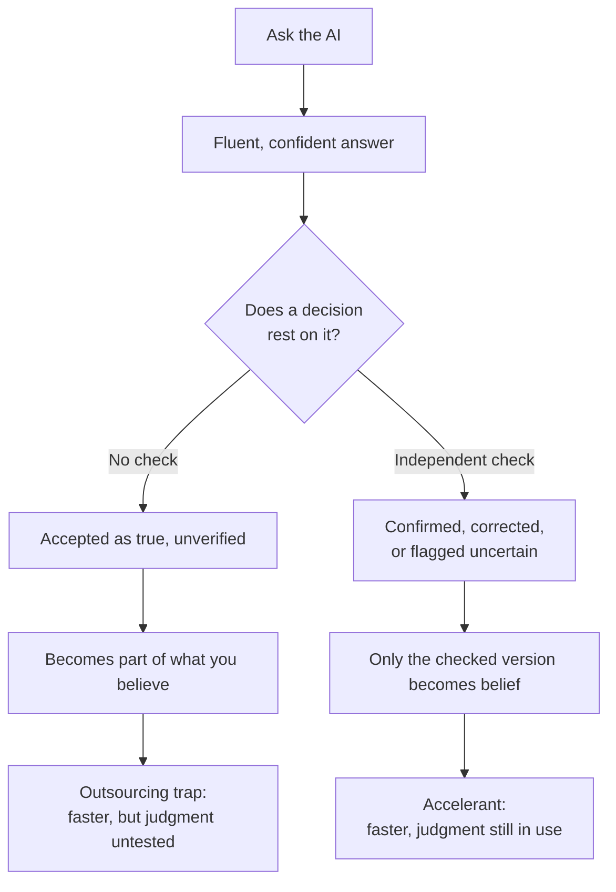
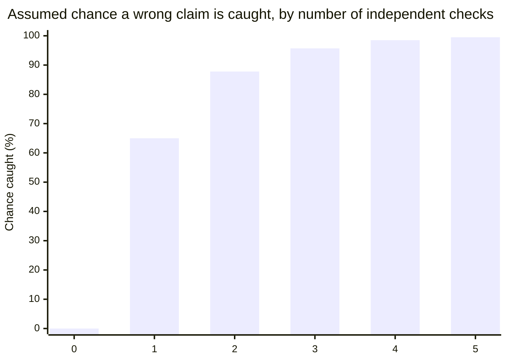

import LevelIntro from "../../../components/LevelIntro.astro";
import Checkpoint from "../../../components/Checkpoint.astro";
import PracticeCheck from "../../../components/PracticeCheck.astro";

export const unit = {
  track: "learning-craft",
  unitSlug: "verification-habits",
};

L1 showed Priya catching a slipped keystroke with a five-second rough check, and
explained why a smooth AI answer deserves the same treatment. L2 turns that
instinct into a loop, and asks what makes a check worth anything. Here is the
AI version of the problem: two parents, Ravi and Ines, ask the same assistant
whether a spoonful of honey is fine for an 8-month-old. Both get the same fluent
"yes, in small amounts." Ines spends thirty seconds on her pediatrician's page,
which says honey should not be given to a baby under 12 months because of a
risk of infant botulism. Ravi serves the honey.

<LevelIntro
  items={[
    "The loop that separates accelerant from outsourcing",
    "What makes a check independent",
    "Why a second check helps less than the first",
  ]}
/>

## What happens to an answer in the minute after it arrives?

**Ravi and Ines read the identical answer. Where exactly did their evenings
split?** At the moment the answer was either accepted as a fact or held as a
draft.

| Moment                       | Passive acceptance                          | Active verification                                             |
| ---------------------------- | ------------------------------------------- | --------------------------------------------------------------- |
| Right after the answer       | Sounds informed, so treated as settled      | Treated as a draft claim, not yet a fact                        |
| A surprising or costly claim | Gets the same light treatment as any other  | Gets an independent check before anything is done               |
| A month later                | The claim quietly became "something I know" | Only checked claims became knowledge; the rest stayed tentative |

The accelerant loop keeps the AI's speed. It adds back only the one step the
trap skips.

<Checkpoint question="A friend asks the assistant what year a film came out, purely out of curiosity, with nothing riding on the answer. Does the habit say they must independently verify that too?">

No. Scaling the scrutiny to the stakes is part of the habit, not an exception to
it. A claim that money, safety or a grade rests on earns a check, and idle
trivia usually does not. The skill is noticing which claims are load-bearing,
because maximum suspicion applied to every sentence is too slow to survive in
real life and would quickly be dropped altogether.

</Checkpoint>

<PracticeCheck
  track={unit.track}
  unitSlug={unit.unitSlug}
  topicId="accelerant-loop"
/>

## What makes a check count?

**Ines "checked" the claim. Would asking the same assistant the same question a
second time have counted too?** No. A check only helps if it can fail in a
different way than the original answer did.

- **Independent** means the source does not share the original's weakness. The
  same assistant, asked again or reworded, is liable to repeat itself for the
  same reason it was wrong the first time.
- **Authoritative for that claim** means the source is one with a real reason to
  be right about this specific thing, such as a pediatrician's own page for infant
  care or official documentation for a tool.
- **Opened, not just named.** When an AI cites a source, the citation is more
  plausible-sounding text. The check is opening the source and confirming it
  says what the AI claimed.

| Candidate check                             | Counts as independent?                       |
| ------------------------------------------- | -------------------------------------------- |
| Ask the same assistant again, reworded      | No, same weakness                            |
| Notice that the answer cites a source       | No, until you open it                        |
| Open the cited source and compare the claim | Yes, if the source really exists and says so |
| Read the owner's own page or official docs  | Yes                                          |
| Apply the claim to a fresh case and test it | Yes, for claims that can be tested           |

How much does a second check add? Assume, for illustration only, that any one
independent check catches a genuinely wrong claim 65% of the time, and that
checks fail independently of one another. Then n checks catch it
$$1 - 0.35^n$$ of the time. These are teaching numbers, not measured rates.

The first check buys the most (0% to 65%). By the fourth, a check adds less than
three points. And the arithmetic only holds if the checks really are
independent: five rewordings of the same question are closer to one check.

<Checkpoint question="Under the 65% assumption, how many more percentage points does a second independent check add over just one?">

About 22.8, from 65% to 87.8%. The second check is worth doing for a
high-stakes claim, and the third adds less again (about 7.9 points). That
shrinking return is why the habit is one good check on the claim that matters,
with more only when being wrong is expensive.

</Checkpoint>

<PracticeCheck
  track={unit.track}
  unitSlug={unit.unitSlug}
  topicId="independent-checks"
/>

## Failure modes at this level

- **Treating a cited-sounding answer as verified.** A named source is a place to
  go and look, not proof.
- **Verifying nothing, or verifying everything.** The habit is picking the claims
  something rests on.
- **Mistaking "it made sense to me" for "it is true."** Following an explanation
  is a much lower bar than confirming its facts.
