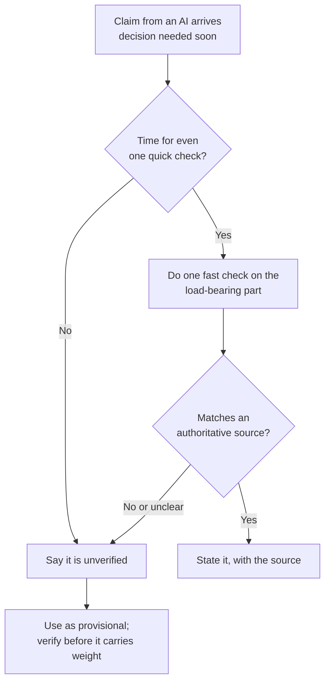

import Scenario from "../../../components/Scenario.astro";
import LevelIntro from "../../../components/LevelIntro.astro";
import Checkpoint from "../../../components/Checkpoint.astro";
import PracticeCheck from "../../../components/PracticeCheck.astro";

export const unit = {
  track: "learning-craft",
  unitSlug: "verification-habits",
};

<Scenario label="The scenario">
  <Fragment slot="facts">
    

      
🍯 Claim A: honey is fine for an 8-month-old. One authoritative page settles it.

      
📈 Claim B: a built-in sort runs in O(n). Needs documentation or a timing experiment.

      
⏱️ Claim C: needed in the next two minutes, with no time to check.

    

  </Fragment>

Same Ines as L2. This time the question is not whether she checks, but how the
check changes as the claim gets harder to verify and the clock gets shorter.
Three claims, three very different situations, and one habit that has to bend
without breaking.

**Before reading on: if the honey claim took thirty seconds, how long would you
guess a claim about a programming language's sort speed should take, and what
would you do if you truly had no time at all?**

</Scenario>

<LevelIntro
  items={[
    "Ines's check, step by step",
    "Claims that are hard to check",
    "Checking when time is short",
  ]}
/>

## What did Ines actually do in her thirty seconds?

**Her check was quick, but was it a shortcut or a method?** A method, with five
parts.

1. **Read the answer in full.** It said honey is fine past 6 months and
   described it as a natural sweetener many parents use.
2. **Isolate the load-bearing claim.** Of several sentences, only one decides
   what she does tonight: whether 8 months is old enough for honey.
3. **Pick an independent, authoritative source.** Not the same assistant asked
   again, but her pediatrician's own patient page.
4. **Compare the claim to the source.** The page says no honey under 12 months.
   That contradicts the age the AI gave.
5. **Act on the checked version.** She skips the honey and calls the office to ask
   what to use instead.

<Checkpoint question="Ines did not check the AI's line that honey is 'a natural sweetener many parents use.' Was that a gap in her habit?">

No. That sentence changes nothing about what she does tonight. Only the safety
threshold is load-bearing, and the skill on display is picking that one claim
out rather than checking every sentence equally. A habit that demanded full
verification of everything would be too slow to use, and a habit nobody uses
protects nobody.

</Checkpoint>

## What changes when the claim is hard to check?

**Honey had one obvious page that settled it. What if no such page exists?**
Suppose a programmer asks an assistant for the time complexity of a language's
built-in list sort, and gets a fluent "O(n), it's linear." That is wrong:
Python's built-in sort (Timsort) is O(n log n) in the average and worst case,
though it can approach O(n) on already-sorted data. A learner who plans around
"linear" will be badly surprised on large inputs.

No single page a non-specialist can read in one sentence settles it. The
reasonable checks are the language's official documentation, or a small timing
experiment on lists of growing size and watching whether the time grows faster
than a straight line.

| Property                   | Easy claim (honey)     | Hard claim (sort complexity)                              |
| -------------------------- | ---------------------- | --------------------------------------------------------- |
| Where to check             | One authoritative page | Official docs, or a small experiment                      |
| Who can do it              | Anyone                 | Someone who knows where the docs live, or how to test     |
| Confidence after one check | Usually settles it     | May only narrow it; a second independent check adds value |
| If you truly cannot check  | Rare                   | Label the claim unverified before anything builds on it   |

The habit is unchanged: check the load-bearing claim before it becomes belief.
What changes is how far one check can be trusted, and the effort of finding the
right kind of check.

## What changes when the clock is short?

**If a decision cannot wait for a full check, does the habit stop applying?** No.
It shrinks and becomes explicit. Say a fact comes up live in a meeting and
there are two minutes.

"I believe X, but I have not confirmed it, so treat it as provisional" is honest.
Repeating the AI's fluent claim as settled fact because there was no time is not.
Time pressure is a reason to shrink the check. It is never a reason to hide
that the check was skipped.

<Checkpoint question="Under time pressure a colleague states an AI's claim as fact in a meeting, without saying it is unchecked, and it happens to be correct. Does being right mean skipping the flag was fine?">

No. Being right was luck, not evidence the shortcut is safe. The people listening
could not tell this unchecked claim from a checked one, so next time the
unchecked claim could be the honey answer and they would act on it just the same.
The cost of one sentence of honesty is tiny next to the cost of everyone
treating unchecked claims as checked.

</Checkpoint>

<PracticeCheck
  track={unit.track}
  unitSlug={unit.unitSlug}
  topicId="hard-claims-and-time"
/>

## Extend it yourself

The honey claim and the sort claim are two cases, not the whole territory.
**What would change about Ines's check if the claim were about an interaction
between two prescription medicines, a field where she has no background and even
finding the right source takes effort? What would change if the decision also had
to be made in two minutes, with nobody to ask?** Work out what a reasonable
version of the habit looks like in each case, and notice which parts (isolate the
claim, seek an independent source, say what is unverified) survive and which
depend on having time.

## Failure modes at this level

- **Assuming one easy check generalizes.** Specialized claims often need a
  different check, and more of it.
- **Letting time pressure justify silence.** Shrinking the check is reasonable;
  hiding that it was skipped is not.
- **Reading a lucky correct outcome as proof.** A correct unchecked claim shows
  nothing about the next one.
- **Burning out into checking nothing.** Scaling to stakes exists to make the
  habit sustainable, not to excuse dropping it.
