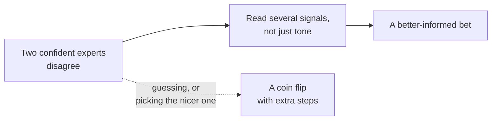

import Scenario from "../../../components/Scenario.astro";
import LevelIntro from "../../../components/LevelIntro.astro";
import PracticeCheck from "../../../components/PracticeCheck.astro";

export const unit = {
  track: "learning-craft",
  unitSlug: "weighing-credibility",
};

<Scenario label="Two mechanics. Two diagnoses. One costs ten times more.">
  <Fragment slot="facts">
    

      

        
🔧 <strong>Mechanic A</strong>: "It's your brakes."$400

        

          

        

      

      

        
🔩 <strong>Mechanic B</strong>: "A loose heat shield."$40

        

          

        

      

      
$400 / $40 = 10 times the price. Same car, same rattle, both heard it in person.

    

  </Fragment>

A car makes a rattling noise. One mechanic listens, says it is the brakes,
and quotes $400. A second mechanic at a different shop listens to the same
car and says it is a loose heat shield rattling against the exhaust, a $40
fix. Both sound confident. Both looked at the actual car.

**You cannot check which one is right, because you do not know cars. What do
you have to go on besides guessing which mechanic seems nicer?**

</Scenario>

The question is not really about cars. Any time two knowledgeable people
disagree and you cannot verify the answer yourself, you face the same gap.

<LevelIntro
  items={[
    "What counts as a credibility signal",
    "Why a stake in the answer matters",
    "The five signals at a glance",
  ]}
/>

## What do you have to go on besides a coin flip?

**If you cannot check the car, is picking at random the only honest option?**
No. Choosing at random, or choosing whichever mechanic you liked, is guessing
with extra steps. A **credibility signal** is any piece of information, short
of verifying the claim yourself, that makes one claim more or less likely to
be trustworthy than another.

- Credibility is not one yes-or-no property. It is made of several separate
  signals, and they can point in different directions for the same person.
- The goal is not a trick that reveals the truth without expertise. It is a
  better-informed bet than a coin flip, from signals a non-expert can reach.
- How confident someone sounds is not one of the signals. Sounding sure is
  cheap and easy to fake.

<PracticeCheck
  track={unit.track}
  unitSlug={unit.unitSlug}
  topicId="credibility-signals"
/>

## Who gains if you believe them?

**Mechanic A earns money when brakes need work. Does that mean A is lying?**
No. The **incentive check** asks what a person gains if you believe them, not
whether they are dishonest. An incentive gives even an honest mistake a
consistent direction, so a claim from an interested source deserves less weight
on its own than the same claim from someone with no stake.

- A diagnosis that costs you $400 and earns the shop money has a stake behind
  it.
- A $40 fix that barely covers the mechanic's time runs against their own
  interest, which is a modest point in its favor, not proof.
- Lower weight is not zero weight. Brakes do wear out.

<PracticeCheck
  track={unit.track}
  unitSlug={unit.unitSlug}
  topicId="incentive-check"
/>

## The five signals at a glance

| Signal       | Plain question                                      | In the car example                        |
| ------------ | --------------------------------------------------- | ----------------------------------------- |
| Incentive    | What do they gain if I believe them?                | A $400 repair creates a stronger stake    |
| Track record | Have they been right before in checkable ways?      | Unknown unless reviews are specific       |
| Specificity  | Did they name a checkable mechanism?                | "Loose heat shield" is more checkable     |
| Consensus    | Do independent experts agree?                       | A third cold opinion can add signal       |
| Recency      | Does the field change fast enough that age matters? | Weak here; strong in medicine or software |

Recency is included because the idea travels beyond cars. A diagnosis from
last week is probably not stale. In medicine, security or fast-changing
technology, the same age might matter a great deal.

## What the next two levels cover

L2 takes the remaining signals one at a time: specificity and track record,
recency, and independent consensus, and shows why none is enough alone. L3
runs the whole car-mechanic scenario through the combined read, including the
cost of being wrong, without ever requiring the driver to know about cars.
