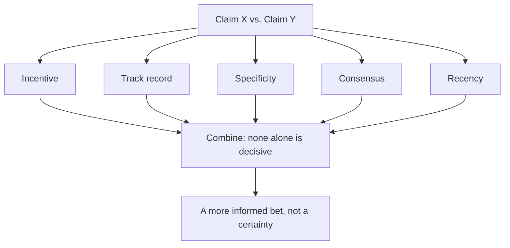
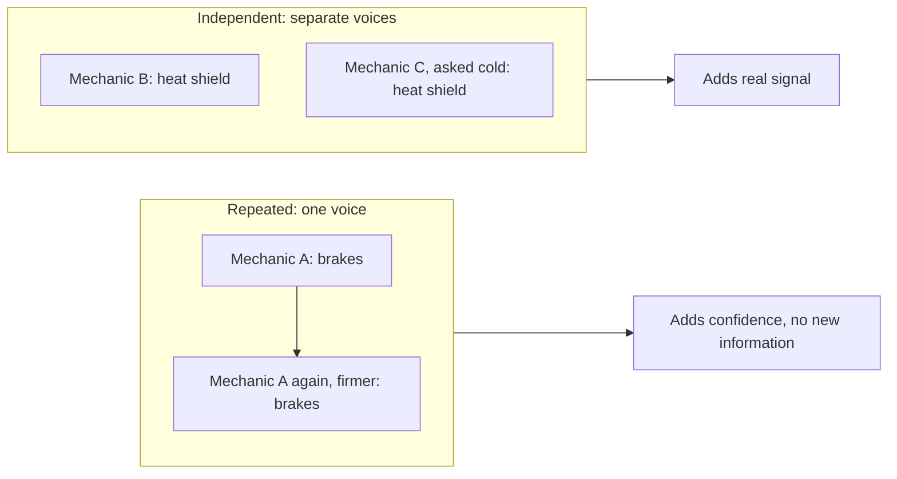

import LevelIntro from "../../../components/LevelIntro.astro";
import Checkpoint from "../../../components/Checkpoint.astro";
import PracticeCheck from "../../../components/PracticeCheck.astro";

export const unit = {
  track: "learning-craft",
  unitSlug: "weighing-credibility",
};

L1 named the five credibility signals and showed why a stake in the answer
lowers a claim's weight. L2 takes the rest one at a time: what each tells you,
what it does not, and why none of them is enough alone.

<LevelIntro
  items={[
    "Specificity and track record",
    "Why age matters only in some fields",
    "What independent consensus adds",
  ]}
/>

## Why does no single signal settle it?

**If one signal looks bad for a claim, is that enough to dismiss it?** No.
Every signal can mislead on its own, which is why the work is combining them.

## Does a more detailed claim deserve more trust?

**Between "it's your brakes" and "it's a loose heat shield rattling against
the exhaust," which gives you more to work with, even if you cannot verify
either?** The second. Not because detail is truth, but because a named
mechanism can fail a check. "Brakes" could mean pads, rotors, calipers or
something else, and offers nothing to look for. A heat shield is an exact
physical cause that anyone could look for.

**Falsifiable does not mean false.** It means there is a clear way the claim
could fail. A vague claim slides around afterward, because each failure can be
re-read as a different part.

**Track record** is the other signal that rewards checkability. Useful track
record is concrete: a diagnosis that another shop confirmed and a cheap repair
that ended the noise. Weak track record is vague reputation: people online say
they are honest.

| Source of evidence                        | Checkable? | What it gives you           |
| ----------------------------------------- | ---------- | --------------------------- |
| "It's your brakes"                        | No         | Nothing to look for         |
| "Loose heat shield on the exhaust"        | Yes        | A part to inspect           |
| "People say the shop is honest"           | No         | Reputation fog              |
| "A second shop confirmed their diagnosis" | Yes        | A past claim later verified |

<Checkpoint question="Two forecasters both say 'expect rain tomorrow.' One adds 'a cold front around 2pm, a 60% chance of rain between 1 and 4pm.' The other repeats 'rain tomorrow, I'm sure' more firmly when asked again. Which claim is more useful before tomorrow arrives?">

The first. It names a mechanism and a window, so tomorrow will either roughly
match it or not, and you can judge the forecaster against what happens. The
second adds confidence but no new information, and confidence is not
specificity. Repeating a vague claim more forcefully does not make it any more
checkable, and a vague claim can always be read as having been right after the
fact.

</Checkpoint>

<PracticeCheck
  track={unit.track}
  unitSlug={unit.unitSlug}
  topicId="specificity-track-record"
/>

## Does an older claim always weigh less?

**Is a ten-year-old source automatically weaker than last week's?** Not
automatically. Recency is a signal only where the underlying facts change fast
enough. A diagnosis of the same rattling car from yesterday is not stale. A
ten-year-old statement that water boils at a lower temperature at altitude is
still fine. A ten-year-old medical guideline or software benchmark may be
dangerously out of date.

| Kind of claim                    | Does it go stale quickly? | Does age matter? |
| -------------------------------- | ------------------------- | ---------------- |
| Yesterday's car-noise diagnosis  | No                        | Barely           |
| A multiplication fact            | No                        | No               |
| A medical guideline              | Yes                       | A lot            |
| A software or security benchmark | Yes                       | A lot            |

The question to ask is not "is this old?" but "does this kind of claim go
stale quickly?"

<PracticeCheck track={unit.track} unitSlug={unit.unitSlug} topicId="recency" />

## What does agreement add, and when is it worth little?

**If a third mechanic, at a third shop, independently says "heat shield"
without hearing the other two, what does that add?** Real signal. Not because
three people are always right where two were wrong, but because independent
agreement, with different people, different incentives and no coordination, is
much harder to produce by accident than one confident voice repeating itself.

<Checkpoint question="You go back to Mechanic A and ask for confirmation, and A repeats 'definitely the brakes' just as confidently. Does that carry the same weight as Mechanic C's independent agreement with B?">

No, and the difference is exactly what makes independence the valuable part of
consensus. A repeating their own diagnosis is the same source with the same
incentive forming the same opinion a second time, so nothing new has entered
the picture. C is a separate person with a separate stake who did not hear
the others, and arriving at the same conclusion is much harder to produce by
accident or by a shared bias. Repetition adds volume. Independence adds
evidence.

</Checkpoint>

<PracticeCheck
  track={unit.track}
  unitSlug={unit.unitSlug}
  topicId="independent-consensus"
/>

## Failure modes at this level

- **Treating any one signal as decisive.** A specific claim from an interested
  source, or a vague claim from a neutral one, still has to be weighed against
  the others.
- **Confusing confidence with a signal.** How certain someone sounds is not
  their incentive, record, specificity or independent agreement.
- **Requiring certainty before acting.** The aim is a better-informed decision,
  not proof. No process guarantees the right answer without knowing about cars;
  it shifts the odds.
