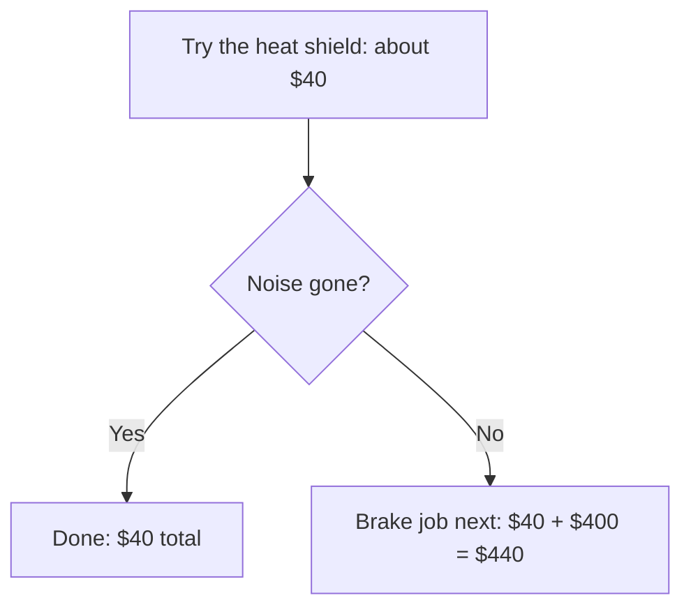

import Scenario from "../../../components/Scenario.astro";
import LevelIntro from "../../../components/LevelIntro.astro";
import Checkpoint from "../../../components/Checkpoint.astro";

<Scenario label="The decision still has to be made">
  <Fragment slot="facts">
    

      
🔧 A: "brakes", $400

      
🔩 B: "loose heat shield", $40

      
👂 C, asked cold: "heat shield first"

      
❓ Driver still cannot check the car

    

  </Fragment>

L1 and L2 gave you the signals. You still have a rattle, two quotes and a
third opinion, and the car is in the driveway. **Which repair do you
authorize first, and what makes that choice defensible if you turn out to be
wrong?**

</Scenario>

<LevelIntro
  items={[
    "All the signals run on the two mechanics",
    "What the cost of being wrong adds",
    "Why this case is not the whole territory",
  ]}
/>

## Applying the incentive check

**What does each mechanic gain if their diagnosis is believed?** Mechanic A
does brake work as regular, profitable business. Mechanic B's diagnosis is a
$40 fix that barely covers their time, so there is little to gain by inventing
it. That does not prove A wrong, because brakes genuinely wear out. It means A's
diagnosis alone deserves somewhat less weight than the same diagnosis from
someone with no stake, while B's runs against their own interest, a modest point
in its favor.

## Applying track record and specificity

The driver has no personal history with either shop, so track record is weak
unless something specific turns up. "Great service" adds almost nothing. A
review saying a shop correctly found a small exhaust rattle that another shop
called a brake problem would add more, because it matches the claim at hand and
was later checked. If the only history is vague, mark it weak rather than
pretending it is absent or decisive.

**Which diagnosis names a more checkable mechanism?** "Brakes" covers several
parts and tells you nothing to look for. A loose heat shield is an exact cause
someone could see under the car. That is a point for B, and a separate point
from incentive. A claim can have a good incentive profile and be vague, or a
poor one and be highly specific. Here both point the same way, which is not
guaranteed in general.

<Checkpoint question="Suppose Mechanic A had said 'it's your left front brake caliper sticking and dragging on the rotor.' Does that change the incentive read? Does it change the specificity read?">

The incentive read does not change at all. A still profits from brake work
however precisely they describe the problem. The specificity read changes
completely, because a sticking caliper is just as checkable as a loose heat
shield. The two signals now point in different directions, and the driver has
to weigh them against each other instead of treating the answer as obvious.

</Checkpoint>

## Adding the independent opinion

Mechanic C, hearing the noise cold, says "something loose near the exhaust,
heat shield is my first guess, I would check that before touching the brakes."
Because C reached this independently, with a different shop and no exposure to
the other opinions, it counts as real additional evidence. Mechanic A repeating
themselves would not.

| Signal       | Read for Mechanic B after C            | What it does not say                            |
| ------------ | -------------------------------------- | ----------------------------------------------- |
| Incentive    | Claim runs against their own interest  | That B is honest                                |
| Track record | Weak unless a specific review turns up | That the shop is bad                            |
| Specificity  | A look-for-able mechanism              | That the mechanism is definitely present        |
| Consensus    | C agrees independently                 | That agreement replaces checking the car        |
| Recency      | Mostly neutral here                    | That recency would be neutral in a faster field |

## What does the cost of being wrong add?

**Even with the read leaning toward B, is it safe to act on it?** Look at what
each ordering costs. Assume each quote is accurate and that trying the $40 heat
shield fix costs $40 whether or not it ends the noise. These are teaching
numbers, not real prices.

| Plan              | If a heat shield is the cause | If the brakes are the cause |
| ----------------- | ----------------------------- | --------------------------- |
| Heat shield first | $40                           | $40 + $400 = $440           |
| Brake job first   | $400 + $40 = $440             | $400                        |

The worst case for both plans is the same $440. The best case for checking the
heat shield first is $40 against $400, a $360 difference. When the signals lean
toward B, that ordering costs nothing extra in the worst case and saves $360 in
the best.

## What generalizes, and what is only this case

The signals travel to any situation where you weigh conflicting claims you
cannot verify: a second medical opinion, two analysts disagreeing about a
stock, two contractors quoting different repairs. **This worked example is a
case, not the whole territory.** The weights here, a strong incentive skew for
A and a very checkable claim from B, will not repeat exactly elsewhere.
Sometimes the more expensive diagnosis really is correct.

**Try extending it yourself.** What if all three mechanics agreed on the
expensive brake diagnosis and only one low-cost mechanic disagreed? Would
consensus now favor the brakes, and how would you weigh that against all three
sharing an incentive to find paid work? What if the claim were about something
fast-moving, where recency starts to matter? What if checking the part were
impossible?

One practical move in the harder case is to buy back independence: ask a shop
that will not do the repair for a paid inspection, ask the next mechanic
without revealing earlier opinions, or ask each shop to show the part that
supports its diagnosis.

## Failure modes

| Failure mode                                                   | What it gets wrong                                                                       |
| -------------------------------------------------------------- | ---------------------------------------------------------------------------------------- |
| Trusting B automatically because B said the cheaper thing      | Cheap is not inherently honest; the signal was incentive plus specificity, not the price |
| Treating "two out of three agree" as proof                     | It improves the odds; the driver still has to check the part to know                     |
| Asking a fourth mechanic after sharing the other opinions      | Hearing prior opinions contaminates the signal that made C's agreement meaningful        |
| Assuming this only applies to expensive or high-stakes choices | The same signals work on small disagreements                                             |
