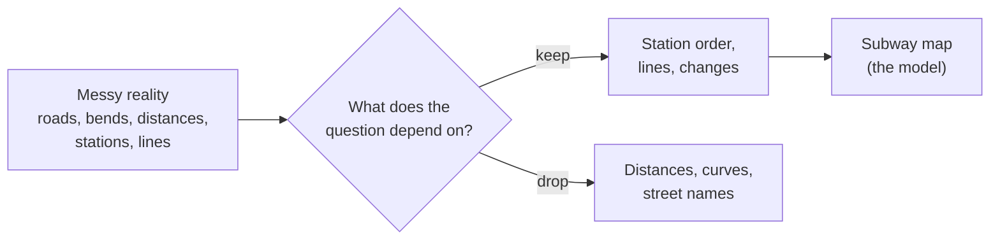

import Scenario from "../../../components/Scenario.astro";
import LevelIntro from "../../../components/LevelIntro.astro";
import PracticeCheck from "../../../components/PracticeCheck.astro";

export const unit = {
  track: "logic",
  unitSlug: "abstraction",
};

<Scenario label="Two maps of the same city: which one gets you home?">
  <Fragment slot="facts">
    

      
🗺️ <strong>Street map</strong> — every road, every bend, true distances

      
🚇 <strong>Subway map</strong> — dots in a tidy line, colour per line, changes marked

      
❓ <strong>The question</strong> — "which line, and where do I change?"

    

    

      
<strong>Kept</strong> stations, order, lines, changes

      
<strong>Dropped</strong> distances, curves, streets

    

  </Fragment>

You are new in a city and need to get across it by subway. You are handed a
street map showing every road, building and bend in the tracks, drawn to
scale. Then someone hands you the subway map: a few coloured lines, dots for
stations, and everything drawn as straight or 45-degree strokes, with
distances that are plainly wrong. **Which one do you trust to answer "which
line do I take, and where do I change?" - and why does the less truthful map
win?**

It wins because it threw away on purpose everything that question does not
depend on. Real distances, curves and street names would only bury the two
things you need: the order of stations on each line, and where lines meet.

</Scenario>

<LevelIntro
  items={[
    "What a model keeps and what it drops",
    "Four shapes a messy problem can take",
    "How the same facts can hide or reveal a problem",
  ]}
/>

## What does a good model keep, and what does it throw away?

**If the street map is more accurate, why is it worse for this job?**
Because accuracy is not the goal. Being useful for a question is. A **model**
(or **abstraction**) is a deliberately simplified stand-in for a messy
situation that keeps only the properties the question depends on.

| Detail                        | Needed for "which line, where do I change?" | In the subway map |
| ----------------------------- | ------------------------------------------- | ----------------- |
| Order of stations on a line   | Yes                                         | Kept              |
| Which lines meet at a station | Yes                                         | Kept              |
| Real distance between stops   | No                                          | Dropped           |
| Shape of the track            | No                                          | Dropped           |

Ask a different question, such as "how long is the walk from the station to
my hotel?", and the street map becomes the better model. Neither map is
right in general. Each is right for a question.

<PracticeCheck
  track={unit.track}
  unitSlug={unit.unitSlug}
  topicId="keep-and-drop"
/>

## The same move on a spreadsheet of 14 services

**Can the same trade pay off outside of maps?** A platform team keeps a
spreadsheet: one row per service, one column listing what each "needs" before
it can start. Fourteen rows. Nobody has ever checked the whole thing for a
service that, three hops away, needs itself.

Treat each service as a dot and each "needs" as an arrow, and the same facts
become a **graph**. Looking for a loop in a graph is a solved problem with a
short, standard procedure. Eyeballing 14 rows is not. The reason is how many
combinations a person would need to keep in their head: with 14 services there
are 14 x 13 / 2 = 91 pairs that could be part of a loop. The slider on this
level lets you push that count up; in the 30-service case it is 435, and at 60
it is 1,770 (each pair counted once, as a rough measure of manual
cross-checks, not a precise cost).

| Services | Pairs to cross-check by eye |
| -------- | --------------------------- |
| 5        | 10                          |
| 14       | 91                          |
| 30       | 435                         |
| 60       | 1,770                       |

## Which shape does the problem have?

**Is a graph the only structure worth knowing?** No. Different messy problems
have different shapes, and each shape has a structure that already comes with
checks worked out.

| Real-world problem shape                   | Formal structure                    | What it unlocks                                     |
| ------------------------------------------ | ----------------------------------- | --------------------------------------------------- |
| "X needs / links to Y"                     | Graph (dots and arrows)             | Loops, reachability, shortest path, order           |
| "A thing moves through phases, some legal" | State machine (states, transitions) | Illegal states made unrepresentable                 |
| "Fit things together under limits"         | Constraint set (variables, limits)  | A solver finds a valid fit, or proves there is none |
| "If X holds, then Y must hold"             | Rule set (if-then conditions)       | Checking for contradictions, deriving consequences  |

<PracticeCheck
  track={unit.track}
  unitSlug={unit.unitSlug}
  topicId="structure-shapes"
/>

## Key terms

- **Abstraction / formal model** — a simplified, precisely defined stand-in
  that keeps only what the question depends on.
- **Graph** — dots (nodes) and arrows (edges) recording a relationship such as
  "needs".
- **Cycle** — a path that leads back to something already on that path; in a
  "needs" graph, nothing in the loop can ever go first.
- **State machine** — named phases and the legal moves between them (see
  `state-machines`).
- **Constraint set** — variables plus the limits they must jointly satisfy.
- **Under-abstraction** — too coarse; drops something the question needs.
- **Over-abstraction** — so detailed it is hard to build, check or trust.

This builds on `problem-decomposition`: once a problem is broken into pieces,
the question here is what shape to give each piece.

## What the next levels cover

L2 explains how to tell a model that is too coarse from one that is too
detailed, and gives a five-step workflow for building one. L3 works a full
example, shows what happens when you force facts into a structure that cannot
hold them, and weighs when modeling is worth the effort.
