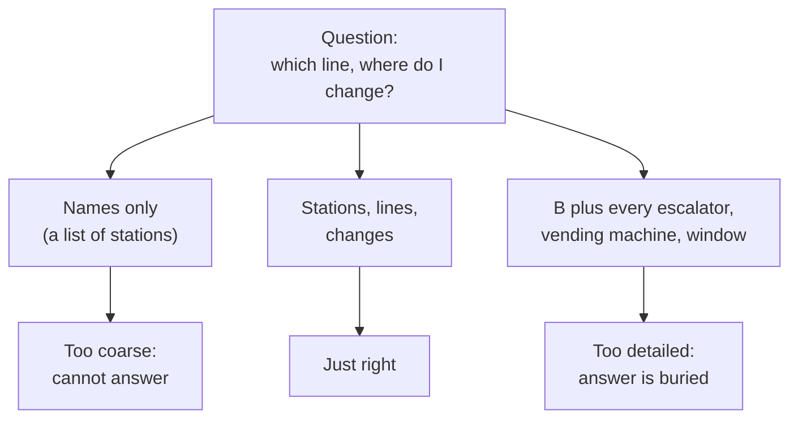
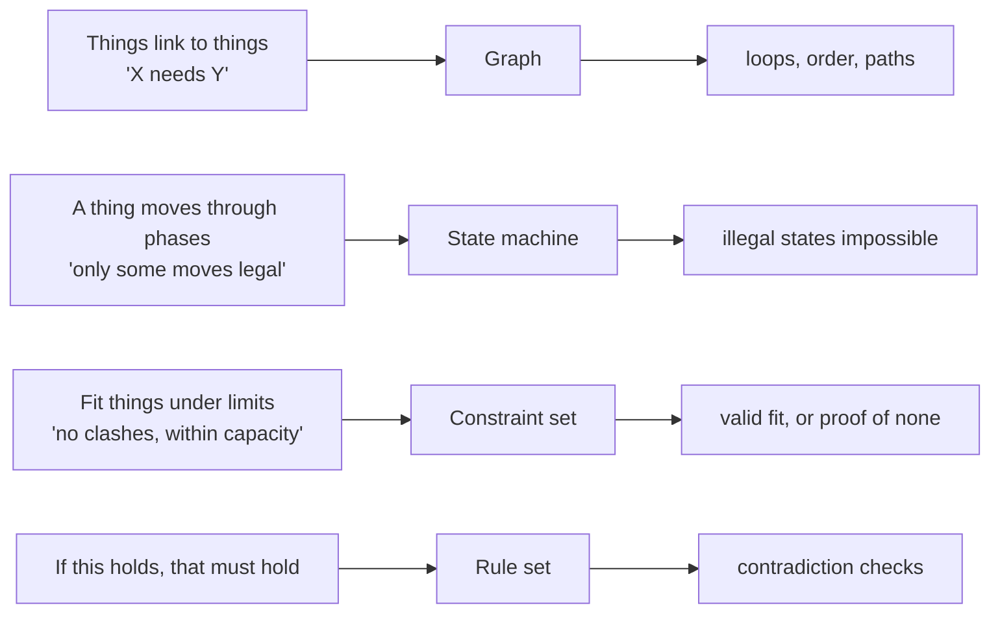
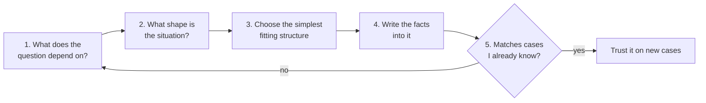

import LevelIntro from "../../../components/LevelIntro.astro";
import Checkpoint from "../../../components/Checkpoint.astro";
import PracticeCheck from "../../../components/PracticeCheck.astro";

export const unit = {
  track: "logic",
  unitSlug: "abstraction",
};

L1 showed that a subway map beats a street map for one question precisely
because it drops detail. L2 asks how to get that balance right on purpose:
how to tell too little from too much, how to pick the structure, and how to
check the result before you rely on it.

<LevelIntro
  items={[
    "Too coarse versus too detailed",
    "How a problem's shape points to a structure",
    "A five-step workflow that ends in a check",
  ]}
/>

## Why can adding more detail make a model worse?

**If a model is meant to help, why not just include everything?** Take the
subway question again, "which line, and where do I change?", and three
possible maps:

| Model                            | Verdict           | What goes wrong                                                               |
| -------------------------------- | ----------------- | ----------------------------------------------------------------------------- |
| Names only                       | Under-abstraction | Drops the property the question needs, and answers an easier question instead |
| Stations, lines, changes         | Just right        | Keeps what the question depends on, nothing else                              |
| Everything, including escalators | Over-abstraction  | Every extra detail must be kept correct and hides mistakes                    |

Under-abstraction is the sneakier failure because the model still produces an
answer. It simply answers a different question than the one you asked. A good
model keeps exactly what the question depends on, and the right amount is
relative to the question, not to the situation.

<Checkpoint question="You keep one model of a city's stations. One question is 'which stations are connected by a line?' and another is 'which stations are open today?' Should one model serve both?">

Not cleanly. Connections stay the same for years, while which stations are
open changes from day to day. Putting both in one model either fills the
stable part with facts that go stale within a day, or treats a temporary
closure as if it were permanent structure. The two questions depend on facts
with different lifetimes, so they justify two models over the same city. The
question decides what belongs, not "everything that is true".

</Checkpoint>

<PracticeCheck
  track={unit.track}
  unitSlug={unit.unitSlug}
  topicId="over-under"
/>

## Which structure does the shape of the problem point to?

**How do you choose among graph, state machine, constraint set and rule set?**
By the shape of the question. Each shape trades a specific kind of mess for a
specific kind of ready-made check:

A graph answers "does this chain loop back?" because following arrows is all
it needs to do. A state machine answers "can this thing ever be in that
combination?" because illegal combinations are simply absent from the model. A
constraint set can find a valid arrangement of shifts or rooms, or show that
none exists. A rule set lets you check that an "if under 18 then no discount"
rule does not contradict an "if member then discount" rule.

<Checkpoint question="Onboarding tasks must happen in an order where some require others to finish first, and two tasks can never both run. Which structure fits the 'requires' half, and what would a graph alone silently lose?">

A graph fits "requires": each requirement is an arrow, and ordering and loops
come for free. But "these two can never both run" is not an arrow between
tasks. It is a limit on how tasks may be combined, and a plain graph has no
place to put it. A graph-only model would accept an order that runs both,
with no warning. A constraint set holds both facts at once, which is why
scheduling problems are usually modeled that way.

</Checkpoint>

## What is the workflow, and where does a mistake get caught?

**Once you know the shape, how do you actually build the model without trusting
it blindly?** Five moves, where the last one matters as much as the middle:

Step 5 does not disappear because the model is formal. A graph built from a
spreadsheet with one mistyped "needs" cell will confidently report a wrong
answer. Formalizing moves _where_ mistakes get caught, from "nobody notices
for six months" to "the check against a known case fails".

<PracticeCheck
  track={unit.track}
  unitSlug={unit.unitSlug}
  topicId="modeling-workflow"
/>

## Failure modes at this level

- **Tying the model to the situation instead of the question.** Detail
  creeps in because it is true, not because the answer depends on it.
- **Dropping the property the question needs.** The model still answers,
  just an easier question.
- **Choosing a structure out of habit.** The next level shows what a wrong
  choice costs.
- **Skipping the check.** Confident output is not correct output.
