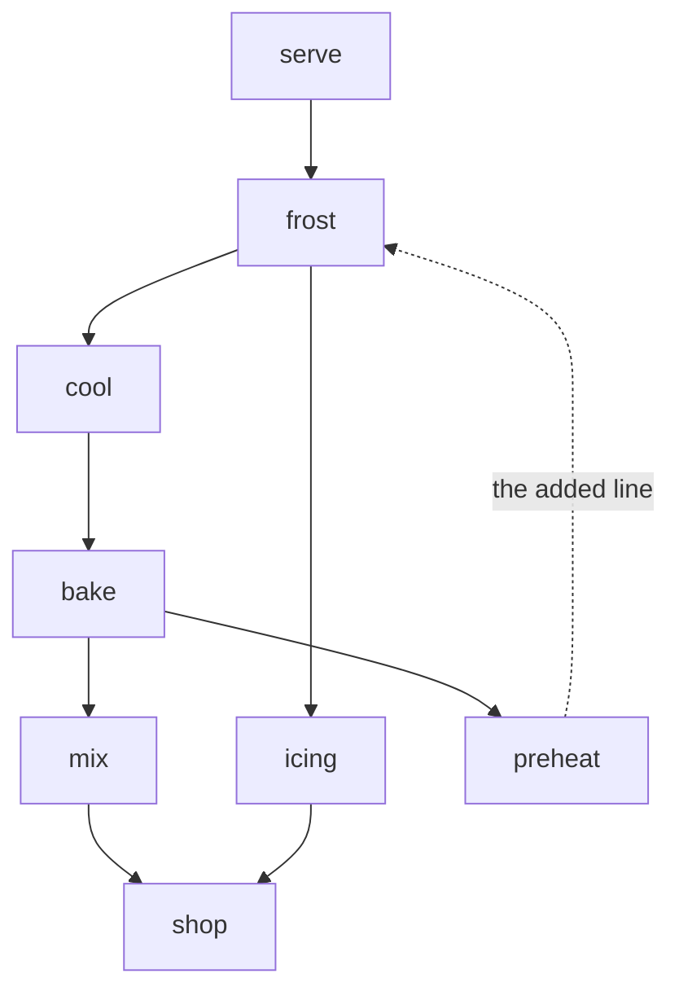
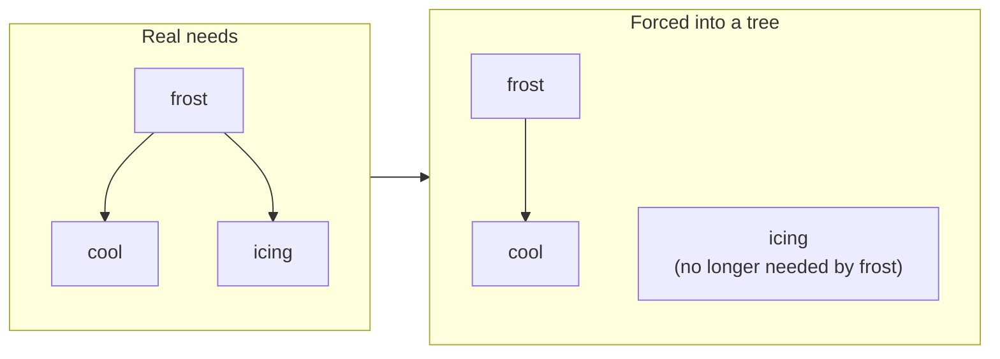

import Scenario from "../../../components/Scenario.astro";
import LevelIntro from "../../../components/LevelIntro.astro";
import Checkpoint from "../../../components/Checkpoint.astro";
import PracticeCheck from "../../../components/PracticeCheck.astro";

export const unit = {
  track: "logic",
  unitSlug: "abstraction",
};

<Scenario label="A cake plan of eight steps where nothing past the shopping can start">
  <Fragment slot="facts">
    <div class="not-prose flex flex-col gap-2 text-sm text-slate-700 dark:text-slate-300">
      <div class="flex items-center gap-1.5"><span>📝</span> <strong>The plan</strong> — 8 steps, each lists what must be done first</div>
      <div class="flex items-center gap-1.5"><span>🛒</span> <strong>Checklist result</strong> — shop, mix, icing get done; 5 steps never do</div>
      <div class="flex items-center gap-1.5"><span>🤷</span> <strong>The clue you get</strong> — none; the list just stops</div>
    </div>
    <div class="not-prose mt-3 flex flex-col gap-1.5 text-xs text-slate-700 dark:text-slate-300">
      <div>
        <div class="flex justify-between"><span>Steps done by the checklist</span><span>3 of 8</span></div>
        <div class="h-2 w-full overflow-hidden rounded-full bg-slate-200 dark:bg-slate-700"><div class="h-full rounded-full bg-amber-500 animate-fill-bar" style="--target-width: 37.5%"></div></div>
      </div>
    </div>
  </Fragment>

Someone writes down a cake plan, one line per step, each listing what has to
be finished first. You walk the lines top to bottom and do a step whenever
everything it needs is done, repeating until nothing new can be done. Shopping
gets done. Mixing and the icing get done. Then it stops, with five steps
untouched and no message. **The plan looks sensible line by line. What is
the checklist unable to tell you, and what would a model of the same lines
let you ask?**

</Scenario>

<LevelIntro
  items={[
    "A checklist stalling with no explanation",
    "The same plan as a graph, with a loop check and a valid order",
    "What a wrong structure costs, and when modeling pays",
  ]}
/>

## Why does the one-pass checklist stall without saying why?

**What exactly is wrong in the plan?** Here are the eight steps, and what each
needs. One line was added by someone who thought it would be nice to warm the
oven "after the icing is on" - so `preheat` needs `frost`:

| Step    | Needs        |
| ------- | ------------ |
| serve   | frost        |
| frost   | cool, icing  |
| cool    | bake         |
| bake    | mix, preheat |
| mix     | shop         |
| preheat | frost        |
| icing   | shop         |
| shop    | nothing      |

The checklist does `shop` on the first pass, then `mix` and `icing` on the
second. After that, every remaining step is waiting on another remaining step.
These were checked by running the repeated-pass procedure in a script, not by
eye. The result is "five steps never started", with no hint of which of them
form the problem.

<Checkpoint question="Would doing more passes of the checklist fix this, or only take longer to fail the same way?">

It would only fail the same way. More passes help steps that were skipped
because of the order the lines were written in, since a later pass picks them
up. But `frost`, `cool`, `bake` and `preheat` are each blocked only by another
member of that group, so no number of passes changes anything. And the output
only says who is stuck, not why. Finding the reason is a different question
from "did I loop enough times".

</Checkpoint>

## What does the graph model keep, and what question does it make easy?

**What does turning the table into dots and arrows add?** No new facts about
cakes. It adds a shape that a known procedure works on. Here is the plan
with the faulty arrow marked:



An arrow means "needs". Following arrows from `frost`, you reach `cool`, then
`bake`, then `preheat`, then `frost` again: a loop of four steps, with
nothing in it able to go first. The model keeps only the needs-relationship;
quantities, times and brands are left out because this question does not
depend on them.

## How does a program find the loop, not just say that one exists?

**Why can't "have I seen this step before?" be the test?** Because `shop` is
reached from two different places, and reaching it twice is fine. What is not
fine is reaching a step that is still _in progress_ higher up the current
path. So each step is in one of three states:

| State       | Meaning                                      | If you reach it again |
| ----------- | -------------------------------------------- | --------------------- |
| not seen    | untouched                                    | start exploring it    |
| on the path | being explored, further up the current chain | **a loop**            |
| finished    | everything it needs has been explored        | fine, a shared need   |

This is one of the places where code really is the clearest vehicle, because
the subtlety only shows up in the exact order of two lines:

```js
function findCycle(deps) {
  const state = new Map();
  const path = [];
  function visit(name) {
    state.set(name, "visiting");
    path.push(name);
    for (const need of deps[name] ?? []) {
      if (state.get(need) === "visiting") {
        return [...path.slice(path.indexOf(need)), need];
      }
      if (!state.has(need)) {
        const found = visit(need);
        if (found) return found;
      }
    }
    path.pop();
    state.set(name, "done");
    return null;
  }
  for (const name of Object.keys(deps)) {
    if (!state.has(name)) {
      const found = visit(name);
      if (found) return found;
    }
  }
  return null;
}
```

On the cake plan this returns `["frost", "cool", "bake", "preheat", "frost"]`
(computed by running it): the exact loop, in order. Remove the added line,
making `preheat` need nothing, and it returns `null`. Visiting needs before
recording a step then gives a valid order: `shop, mix, preheat, bake, cool,
icing, frost, serve`.

<Checkpoint question="Why must the check distinguish 'on the current path' from 'finished'? What would go wrong if it only remembered 'seen'?">

`shop` is needed by both `mix` and `icing`. With only a "seen" flag, reaching
`shop` the second time would look identical to reaching a step that is still
being explored, so a perfectly valid plan would be reported as a loop. Going
the other way and ignoring revisits entirely would hide real loops. The
three states are what separate "a shared need, already settled" from "I have
walked back onto my own path".

</Checkpoint>

<PracticeCheck
  track={unit.track}
  unitSlug={unit.unitSlug}
  topicId="graph-code"
/>

## What happens when the structure cannot hold the facts?

**Someone says a tree would be simpler to draw. What does it cost?** A tree
allows one parent per item. But `frost` needs both `cool` and `icing`, and
`bake` needs both `mix` and `preheat`. Keeping only the first listed need:



In the tree, nothing says `icing` must be done before `frost`. A plan built
from it can put frosting first, and it will look completely fine. That is
worse than the checklist's stall, which at least visibly failed: the tree
returns a confident wrong answer. So the first test of a structure is whether
it can _represent_ the relationships the problem has, before simplicity or
familiarity.

## Is it worth building the model at all?

**Building the loop check took about 25 lines.** For eight steps, a careful
person could probably have found the loop by reading. The real question is how
that changes as the plan grows. If every pair of steps is a possible link to
cross-check, the count is n x (n - 1) / 2: 28 for 8 steps, 91 for 14 (the
number from L1), 378 for 28, and 1,770 for 60. These are counts of pairs under
that simple assumption, not measured effort, but they show the direction: the
manual burden grows with roughly the square of the size, while the model's
build cost is mostly fixed. Small, one-off, easy to verify: just read it.
Large, long-lived, edited by many people: model it.

<PracticeCheck
  track={unit.track}
  unitSlug={unit.unitSlug}
  topicId="wrong-structure-and-cost"
/>

## This is a case, not the whole territory

The cake plan is one worked case of a general move. Try pushing it further
before assuming the same approach works unchanged:

- What would have to change if a step could be marked **optional** (nice to do
  first, but not blocking)? Does a loop through an optional step still count as
  a problem?
- What if each step had a **duration**, and the question changed from "is
  there a valid order?" to "what is the fastest way to finish?" Is the graph
  still the right structure, and what extra fact does it now need to hold?
- What if two steps could **never share the oven**? Which fact from the
  earlier levels does the graph have no place for?
- Replace the cake with a different messy problem you know, such as moving
  house or setting up a team's accounts. Which of the four shapes is it, and
  what would you drop on purpose?

Those are the follow-ups a well-chosen model makes tractable, instead of
forcing the whole approach to be rebuilt from scratch.
