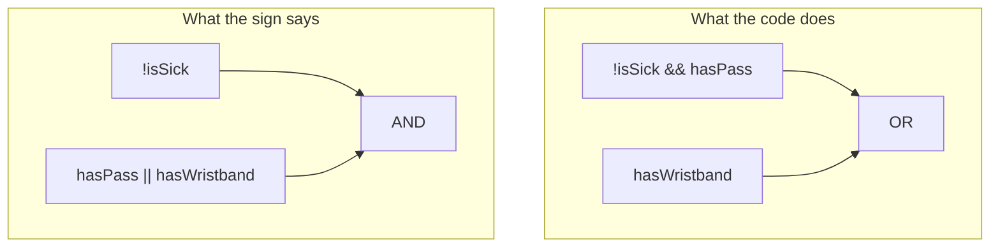

import Scenario from "../../../components/Scenario.astro";
import LevelIntro from "../../../components/LevelIntro.astro";
import PracticeCheck from "../../../components/PracticeCheck.astro";

export const unit = {
  track: "logic",
  unitSlug: "boolean-logic",
};

<Scenario label="The pool sign nobody read the same way">
  <Fragment slot="facts">
    

      
🪧 <strong>The sign</strong> — "No swimming if you're sick. Otherwise you need a pass or a guest wristband."

      
💻 <strong>The code</strong> — <code>!isSick &amp;&amp; hasPass || hasWristband</code>

      
🤒 <strong>The bug</strong> — a sick guest with a wristband is let in

    

  </Fragment>

A community pool posts one rule: **"You may swim if you are not sick, and you
have either a season pass or a guest wristband."** The person writing the
entry-gate software types `!isSick && hasPass || hasWristband`. It reads like
a word-for-word copy of the sign. A week later, a lifeguard notices a sick
child with a guest wristband swimming happily, which the sign clearly forbids.

**The code looks like it says what the sign says. So what did the computer
read that the humans did not?**

</Scenario>

<LevelIntro
  items={[
    "Which operator grabs its neighbours first",
    "Truth tables that check every case",
    "Flipping a whole rule with De Morgan",
  ]}
/>

## How does the computer decide what groups with what?

**Why does the sick child get in?** The computer does not read left to right
like a person reading a sentence. It uses a fixed pecking order, and `&&`
outranks `||`, exactly as `*` outranks `+` in `2 + 3 * 4`.

| You wrote                                | The computer reads                              | Sick guest with wristband |
| ---------------------------------------- | ----------------------------------------------- | ------------------------- |
| `!isSick && hasPass \|\| hasWristband`   | `(!isSick && hasPass) \|\| hasWristband`        | allowed (bug)             |
| `!isSick && (hasPass \|\| hasWristband)` | `!isSick` AND the whole pass-or-wristband group | blocked (sign)            |

- `!` goes first, then every `&&`, then every `||`.
- Parentheses force a group to resolve first. They are the fix.

<PracticeCheck
  track={unit.track}
  unitSlug={unit.unitSlug}
  topicId="precedence"
/>

## How can you be certain two versions really differ?

**Is picking a few test visitors enough?** No. A sick visitor with a pass
behaves the same under both versions, so that test would pass. A **truth
table** lists every combination of the yes/no inputs and the result of each
rule, so no case hides.

| isSick | hasPass | hasWristband | Code (buggy) | Sign (intended) |
| ------ | ------- | ------------ | ------------ | --------------- |
| true   | true    | true         | **true**     | **false**       |
| true   | true    | false        | false        | false           |
| true   | false   | true         | **true**     | **false**       |
| true   | false   | false        | false        | false           |
| false  | true    | true         | true         | true            |
| false  | true    | false        | true         | true            |
| false  | false   | true         | true         | true            |
| false  | false   | false        | false        | false           |

Three inputs give 2 x 2 x 2 = 8 rows. The two bold rows are the bug: both
involve a sick person holding a wristband.

<PracticeCheck
  track={unit.track}
  unitSlug={unit.unitSlug}
  topicId="truth-table"
/>

## What this unit covers

- **Operator precedence**: `!` then `&&` then `||`; parentheses override.
- **Truth table**: every input combination with the result of each rule;
  two rules are equivalent only if the result columns match on every row.
- **De Morgan's laws** (L2): `!(A && B)` is `!A || !B`, and `!(A || B)` is
  `!A && !B`. The operator flips when the negation moves inside.
- **Short-circuiting** (L2): `&&` and `||` stop as soon as the answer is
  known.
