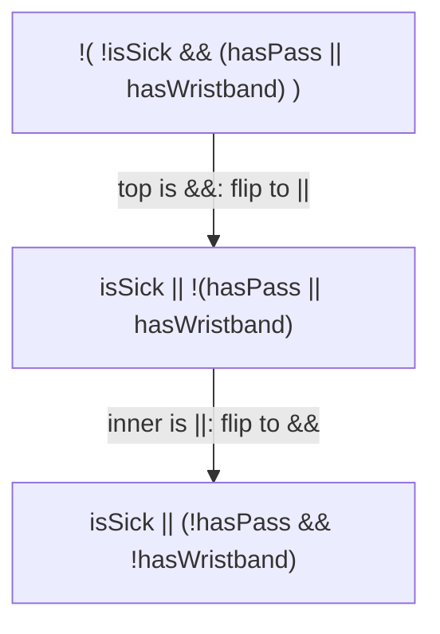
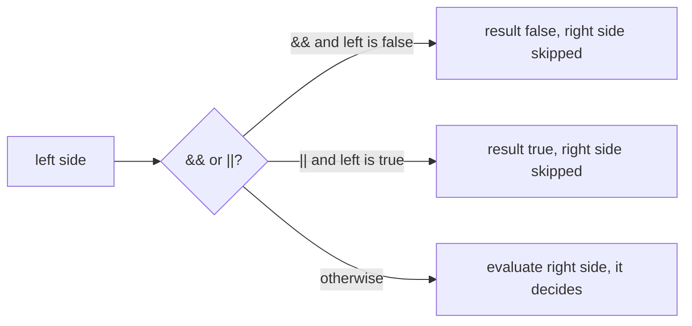

import LevelIntro from "../../../components/LevelIntro.astro";
import Checkpoint from "../../../components/Checkpoint.astro";
import PracticeCheck from "../../../components/PracticeCheck.astro";

export const unit = {
  track: "logic",
  unitSlug: "boolean-logic",
};

L1 showed that the pool gate's rule needed parentheses and that a truth table
exposes the difference. L2 asks two follow-up questions the pool sign raises:
how do you write the opposite of a rule, and does the computer always look at
every part of it?

<LevelIntro
  items={[
    "Negating a rule with De Morgan's laws",
    "The careless negation and where it breaks",
    "Short-circuit evaluation",
  ]}
/>

## How do you write the opposite of the sign's rule?

**The gate needs a "not allowed" message. Is it just the rule with every
word flipped?** The allowed rule is `!isSick && (hasPass || hasWristband)`.
Its opposite is "you are sick, or you have neither pass nor wristband".
Notice that `and` became `or`, and `or` became `and`. That is De Morgan:

| Original      | Opposite     |
| ------------- | ------------ |
| `!(A && B)`   | `!A \|\| !B` |
| `!(A \|\| B)` | `!A && !B`   |

Everyday check: "not (raining and cold)" means "dry or warm", not "dry and
warm".

Work from the outside in: the operator at the top of the thing being negated
decides which row applies, then repeat for what is inside.

<Checkpoint question="What does !(isSick || isLate) become, and how many De Morgan steps does it take?">

It becomes `!isSick && !isLate` in one step. The thing being negated is an
`||` at the top, so the second row applies directly. There is no nested group
to peel apart, unlike the pool rule, which needed two steps because an `&&`
sat on the outside with an `||` inside it.

</Checkpoint>

**What goes wrong if you negate carelessly?** Flipping only the pieces and
leaving the operator, `!isOwner || !isEditor` for "not (owner or editor)",
looks right but disagrees on every input where exactly one is true.

| isOwner | isEditor | `!(isOwner \|\| isEditor)` | Careless `!isOwner \|\| !isEditor` |
| ------- | -------- | -------------------------- | ---------------------------------- |
| true    | true     | false                      | false                              |
| true    | false    | false                      | **true**                           |
| false   | true     | false                      | **true**                           |
| false   | false    | true                       | true                               |

<PracticeCheck
  track={unit.track}
  unitSlug={unit.unitSlug}
  topicId="de-morgan"
/>

## Does the computer always look at both sides?

**If the left side of an `&&` is already false, why look at the right?** It
does not. `&&` and `||` stop the moment the answer is known:

This never changes the final true or false of a rule whose parts are pure
questions. It changes whether the right side runs at all, which matters when
that side is expensive or fails on bad input: `list.length > 0 && list[0].ok`
is safe only because the length check comes first.

<Checkpoint question="Why can swapping the two sides of an && change whether a program crashes, even though the true/false result is the same when nothing crashes?">

Because the right side only runs when the left side does not already settle
the answer. Put the guard first and the risky part is skipped on bad input;
put the risky part first and it runs anyway and fails. The truth table is
identical either way, which is why this kind of bug never shows up in
true/false reasoning, only when the program actually runs.

</Checkpoint>

<PracticeCheck
  track={unit.track}
  unitSlug={unit.unitSlug}
  topicId="short-circuit"
/>

## The habit to keep

Parenthesize mixed `&&` and `||`, derive a negation step by step instead of
rewriting the sentence in your head, and check small rules with a truth table.
