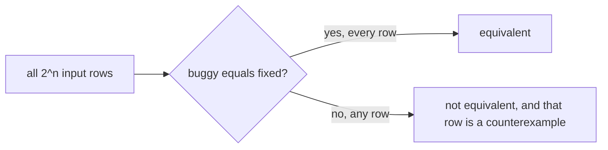

import Scenario from "../../../components/Scenario.astro";
import LevelIntro from "../../../components/LevelIntro.astro";
import Checkpoint from "../../../components/Checkpoint.astro";
import PracticeCheck from "../../../components/PracticeCheck.astro";

export const unit = {
  track: "logic",
  unitSlug: "boolean-logic",
};

<Scenario label="The pool gate, as code you can run">
  <Fragment slot="facts">
    <div class="not-prose flex flex-col gap-2 text-sm text-slate-700 dark:text-slate-300">
      <div class="flex items-center gap-1.5"><span>🐞</span> <strong>buggy</strong> — <code>(!isSick &amp;&amp; hasPass) || hasWristband</code></div>
      <div class="flex items-center gap-1.5"><span>✅</span> <strong>fixed</strong> — <code>!isSick &amp;&amp; (hasPass || hasWristband)</code></div>
      <div class="flex items-center gap-1.5"><span>🔢</span> 3 inputs, 8 combinations, 2 expected disagreements</div>
    </div>
  </Fragment>

**Before reading on, predict which input combinations make `buggy` and `fixed`
disagree, and how a program could find every one of them without a human
checking rows.**

</Scenario>

<LevelIntro
  items={[
    "Enumerating every combination in code",
    "What a counterexample does and does not prove",
    "Turning a negation into code and checking it",
  ]}
/>

## How does a program check every row?

**A truth table by hand is fine for 3 inputs. What about 4, or 10?** The row
count doubles with every input (3 inputs: 8, 4 inputs: 16, 10 inputs: 1,024),
so you let the machine walk them all. This is one of the cases where code is
the clearest vehicle, so keep it to the one mechanism:

```js
const bools = [true, false];
for (const isSick of bools)
  for (const hasPass of bools)
    for (const hasWristband of bools) {
      const buggy = (!isSick && hasPass) || hasWristband;
      const fixed = !isSick && (hasPass || hasWristband);
      if (buggy !== fixed) console.log({ isSick, hasPass, hasWristband });
    }
// prints exactly two rows: sick + wristband, with and without a pass
```



A single disagreeing row is a complete proof that the rules differ and also
tells you exactly which input to argue about. Agreement on every row is a
complete proof of equivalence, but only because the whole table was covered.

<Checkpoint question="A tester only tries visitors who are not sick and finds no disagreement between buggy and fixed. What has been proved?">

Only that the two agree when `isSick` is false. The bug lives entirely in the
rows where `isSick` is true, so a check restricted to the other half of the
table can never see it. A proof covers exactly the rows it enumerated, not
the rows that merely seemed typical.

</Checkpoint>

<PracticeCheck
  track={unit.track}
  unitSlug={unit.unitSlug}
  topicId="equivalence-proof"
/>

## How do you write a negation and know it is right?

**The gate needs a "refuse entry" rule.** Derive it by De Morgan from the
fixed rule `!isSick && (hasPass || hasWristband)`:

1. Top operator is `&&`: `isSick || !(hasPass || hasWristband)`.
2. Inner is `||`: `isSick || (!hasPass && !hasWristband)`.

Then let the same loop confirm `refuse === !fixed` on all 8 rows. Deriving and
then verifying is the habit: the derivation gives you the form, the
enumeration gives you the proof.

| Step           | Expression                                  | Operator flipped |
| -------------- | ------------------------------------------- | ---------------- |
| Start          | `!(!isSick && (hasPass \|\| hasWristband))` | none             |
| Outer negation | `isSick \|\| !(hasPass \|\| hasWristband)`  | `&&` to `\|\|`   |
| Inner negation | `isSick \|\| (!hasPass && !hasWristband)`   | `\|\|` to `&&`   |

<Checkpoint question="Why derive the negation from the outside in instead of negating the inner || first?">

Because the `!` applies to the whole expression, so the operator at the top
is the one it meets first. Negating the inner `||` while the outer negation is
still pending would flip a piece that the outer step is going to flip again,
and the two flips cancel in the wrong place. Peeling from the top keeps each
step a single, checkable application of one rule.

</Checkpoint>

<PracticeCheck
  track={unit.track}
  unitSlug={unit.unitSlug}
  topicId="de-morgan-rewrite"
/>

## A case, not the whole territory

The pool is one worked case, with three inputs and one bug. Extend it
yourself:

- **What changes if the pool adds a fourth input, `isSuspended`, to both
  versions?** How many of the now 16 rows disagree, and why that number?
- **What changes if the sign used "or" at the top**, say "pass, or wristband
  and not sick"? Which grouping does the English suggest, and would the code
  without parentheses be right this time?
- **What if one input is expensive to compute?** Short-circuiting means the
  order of operands now affects cost, even though the truth table does not.

Real rules at work have the same shape with different words (access
control, feature gates, validation); the method is the same, but the
inputs and the stakes of a wrong row change.
