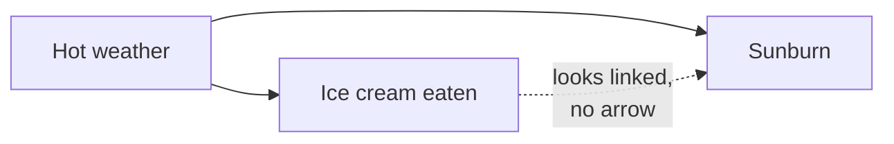

import Scenario from "../../../components/Scenario.astro";
import LevelIntro from "../../../components/LevelIntro.astro";
import PracticeCheck from "../../../components/PracticeCheck.astro";

export const unit = {
  track: "logic",
  unitSlug: "correlation-causation",
};

<Scenario label="Beach days with more ice cream also have more sunburn. Should the beach ban ice cream?">
  <Fragment slot="facts">
    

      
🍦 <strong>Ate ice cream</strong> — 500 visitors, 170 got sunburnt

      
🚫 <strong>No ice cream</strong> — 500 visitors, 80 got sunburnt

      
☀️ <strong>The hidden factor</strong> — hot days bring both more ice cream and more sun

    

    

      

        
Sunburnt, ate ice cream34%

        

      

      

        
Sunburnt, no ice cream16%

        

      

    

  </Fragment>

A beach counts 1,000 visitors in a season. The 500 who ate ice cream got
sunburnt 34% of the time. The 500 who did not got sunburnt 16% of the time.
The gap is real, not a counting mistake. **Does that mean ice cream causes
sunburn? And if not, what else could produce a gap this size?**

(The counts are an illustrative assumption built to show the pattern, not
real survey data.)

</Scenario>

<LevelIntro
  items={[
    "Why moving together is not causing",
    "Why an accurate signal can still be usually wrong",
    "The two questions that catch both traps",
  ]}
/>

## Why does a real gap not prove a cause?

**If the gap is real, why isn't the cause obvious?** Because a third thing can
push both numbers up at once. On hot days more people buy ice cream, and on hot
days more people sit in strong sun. Ice cream never touches skin damage.

Split the same 1,000 visitors by weather and the gap disappears:

| Weather          | Ate ice cream | Sunburnt | No ice cream | Sunburnt |
| ---------------- | ------------- | -------- | ------------ | -------- |
| Hot (500 people) | 400           | 40%      | 100          | 40%      |
| Mild (500)       | 100           | 10%      | 400          | 10%      |

Within each weather group, ice cream makes no difference. The gap came from
the mix: ice cream eaters were mostly hot-day visitors.

<PracticeCheck
  track={unit.track}
  unitSlug={unit.unitSlug}
  topicId="correlation-patterns"
/>

## Three ways a real correlation misleads

- **Confound** — a third factor drives both (hot weather).
- **Reverse causation** — the arrow runs the other way (high crime leads a
  city to hire more police, so more police and more crime go together).
- **Coincidence** — no link at all; two trends just happen to move together.

## Why does an accurate signal still fail?

<Scenario label="A coin machine is right 95% of the time. When it beeps, is the coin fake?">
  <Fragment slot="facts">
    

      
🪙 <strong>1,000 coins</strong> — 20 are fake (2%), 980 are genuine

      
✅ <strong>Beeps on fakes</strong> — 19 of the 20

      
❌ <strong>Beeps on genuine</strong> — 49 of the 980

      
📉 <strong>Beep means fake</strong> — only 19 of 68 beeps

    

    

      

        
Beeps that are real fakes28%

        

      

    

  </Fragment>

A machine catches 95% of fake coins and wrongly beeps at 5% of genuine ones.
Only 2% of the coins it checks are fake. The machine beeps. **How likely is
that coin to be fake?** Most people say 95%.

Count it instead, out of 1,000 coins: 19 fakes beep, and 49 genuine coins beep
too. That is 68 beeps, and only 19 of them are fakes, about 28%. (The 2%, 95%
and 5% are illustrative assumptions chosen to show the effect.)

</Scenario>

The same arithmetic applies to any alert, test or detector, such as a
monitoring alert that pages a team at 3am. The coin is just the simplest case.

<PracticeCheck
  track={unit.track}
  unitSlug={unit.unitSlug}
  topicId="base-rate-precision"
/>

## Key terms

- **Correlation** — two quantities tend to move together. It says nothing
  about why.
- **Causation** — one really brings about the other through a mechanism.
- **Confound** — a third factor that drives both.
- **Reverse causation** — the arrow points the opposite way from the obvious
  reading.
- **Base rate** — how common the thing being detected is (2% of coins).
- **True positive rate** — of the real cases, the share the signal catches
  (95%).
- **False positive rate** — of the non-cases, the share it flags anyway (5%).
- **Precision** — of the signals that fire, the share that are real (28%).
  This is the number that answers "should I trust this beep."

## The two questions

| Trap                        | The question that catches it                           |
| --------------------------- | ------------------------------------------------------ |
| Correlation as causation    | What else could drive both, or is the arrow backwards? |
| Accuracy as trustworthiness | How rare is the real thing, and what is the precision? |

L2 shows why the counts come out this way, and L3 turns both into a
repeatable method.
