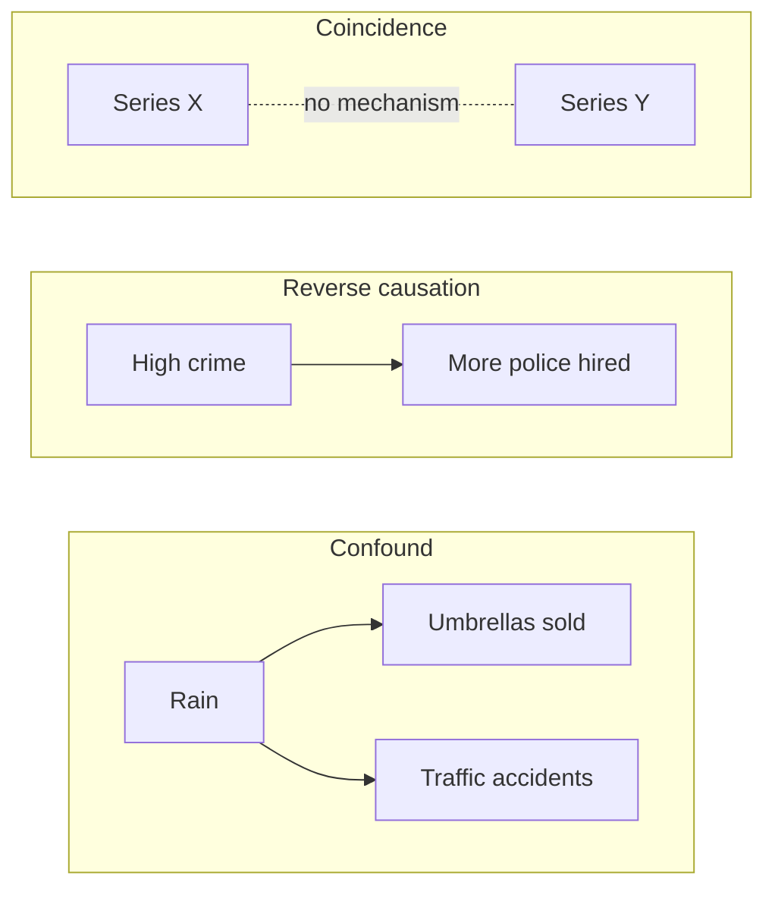
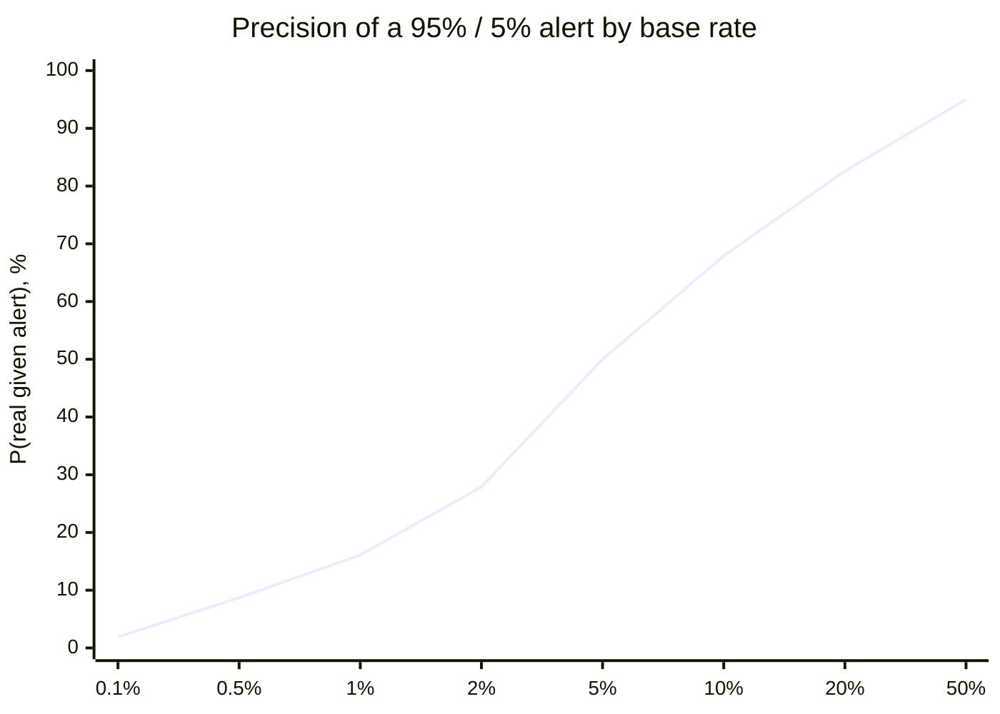
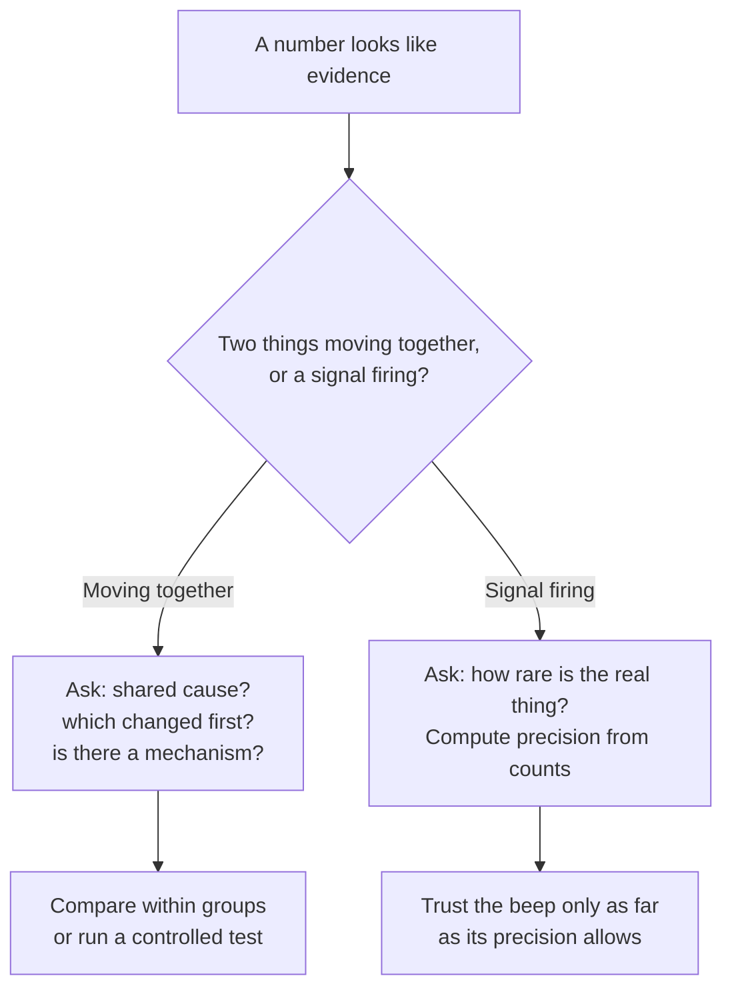

import LevelIntro from "../../../components/LevelIntro.astro";
import Checkpoint from "../../../components/Checkpoint.astro";
import PracticeCheck from "../../../components/PracticeCheck.astro";

export const unit = {
  track: "logic",
  unitSlug: "correlation-causation",
};

L1 showed two traps: ice cream and sunburn moved together without one causing
the other, and a "95% accurate" coin machine beeped at a fake coin only 28% of
the time. L2 names the structures behind each trap and works the arithmetic of
the second one with real counts.

<LevelIntro
  items={[
    "Confound, reverse causation and coincidence",
    "The base rate calculation behind the 28%",
    "A fix that matches each trap",
  ]}
/>

## Three ways a real correlation misleads

**The two numbers really do move together. So why might "A causes B" still be
the wrong conclusion?** There are three different answers, and each needs a
different fix.



| Pattern               | What is actually happening                                          | The fix                                             |
| --------------------- | ------------------------------------------------------------------- | --------------------------------------------------- |
| **Confound**          | A third factor independently drives both quantities                 | Find the shared cause and compare within its groups |
| **Reverse causation** | The arrow runs opposite to the obvious reading                      | Check the timeline: which one changed first         |
| **Coincidence**       | A statistical accident, or two unrelated trends over the same years | Ask for a mechanism: how would A bring about B      |

<Checkpoint question="Cities with more umbrellas sold also have more traffic accidents. A councillor proposes banning umbrellas. Which pattern is this, and what single comparison would test it?">

It is a confound: rain makes people buy umbrellas and also makes roads slippery
and visibility poor, so both numbers rise on wet days without either one
causing the other. The test is to compare within weather conditions. Look only
at rainy days and ask whether days with higher umbrella sales still have more
accidents, then do the same for dry days. If the link vanishes inside each
group, the shared cause was doing all the work, and banning umbrellas would
change nothing about accidents.

</Checkpoint>

<PracticeCheck
  track={unit.track}
  unitSlug={unit.unitSlug}
  topicId="correlation-patterns"
/>

## Where does the coin machine's 28% come from?

**L1 said the machine's beep is right only 28% of the time it fires. Which
counts produce that number?** Walk it with 1,000 coins (the 2%, 95% and 5% are
illustrative assumptions):

| Group                       | Count             | Machine beeps? | Reasoning                      |
| --------------------------- | ----------------- | -------------- | ------------------------------ |
| Fake coins                  | 20                | —              | Base rate: 2% of 1,000         |
| ...and the machine catches  | 19                | Yes            | True positive rate: 95% of 20  |
| ...and the machine misses   | 1                 | No             | The other 5% of fakes          |
| Genuine coins               | 980               | —              | 98% of 1,000                   |
| ...and the machine is quiet | 931               | No             | 95% of 980                     |
| ...and the machine beeps    | 49                | Yes            | False positive rate: 5% of 980 |
| **Total beeps**             | **68**            |                | 19 real + 49 false             |
| **Fake, given a beep**      | **19 / 68 ≈ 28%** |                | The number that matters        |

As a formula (Bayes' theorem for a yes/no signal):

```text
precision = (base_rate * true_positive_rate)
          / (base_rate * true_positive_rate
             + (1 - base_rate) * false_positive_rate)
```

**Why does a 5% false positive rate beat a 95% true positive rate here?**
Because 980 genuine coins is a far bigger pool than 20 fakes. A small rate on a
huge pool (49 false beeps) outweighs a large rate on a tiny pool (19 true
beeps). The machine is not lying about its 95%: that describes its behaviour
_given_ a fake coin. It says nothing about what share of _beeps_ are fakes,
which depends just as much on how rare fakes are.

The demo below holds the machine's rates fixed and moves only the base rate.
Drag it from 2% up and down and watch precision follow.

The same relationship as a chart (95% true positive, 5% false positive):



Only when the real thing is about as common as the false alarms (around 5%
here) does precision reach half.

<Checkpoint question="Keep the 2% base rate and 95% true positive rate, but cut the false positive rate from 5% to 1%. Does precision improve a little or a lot, and why?">

A lot, because false beeps are the dominant part of the denominator. At 5%,
there are 49 false beeps against 19 true ones (28%). At 1%, false beeps drop to
about 9.8 against the same 19, so precision rises to roughly 66%. Cutting the
false positive rate fivefold nearly tripled precision while the true positive
rate never moved. For a rare event, the false positive rate is usually the
number worth improving first.

</Checkpoint>

<PracticeCheck
  track={unit.track}
  unitSlug={unit.unitSlug}
  topicId="base-rate-precision"
/>

## How do the two fixes fit together?



Both fixes share one move: stop trusting the summary number and ask what it is
built from. A correlation coefficient hides mechanism, direction and third
causes. An accuracy figure hides how rare the real event is.

L3 turns both into a worked method: splitting data into groups to expose a
confound, then comparing detectors across base rates, and what to do when a
proper experiment is not possible.
