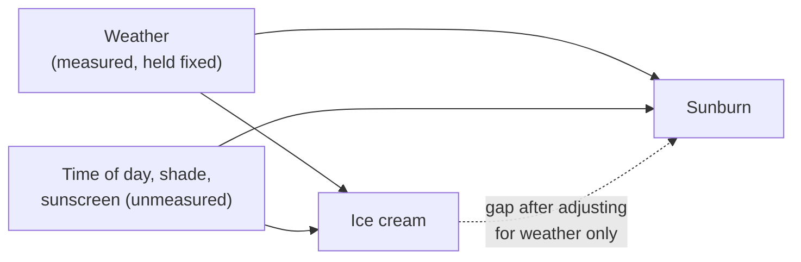
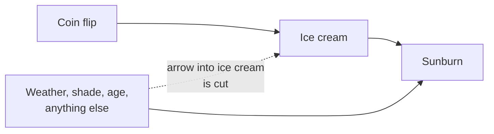
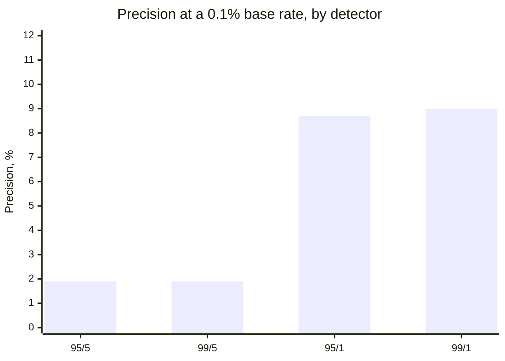

import Scenario from "../../../components/Scenario.astro";
import LevelIntro from "../../../components/LevelIntro.astro";
import Checkpoint from "../../../components/Checkpoint.astro";
import PracticeCheck from "../../../components/PracticeCheck.astro";

export const unit = {
  track: "logic",
  unitSlug: "correlation-causation",
};

<Scenario label="You split the beach data by weather and the gap vanished. What if the factor you did not think of is the real one?">
  <Fragment slot="facts">
    

      
☀️ <strong>Hot days</strong> — 40% sunburnt with or without ice cream

      
⛅ <strong>Mild days</strong> — 10% sunburnt with or without ice cream

      
🕶️ <strong>Unmeasured</strong> — time of day, shade, sunscreen, age

      
🪙 <strong>Also open</strong> — which detector upgrade actually helps a rare event

    

  </Fragment>

L1 and L2 gave the model. Comparing within weather groups removed the ice cream
gap, but the adjustment only covers the factor someone thought to record.
**How much can adjustment prove, what is stronger, and how do you compare two
detectors honestly when the event is rare?** All counts and rates here are
illustrative assumptions, not measurements.

</Scenario>

<LevelIntro
  items={[
    "Comparing within groups to expose a confound",
    "Why random assignment beats adjustment",
    "Comparing detectors by precision at a real base rate",
  ]}
/>

## How does comparing within groups expose a confound?

**The overall gap was 34% against 16%. What exactly changes when the same
visitors are compared within weather groups?** Each group holds weather fixed,
so weather can no longer explain a difference inside it.

| Group | Ate ice cream: sunburnt | No ice cream: sunburnt | Gap within group |
| ----- | ----------------------- | ---------------------- | ---------------- |
| Hot   | 160 of 400 (40%)        | 40 of 100 (40%)        | 0 points         |
| Mild  | 10 of 100 (10%)         | 40 of 400 (10%)        | 0 points         |
| All   | 170 of 500 (34%)        | 80 of 500 (16%)        | 18 points        |

The 18-point overall gap is entirely a mix effect. Ice cream eaters were 80% hot
day visitors (400 of 500), while non-eaters were only 20% hot day visitors
(100 of 500), and hot days burn more people whatever anyone eats.

Adjustment removes the arrows through the weather you measured. It leaves the
unmeasured ones untouched, so a gap that survives adjustment is still not proof
of a cause, and a gap that vanishes only proves the measured factor explained it.

<Checkpoint question="After splitting by weather, the gap between ice cream eaters and non-eaters is 0 in both groups. Does that prove ice cream has no effect on sunburn?">

No. It shows weather accounts for the gap that was seen, which is the
strongest thing this adjustment can say. An unmeasured factor could still be
hiding a small real effect or creating one in the opposite direction, and with
only two weather groups there may be differences inside each group that the
split cannot see. "No gap after controlling" fits no effect, but it cannot rule
out every other explanation the way a controlled experiment can.

</Checkpoint>

<PracticeCheck
  track={unit.track}
  unitSlug={unit.unitSlug}
  topicId="controlling-and-experiments"
/>

## Why does random assignment beat adjustment?

**If adjustment only covers what you measured, what covers what you did not?**
Random assignment. Suppose a coin flip decides who gets a free cone. Weather,
shade and age can no longer influence who eats ice cream, because the coin does.

Both groups end up with the same mix of hot days, shade lovers and ages, on
average, including the factors nobody listed. Any remaining gap in sunburn can
then be attributed to the ice cream itself.

When you cannot randomise, three weaker proxies exist:

| Proxy                                | What it adds                                                     | What can still fool it                      |
| ------------------------------------ | ---------------------------------------------------------------- | ------------------------------------------- |
| Natural experiment                   | An event changed one variable for reasons unrelated to the other | The event may have changed other things too |
| Before/after with a comparison group | A shared trend over time shows up in both groups                 | The groups may differ in ways that matter   |
| Mechanism plausibility               | A concrete causal chain makes the claim believable               | A believable story can still be wrong       |

None of the three equals a randomised comparison. Each is what you reach for
when the real thing is not available, not a substitute to prefer.

<PracticeCheck
  track={unit.track}
  unitSlug={unit.unitSlug}
  topicId="controlling-and-experiments"
/>

## Does a "more accurate" detector fix the base rate problem?

**A team improves its detector to a 99% true positive rate and a 1% false
positive rate. The event now happens once in 1,000 checks. Is precision better
or worse than L2's coin machine at 28%?** Compute it with the formula from L2:

| Detector (true / false positive) | Base rate | Precision |
| -------------------------------- | --------- | --------- |
| 95% / 5%                         | 2%        | 27.9%     |
| 95% / 5%                         | 0.1%      | 1.9%      |
| 99% / 5%                         | 0.1%      | 1.9%      |
| 95% / 1%                         | 0.1%      | 8.7%      |
| 99% / 1%                         | 0.1%      | 9.0%      |

The "99% accurate" detector is right only about 9% of the time it fires, and
that is worse than the original 28% because the event also became twenty times
rarer (2% down to 0.1%). Raising the true positive rate from 95% to 99% barely
moved precision, from 1.87% to 1.94%. Cutting the false positive rate from 5% to 1%
moved it from 1.9% to 8.7%. For a rare event, the false positive rate decides
nearly everything.

The same lesson applies to a monitoring alert that pages an on-call team at
3am: if a real incident is rare, an alert's headline accuracy says little about
whether any single page is real.

<Checkpoint question="Team A's event has a 10% base rate and Team B's has 0.1%. Both detectors go from 90% to 99% true positive rate with a 5% false positive rate. Which team's precision gains more from the same upgrade?">

Team A's. At a 10% base rate, real events make up a large share of what fires,
so catching more of them matters: precision goes from about 66.7% to 68.8%, a
gain of roughly two points. At 0.1%, false alarms from the huge pool of
non-events dominate whatever the true positive rate is, and precision only
moves from about 1.8% to 1.9%, a gain of under a fifth of a point. The rarer the
event, the less a better true positive rate can do.

</Checkpoint>

<PracticeCheck
  track={unit.track}
  unitSlug={unit.unitSlug}
  topicId="precision-calculator"
/>

## This is a case, not the whole territory

The beach and the coin machine are two cases. The general lessons are that a
gap between groups needs a check for shared causes, direction and mechanism, and
that a signal's trustworthiness depends on its base rate, not only its accuracy.
What is specific here is the neat structure: one measured confound, a yes/no
detector with fixed error rates. Real data has many confounds at once, error
rates that change with conditions, and base rates that are themselves uncertain.

**Try extending it yourself.**

- What if the base rate were not exactly 2% but somewhere between 1% and 4%?
  With the 95% / 5% detector, precision runs from about 16% to about 44%, so
  a fourfold uncertainty in the base rate becomes nearly a threefold swing in
  the answer. What historical counts would you gather to narrow it?
- What if a second, independent coin machine also beeped at the same coin?
  Would the combined precision rise, and what assumption about the two machines
  would you need to check?
- What if the confound was only partly measured, such as a rough "hot or not"
  label? How much of the gap would you expect to survive, and in which
  direction would you be misled?

## Failure modes

| Failure mode                                                  | What it gets wrong                                                |
| ------------------------------------------------------------- | ----------------------------------------------------------------- |
| Treating a strong correlation as proof of a cause             | Skips confounds, reverse causation and coincidence                |
| Concluding "no effect" because one adjustment removed the gap | Unmeasured factors can still create or hide an effect             |
| Reading "accuracy" as precision                               | Right when tested on real cases is not right when it fires        |
| Shipping a better true positive rate for a rare event         | The false positive rate controls precision when the event is rare |
| Trusting a precision figure built on a guessed base rate      | The output inherits the full uncertainty of that guess            |
