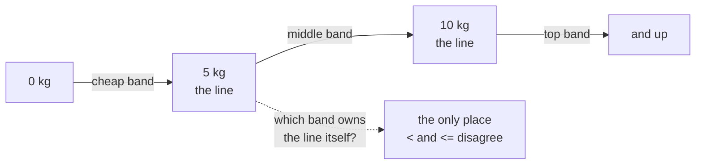

import Scenario from "../../../components/Scenario.astro";
import LevelIntro from "../../../components/LevelIntro.astro";
import PracticeCheck from "../../../components/PracticeCheck.astro";

export const unit = {
  track: "logic",
  unitSlug: "edge-case-reasoning",
};

<Scenario label="Three green tests, one angry customer">
  <Fragment slot="facts">
    

      
📏 <strong>The rule</strong> — "5 kg and under" is the cheap price

      
💻 <strong>The code</strong> — <code>weightKg &lt; 5</code>

      
🧪 <strong>The tests</strong> — 2 kg, 6 kg, 15 kg, all green

      
💸 <strong>The bug</strong> — a package of exactly 5.0 kg is overcharged

    

  </Fragment>

A parcel shop charges the cheap price for packages of **"5 kg and under"**. The
developer types `weightKg < 5`, then writes three tests: 2 kg, 6 kg and 15 kg,
one comfortably inside each price band. All three pass. A week later a customer
brings in a package that weighs exactly 5.0 kg and is charged the middle price.

**Every test passed and the bug was real. What kind of input does "pick one
value from each band" never try?**

</Scenario>

<LevelIntro
  items={[
    "Interior values versus the edge between bands",
    "Why one wrong symbol hides at one exact value",
    "Inclusive and exclusive wording",
  ]}
/>

## Where did the three tests miss?

**Which weights does `<` treat differently from `<=`?** Only one: the exact line.
Look at how the two versions of the rule answer for weights around 5 kg.

| Weight   | Rule says ("5 kg and under") | Buggy `< 5` | Fixed `<= 5` |
| -------- | ---------------------------- | ----------- | ------------ |
| 2.00     | cheap                        | cheap       | cheap        |
| 4.99     | cheap                        | cheap       | cheap        |
| **5.00** | **cheap**                    | **middle**  | **cheap**    |
| 5.01     | middle                       | middle      | middle       |
| 6.00     | middle                       | middle      | middle       |

Every row except one is identical for the buggy and the fixed code. The developer's
tests (2, 6, 15) all sit in the identical rows, so they cannot tell the two
versions apart.

The bug does not live in a band. It lives on the line between two bands, a single
point. No number of values chosen from inside the bands ever lands on it.

<PracticeCheck
  track={unit.track}
  unitSlug={unit.unitSlug}
  topicId="interior-vs-boundary"
/>

## The vocabulary, in one table

| Term                  | Plain meaning                                                            |
| --------------------- | ------------------------------------------------------------------------ |
| Input space           | Every value the rule might receive: 0, 2, 4.99, 5.0, 5.01, 10, -3, blank |
| Edge case             | An unusual or extreme input: empty, zero, negative, maximum, on a line   |
| Boundary              | The exact value where the rule's answer changes (5 kg, 10 kg)            |
| Equivalence class     | A group of inputs the rule should treat the same way (all of 0 to 5 kg)  |
| Inclusive / exclusive | "5 kg and under" includes 5; "under 5 kg" leaves it out                  |
| Off-by-one            | The wrong comparison (`<` for `<=`), wrong only on the boundary itself   |
| Invariant             | A property that should hold for every valid input, not just tested ones  |

## What the next levels do

- **L2** turns "test the edges" into a step-by-step way to map any rule's input
  space, and shows what an invariant such as "price never goes down as weight
  goes up" can and cannot catch.
- **L3** runs the buggy code, runs the invariant check against it to watch it
  miss, then writes the boundary tests that do catch it.

For the symbols themselves (`<`, `<=`, `&&`), see `logic/boolean-logic`. For
splitting a big rule into regions, see `logic/problem-decomposition`.
