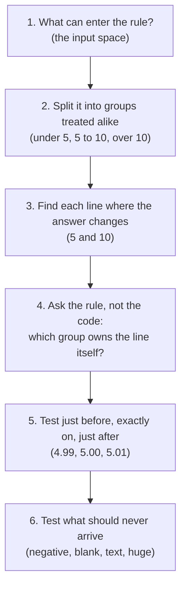
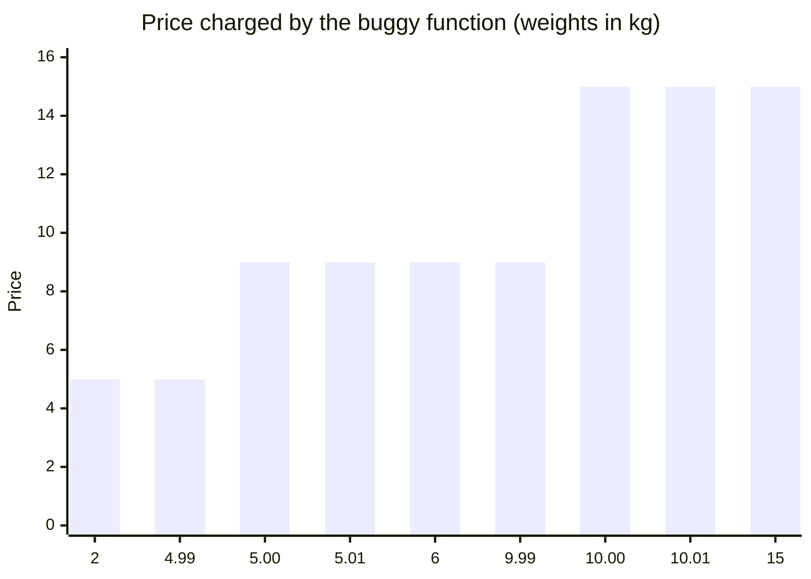

import LevelIntro from "../../../components/LevelIntro.astro";
import Checkpoint from "../../../components/Checkpoint.astro";
import PracticeCheck from "../../../components/PracticeCheck.astro";

export const unit = {
  track: "logic",
  unitSlug: "edge-case-reasoning",
};

L1 showed that the 5 kg bug hides on a single point and that bands of "typical"
values never touch it. L2 makes that a repeatable method for any rule, then tests
a popular safety net, the invariant, to see which bugs it really guards against.

<LevelIntro
  items={[
    "A five-step map of any input space",
    "The edge categories typical tests skip",
    "What an invariant like monotonicity catches",
  ]}
/>

## If one value per band is not enough, is the fix "more tests"?

**Would ten more interior weights (2.1, 3.7, 8.2 ...) find the 5.0 bug?** No. Ten
more tests of the same kind are still the same kind of test. The fix is a
different process:

**Why three values around a line and not just the line?** Because a boundary bug
can sit on either side of the comparison. Only the three together show the shape
of the comparison. The step size depends on the data: for weights measured to two
decimals use 4.99 / 5.00 / 5.01; for whole years of age around 12 use 11 / 12 / 13.

<Checkpoint question="Step 4 says to ask the rule, not the code, which group owns the line. Why not just read the code's comparison?">

Because the code is the thing under suspicion. If the code says `weightKg < 5`
and the business wording says "5 kg and under", reading the code only tells you
what the code does, never what it should do. The expected answer for the line
has to come from the requirement (or from the person who owns it), and then the
test compares the code against it. That is exactly the comparison that exposes
the bug.

</Checkpoint>

<PracticeCheck
  track={unit.track}
  unitSlug={unit.unitSlug}
  topicId="mapping-input-space"
/>

## Where does the bug sit on the number line?

The chart shows what the buggy function charges at nine weights. Everything that
happens in the bands is correct; the error is one step, at one point.

The bars at 5.00 and 10.00 are already one tier too high. The interactive demo
below plots the buggy and fixed prices against weight: drag the slider onto 5.00
and 10.00 and watch the "Versions differ" output flip.

## Which inputs do typical tests skip?

**Beyond lines between bands, which inputs does "realistic" test data avoid?**
Realistic data clusters in the middle of ranges by definition. Keep a short
checklist:

| Category            | Example for the shipping rule | Why it gets skipped                   |
| ------------------- | ----------------------------- | ------------------------------------- |
| Zero                | `weightKg = 0`                | Feels too trivial to write down       |
| Negative            | `weightKg = -3`               | "Nobody would send that"              |
| Exactly on a line   | `5`, `10`                     | Interior values sit comfortably away  |
| Just past a line    | `5.01`, `10.01`               | Feels redundant next to the line test |
| Extreme             | `weightKg = 10000`            | Realistic samples rarely include it   |
| Empty or wrong type | blank, `"five"`               | Assumed to be checked somewhere else  |

For a list-based rule the same idea reads: empty list, one item, two items, and a
list where the first or last item is the unusual one.

## What can an invariant check catch?

**If "price never goes down as weight goes up" holds for the buggy and the fixed
code, is the check useless?** No, but it guards against a different bug. This
property is called **monotonicity**: as weight rises, price stays the same or
rises.

| Bug                                           | Breaks monotonicity?  | Caught by the invariant? |
| --------------------------------------------- | --------------------- | ------------------------ |
| Middle band accidentally priced below cheap   | Yes, price drops      | Yes                      |
| `<` where the rule says `<=` (our bug)        | No, price still rises | **No**                   |
| Wrong price in the top band, but still higher | No                    | No                       |

The 5.0 bug moves one weight from 4.99 up to 8.99. Price still never decreases,
so the invariant stays green at the exact input where the function is wrong.

<Checkpoint question="A test sweeps weights from 0 to 20 and confirms price never decreases. Does that show every weight lands in the right band?">

No. Monotonicity only says the trend runs the right way. It says nothing about
whether each individual weight got the band the rule intends. The shipping bug is
the proof: the invariant holds at the very input where the answer is wrong. An
invariant raises confidence about the one property it measures; it does not
generalise to "the logic is correct everywhere", and a boundary test is needed
for the bugs it cannot see.

</Checkpoint>

<PracticeCheck
  track={unit.track}
  unitSlug={unit.unitSlug}
  topicId="invariants"
/>

## Failure modes at this level

- **"One value per case" treated as "every case".** The interior and the line are
  different inputs with possibly different behaviour.
- **Believing a passing invariant proves correctness.** It rules out only the
  bugs it is sensitive to.
- **Testing the line but not a step to either side.** `<` versus `<=` shows up by
  comparing across the line.
