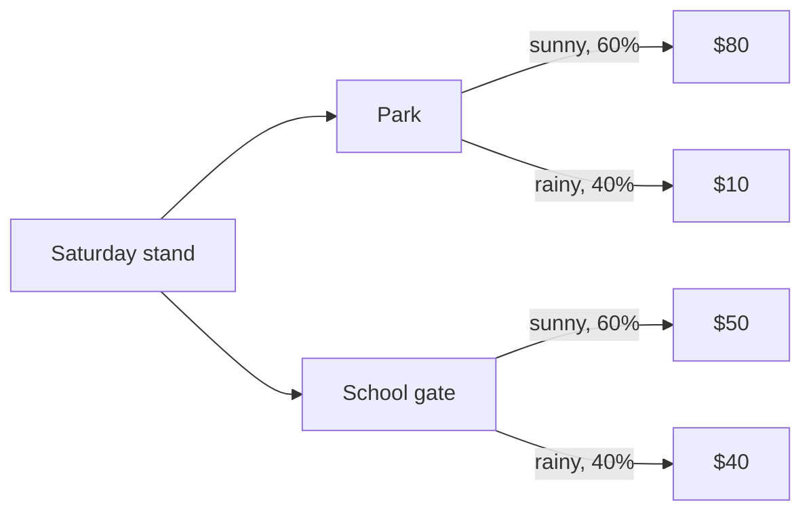

import Scenario from "../../../components/Scenario.astro";
import LevelIntro from "../../../components/LevelIntro.astro";
import PracticeCheck from "../../../components/PracticeCheck.astro";

export const unit = {
  track: "logic",
  unitSlug: "expected-value",
};

<Scenario label="Two spots for a lemonade stand, and a coin you can't call">
  <Fragment slot="facts">
    

      <table class="not-prose w-full text-xs">
        <thead>
          <tr>
            <th class="pr-2 text-left font-semibold">Weather</th>
            <th class="pr-2 text-left font-semibold">Chance</th>
            <th class="pr-2 text-left font-semibold">Park earns</th>
            <th class="text-left font-semibold">School gate earns</th>
          </tr>
        </thead>
        <tbody>
          <tr><td class="pr-2">☀️ Sunny</td><td class="pr-2">60%</td><td class="pr-2">$80</td><td>$50</td></tr>
          <tr><td class="pr-2">🌧️ Rainy</td><td class="pr-2">40%</td><td class="pr-2">$10</td><td>$40</td></tr>
        </tbody>
      </table>
    

    

      

        
Park, on average (0.6 x 80 + 0.4 x 10)$52

        

      

      

        
School gate, on average (0.6 x 50 + 0.4 x 40)$46

        

      

    

    

      <strong>Why it matters:</strong> neither spot has one guaranteed
      result, so you compare their averages, not a single outcome.
    

  </Fragment>

You are setting up a lemonade stand for Saturday. The park is packed on a
sunny day and nearly empty in the rain. The school gate gets a steady
trickle either way. The forecast says 60% sunny and 40% rainy (an
assumption, forecasts are guesses). Your gut flips by the hour: "the park,
it will be sunny," then "the gate, what if it rains?" **How do you compare
two choices when neither one has a single guaranteed result, because each
is really a set of possible results with its own odds?**

Do not pick the best day or the worst day. Weigh each result by how likely
it is. The park earns $80 with chance 0.6 and $10 with chance 0.4, so on
average 0.6 x 80 + 0.4 x 10 = **$52**. The school gate averages 0.6 x 50 +
0.4 x 40 = **$46**. The flip-flopping stops, because now there is a number to
argue about instead of a mood.

</Scenario>

<LevelIntro
  items={[
    "Probability times payoff, summed",
    "Why the best average is not automatically the right pick",
    "Where the odds and payoffs come from",
  ]}
/>

## What is that number, exactly?

**Expected value (EV)** is the sum, over every possible outcome, of its
probability times its payoff. Write down the outcomes, multiply each by its
chance, add the products. The probabilities of one option must add up to
1, or you left an outcome out.

| Option      | Outcome | Chance | Payoff | Chance x payoff |
| ----------- | ------- | ------ | ------ | --------------- |
| Park        | Sunny   | 0.6    | $80    | $48             |
| Park        | Rainy   | 0.4    | $10    | $4              |
| **Park**    |         | 1.0    |        | **EV $52**      |
| School gate | Sunny   | 0.6    | $50    | $30             |
| School gate | Rainy   | 0.4    | $40    | $16             |
| **Gate**    |         | 1.0    |        | **EV $46**      |

By EV the park wins by $6. **But an average is not something you ever
actually earn on one Saturday.** You earn $80 or $10 at the park, never $52.
Level 2 asks when that matters, because it is the most important caveat in
this unit.

<PracticeCheck
  track={unit.track}
  unitSlug={unit.unitSlug}
  topicId="ev-formula"
/>

## Key terms

- **Expected value (EV)** — the sum of each outcome's probability times its
  payoff (or cost). One-number summary of an uncertain choice.
- **Outcome** — one specific way things could turn out: "sunny," "rainy."
- **Probability** — how likely an outcome is, between 0 and 1. All the
  outcomes of one option add to 1.
- **Payoff / cost** — what an outcome is worth, in the unit that matters
  (dollars, hours). A cost is just a negative payoff.
- **Tail outcome** — a low-chance outcome at the extreme end, such as the
  $10 rainy day at the park. Small odds, large effect on how it feels.
- **Risk tolerance** — how bad a worst case you can actually absorb,
  regardless of how unlikely it is. Level 2 builds on this.

The average of $52 did not end the argument by being "objective." It ended
it by giving everyone one shared calculation to question: is it really 60%
sunny, is the park really $80? That is the point of the method.
